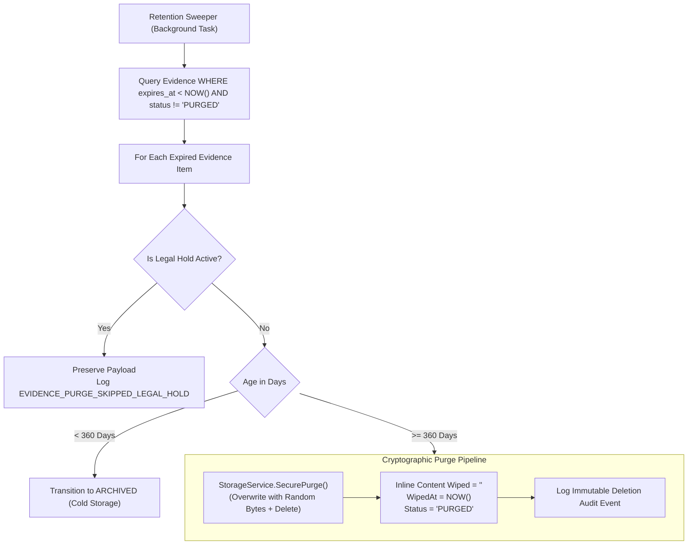

# Evidence Retention, Expiry and Deletion Policies

**Document ID:** KELVIN-ARCH-0050  
**Status:** Approved  
**Workstream:** Workstream D (Evidence Management & Auditability)  
**Issue Reference:** P3-32 (#185)  

---

## 1. Purpose & Overview

The Kelvin Evidence Retention, Expiry, and Deletion subsystem operationalizes the data lifecycle and privacy policies defined in Phase 1 (`docs/security/DATA_LIFECYCLE.md`). It ensures evidence objects undergo deterministic archival transitions, supports regulatory legal holds, and executes cryptographic-grade secure erasure while preserving the continuity and status of persistent findings.

---

## 2. Retention Lifecycle Architecture

---

## 3. Retention Phases & Legal Hold Protections

1. **Active State (Day 0 to 90)**:
   - Default active retention period (`ActiveDays = 90`).
   - Accessible via signed URLs and inline database storage.
2. **Archived State (Day 91 to 360)**:
   - Default archive tier duration (`ArchivedDays = 270`).
   - Short-lived retrieval restricted to authorized security leads.
3. **Legal Hold Enforcement (`is_legal_hold`)**:
   - Subpoenas, regulatory investigations, or audit disputes can attach `is_legal_hold = true` with a mandatory reason.
   - Purge routines strictly bypass items under active legal holds.
   - Manual purges without `force = true` return `ErrLegalHoldEnforced`.
4. **Purged State (After Day 360)**:
   - Physical storage objects are overwritten with cryptographic random data (`crypto/rand`) before file removal.
   - Database record content is wiped (`inline_content = ""`, `storage_ref = ""`, `wiped_at = NOW()`).
   - Database record transitions to `StatusPurged`.

---

## 4. Partial Failure Resilience & Finding Invariance

- **Partial Storage Failures:** If storage deletion fails due to network or provider unavailability, the record transitions to `StatusPurgeFailed` and increments `purge_retry_count`. The failure is observable and automatically retried on subsequent sweeps.
- **Finding Invariance:** Findings associated with purged evidence remain completely valid, open, and actionable. Evidence pruning only cleans up technical payload blobs and never alters finding lifecycle state (`FindingLifecycleStateUnchanged`).
- **Idempotency:** Re-running retention sweeps is safe, non-destructive, and idempotent.
