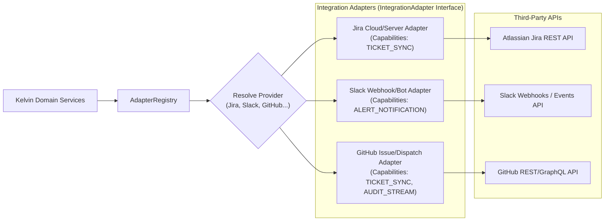

# External Integration Adapter Framework Architecture

## 1. Overview
The External Integration Adapter Framework establishes a decoupled, provider-agnostic abstraction layer for connecting Kelvin to enterprise ticketing (Jira, ServiceNow), team messaging (Slack, Microsoft Teams), SIEM platforms (Splunk, Datadog), and cloud services. It isolates third-party vendor APIs, enforces standardized error semantics, and preserves multi-tenant authorization boundaries.

## 2. Adapter Architecture & Execution Flow



## 3. IntegrationAdapter Interface Contract
```go
type IntegrationAdapter interface {
    Provider() ProviderType
    Version() string
    Capabilities() []AdapterCapability
    ValidateConfig(ctx context.Context, config map[string]any) error
    CheckHealth(ctx context.Context, conn *IntegrationConnection, decryptedSecret string) (*HealthStatus, error)
    Execute(ctx context.Context, execCtx ExecutionContext) (*ExecutionResult, error)
}
```

## 4. Key Architectural Guarantees
1. **Decoupled Provider Boundaries**: Core vulnerability finding workflows, remediation lifecycles, and policy engines interact exclusively through `IntegrationAdapter` contracts. Vendor-specific REST formats or quirks never leak into core domain packages.
2. **Tenant and Permission Context Preservation**: `ExecutionContext` conveys `OrganizationID` and `WorkspaceID`. Adapters operate strictly within the tenant boundary of the associated connection.
3. **Standardized Error Taxonomy**: Provider errors are translated into canonical domain errors (`ErrProviderRateLimited` for HTTP 429, `ErrProviderAuthFailed` for HTTP 401/403, and `ErrProviderUnavailable` for network timeouts).
4. **Observable Health & Conformance**: Each adapter exposes a standardized `CheckHealth` interface reporting reachability and latency metrics (`HealthHealthy`, `HealthDegraded`, `HealthUnreachable`).
5. **Deterministic Mocking**: Test environments utilize in-memory mock adapters implementing the full interface contract for fast, reliable unit and integration testing without network flakiness.
