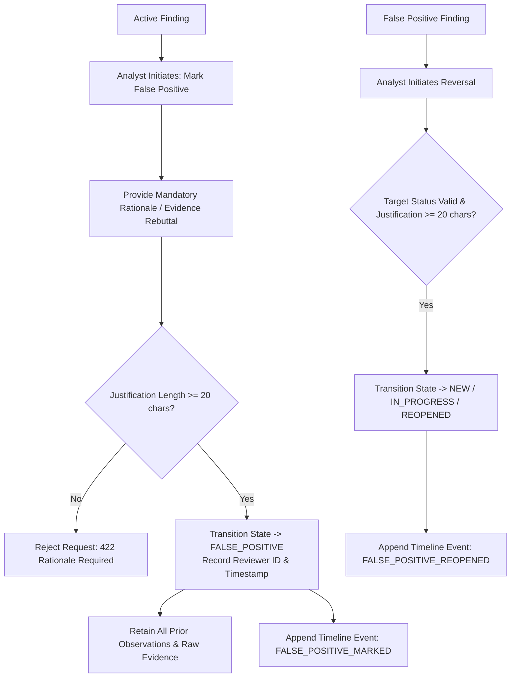

# False-Positive Review and Management Architecture

## Overview
The Kelvin False-Positive Review subsystem enables authorized security analysts to classify findings as false positives while rigorously preserving all underlying observation history, raw scanner outputs, and cryptographic evidence hashes.

Reclassifying a vulnerability finding as false positive suppresses further alerts for the exact flaw without permanently destroying historical observations. If subsequent assessments produce materially distinct evidence (e.g. modified payloads, differing response signatures, or new CVE associations), the system flags the finding for reconsidered human review.

## Core Invariants

1. **Mandatory Substantive Justification:**
   - Any request to classify a finding as `FALSE_POSITIVE` must include a justification of at least 20 non-whitespace characters (`MinRationaleLength = 20`).
   - A superficial or missing rationale is rejected with `422 Unprocessable Entity`.

2. **Evidence Preservation & Non-Destruction:**
   - Classifying a finding as a false positive **never deletes** or truncates prior observations, raw evidence artifacts, or timeline records.
   - All historical data remains fully accessible for compliance, trend analysis, and verification.

3. **Reconsideration & Reversal:**
   - Authorized analysts can reverse a false-positive finding back to active status (`NEW`, `IN_PROGRESS`, `REOPENED`) at any time by providing a documented reversal rationale.
   - Transitioning directly from `FALSE_POSITIVE` to `RESOLVED` or `ACCEPTED_RISK` is strictly prohibited by state machine validation.

4. **Material Change Detection:**
   - When new scanner findings arrive during recurring assessments, `DetectMaterialChange` compares evidence checksums.
   - If novel evidence signatures are detected, the system records `material_change_detected = true` and creates an auditable review flag event (`FALSE_POSITIVE_REVIEW_FLAGGED`).

## Database Schema
The `finding_false_positive_reviews` table provides an immutable record of all classifications and reversals:
- `id` (UUID PRIMARY KEY)
- `tenant_id` (UUID NOT NULL REFERENCES tenants(id))
- `finding_id` (UUID NOT NULL REFERENCES findings(id))
- `actor_id` (UUID NULL REFERENCES users(id))
- `action` (TEXT NOT NULL: `MARKED_FALSE_POSITIVE`, `REVERSED`, `REVIEW_FLAGGED`)
- `justification` (TEXT NOT NULL)
- `evidence_rebuttal` (TEXT NULL)
- `material_change_detected` (BOOLEAN NOT NULL DEFAULT FALSE)
- `metadata` (JSONB NOT NULL DEFAULT '{}')
- `created_at` (TIMESTAMPTZ NOT NULL DEFAULT NOW())

## API Contract
- `POST /api/v1/findings/{id}/false-positive`: Marks finding as false positive.
- `POST /api/v1/findings/{id}/false-positive/reverse`: Reverses classification and returns finding to active state.
- Idempotency supported via `Idempotency-Key` header.
- Strict tenant context validation; cross-tenant requests yield `404 Not Found`.
