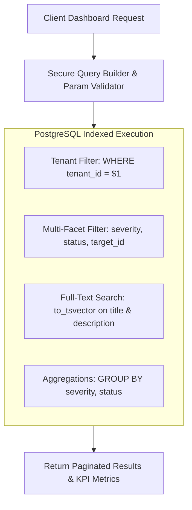

# Findings Search, Filtering and Dashboard APIs

## 1. Overview & Purpose

The Findings Search, Filtering and Dashboard APIs provide high-performance, multi-tenant backend query capabilities for analyzing, filtering, sorting, and reporting on security findings across assessments.



---

## 2. API Endpoints

### 1. `GET /api/v1/findings`
Retrieves a paginated list of findings conforming to multi-facet filters.

**Query Parameters:**
- `q`: Case-insensitive substring match on finding title, CWE ID, CVE IDs, or endpoint path.
- `severity`: Filter by severity (`CRITICAL`, `HIGH`, `MEDIUM`, `LOW`, `INFO`).
- `status`: Filter by lifecycle state (`NEW`, `CONFIRMED`, `IN_PROGRESS`, `RESOLVED`, `FALSE_POSITIVE`, `ACCEPTED_RISK`).
- `risk_priority`: Filter by calculated priority band (`P1`, `P2`, `P3`, `P4`, `P5`).
- `scanner`: Filter by detecting scanner tool (`nuclei`, `zap`, `tls`).
- `target`: Substring match on affected endpoint or domain.
- `assessment_id`: UUID of assessment run.
- `is_suppressed`: Boolean flag indicating active suppression.
- `sort_by`: Field to sort on (`severity`, `risk_score`, `created_at`, `first_seen_at`, `last_seen_at`, `title`). Default: `last_seen_at`.
- `sort_order`: `asc` or `desc`. Default: `desc`.
- `limit`: Integer between 1 and 100. Default: 20.
- `offset`: Non-negative integer offset. Default: 0.

### 2. `GET /api/v1/findings/dashboard`
Computes executive and operational KPI metrics for the tenant.

**Response Structure:**
```json
{
  "data": {
    "total_findings": 42,
    "open_findings": 35,
    "resolved_findings": 7,
    "severity_breakdown": {
      "CRITICAL": 3,
      "HIGH": 12,
      "MEDIUM": 18,
      "LOW": 7,
      "INFO": 2
    },
    "status_breakdown": {
      "NEW": 5,
      "CONFIRMED": 25,
      "IN_PROGRESS": 5,
      "RESOLVED": 7
    },
    "priority_breakdown": {
      "P1": 3,
      "P2": 10,
      "P3": 15,
      "P4": 12,
      "P5": 2
    },
    "remediation_progress": {
      "OPEN": 20,
      "IN_PROGRESS": 5,
      "COMPLETED": 7
    }
  }
}
```

---

## 3. Security & Architectural Invariants

- **Multi-Tenant Isolation (ADR-0002):** Every query unconditionally filters by the caller's tenant boundary (`tenant_id = app.current_tenant_id`). Cross-tenant visibility is impossible.
- **Query Bounds & Denial-of-Service Defense:** Limits are clamped at `MaxSearchLimit = 100` to prevent database memory exhaustion.
- **Stable Sorting:** Results with equal sort keys are deterministically tie-broken by `id ASC` to prevent pagination jitter.
