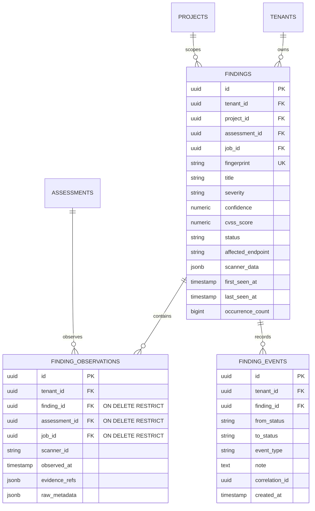

# Finding and Observation Persistence Architecture

## 1. Overview & Purpose

This document details the PostgreSQL persistence architecture for findings, individual observations, and audit events, implemented as part of **P3-05** (Issue #157).

The persistence model enforces relational integrity, immutable observation history, strict multi-tenant boundary constraints, and high-performance querying across tenant and project scopes.

---

## 2. Key Database Invariants & Referential Constraints

1. **Strict Referential Integrity (`ON DELETE RESTRICT`)**:
   - `finding_observations` foreign key to `findings(id)` enforces `ON DELETE RESTRICT` (Migration `000006`).
   - Findings with active historical observations cannot be accidentally deleted or purged in cascade without an explicit administrative retention cycle.

2. **Deduplication Key & Upsert Semantics**:
   - `findings` enforces `CONSTRAINT uq_findings_project_fingerprint UNIQUE (project_id, fingerprint)`.
   - Ingestion uses PostgreSQL `ON CONFLICT (project_id, fingerprint) DO UPDATE SET` to increment `occurrence_count` and update `last_seen_at` without overwriting historical triage or status.

3. **Observation Immutability**:
   - `prevent_observation_update()` trigger rejects all `UPDATE` operations on `finding_observations`.
   - Each scanner observation remains an immutable record of historical assessment evidence.

4. **Row-Level Security (RLS)**:
   - Both `findings` and `finding_observations` enforce `tenant_isolation` policies where `tenant_id = current_tenant_id()`.

---

## 3. Query Indexes & Optimization

Migration `000006` adds composite indexes for high-throughput operational queries:
- `idx_findings_project_fingerprint_lookup`: `(tenant_id, project_id, fingerprint)` for $O(1)$ deduplication probes during assessment ingestion.
- `idx_findings_project_last_seen`: `(tenant_id, project_id, last_seen_at DESC)` for project dashboard timelines.
- `idx_finding_observations_history_lookup`: `(tenant_id, finding_id, observed_at DESC)` for efficient retrieval of a finding's historical observation chain.
- `idx_finding_observations_scanner_history`: `(tenant_id, scanner_id, observed_at DESC)` for scanner performance and diagnostic auditing.
- `idx_finding_events_tenant_history`: `(tenant_id, finding_id, created_at DESC)` for finding audit logs and compliance reporting.
