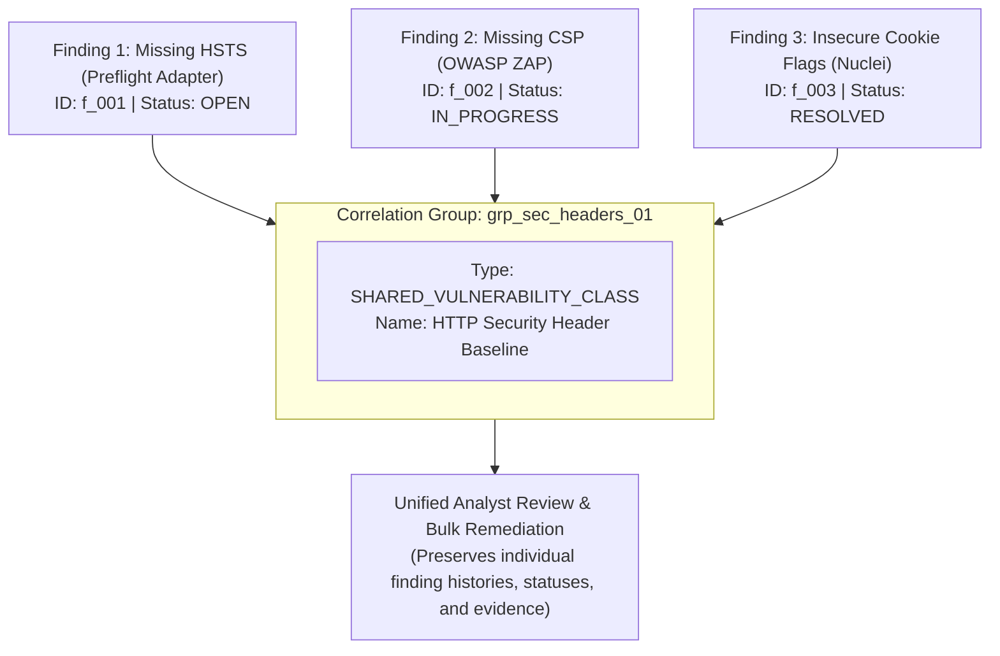

# Finding Correlation Group Model

## Overview

In enterprise security environments, multiple discrete vulnerabilities often share an underlying operational context—such as issues discovered by multiple scanners against the same service, a fleet-wide CVE vulnerability, or a family of missing HTTP baseline security headers.

While **deduplication** (P3-03, P3-12, P3-13) consolidates exact repeated instances of the same flaw on the same endpoint into a single persistent finding, **correlation** (P3-14) clusters independent findings together for bulk analysis, reporting, and triage **without merging or destroying their independent identities**.

---

## Architecture & Workflow

---

## Deduplication vs. Correlation

| Dimension | Duplicate Finding Identity (P3-03 / P3-12 / P3-13) | Correlation Grouping (P3-14) |
|---|---|---|
| **Scope** | Exact same flaw at the exact same location | Related but distinct security findings |
| **Identity** | Single persistent finding record (`id`) | Multiple independent finding records linked via membership |
| **Observations** | Multiple observations attached to one finding | Each finding retains its own observation chain and evidence |
| **Triage State** | Shared lifecycle status (`NEW`, `CONFIRMED`, `RESOLVED`) | Each finding maintains an independent lifecycle status |
| **Use Case** | Preventing false inflation of finding counts | Facilitating batch triage, remediation campaigns, and root-cause clustering |

---

## Correlation Group Classifications

1. **`SHARED_VULNERABILITY_CLASS`:**
   Findings sharing a broad security classification or weakness type across different targets (e.g., all SQL Injection vulnerabilities across an entire microservice fleet).
2. **`SAME_TARGET_CLUSTER`:**
   Findings of varied types affecting the same host, domain, or container workload (e.g., all open ports, header issues, and outdated packages on `auth.internal.example.com`).
3. **`COMMON_IDENTIFIER`:**
   Findings explicitly associated with a common vulnerability identifier (e.g., `CVE-2021-44228` Log4Shell) identified across distinct scan profiles and network segments.
4. **`ANALYST_CURATED`:**
   Custom groups created by security analysts to organize findings for specific remediation sprints or compliance audits.

---

## Membership Invariants & Lifecycle Rules

- **Independent Identifiers:** Correlation groups possess their own UUIDs and metadata (`finding_correlation_groups`).
- **Non-Destructive Membership:** Adding a finding to a group (`finding_correlation_group_members`) creates a relational link without altering the finding's severity, status, timestamps, or observation history.
- **Strict Multi-Tenant Isolation (ADR-0002):** Correlation groups and memberships require identical `tenant_id`. Cross-tenant grouping is strictly blocked at the relational constraint and application layers.
- **Dynamic Join/Leave:** Findings can join multiple correlation groups and leave without affecting the underlying finding record or foreign group memberships.
