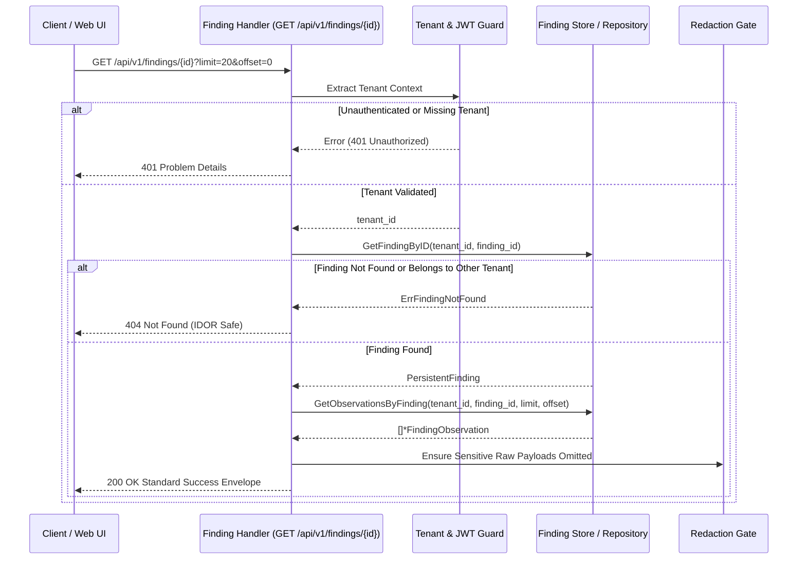

# Finding Detail Retrieval API Architecture

## 1. Overview & Purpose

This document details the authorized Finding Detail Retrieval API endpoint (`GET /api/v1/findings/{id}`) implemented for Kelvin as part of **P3-08** (Issue #160).

The endpoint exposes an authorized, tenant-scoped interface for operators, web dashboards, and automated pipelines to retrieve finding details alongside their paginated observation history and execution provenance without leaking sensitive evidence or enabling cross-tenant IDOR access.



---

## 2. API Contract & Response Formatting

### 2.1 Route Definition & OpenAPI
- **Method & Path**: `GET /api/v1/findings/{id}`
- **Security**: Requires bearer JWT authorization (`x-required-permission: finding:read`).
- **Path Parameter**: `id` (UUID format, strictly validated; malformed UUIDs yield `422 Unprocessable Entity`).
- **Query Parameters**:
  - `limit`: Integer (default 20, minimum 1, maximum 100).
  - `offset`: Integer (default 0, minimum 0).

### 2.2 Standard Success Envelope
Follows Kelvin API standards (`API_STANDARDS.md §6`):
```json
{
  "success": true,
  "data": {
    "finding": {
      "id": "018f6f0c-99a3-7182-8bc1-123456789abc",
      "tenant_id": "018f6f0c-0000-7000-8000-000000000001",
      "project_id": "018f6f0c-0000-7000-8000-000000000002",
      "fingerprint": "a591a6d40bf420404a011733cfb7b190d62c65bf0bcda32b57b277d9ad9f146e",
      "title": "Remote Code Execution via Template Injection",
      "severity": "CRITICAL",
      "confidence": 0.99,
      "status": "OPEN",
      "affected_endpoint": "https://api.example.com/render",
      "occurrence_count": 3,
      "first_seen_at": "2026-11-01T12:00:00Z",
      "last_seen_at": "2026-11-02T10:00:00Z"
    },
    "observations": [
      {
        "id": "018f6f0c-99a3-7182-8bc1-987654321def",
        "scanner_id": "nuclei",
        "observed_at": "2026-11-02T10:00:00Z",
        "evidence_refs": ["ev-101", "ev-102"]
      }
    ]
  },
  "meta": {
    "limit": 20,
    "offset": 0,
    "count": 1
  }
}
```

---

## 3. Security & Multi-Tenant Guarantees

- **IDOR Protection**: Inquiries against finding IDs belonging to different tenants return `404 Not Found`, preventing existence enumeration.
- **Evidence Protection**: Raw evidence blobs, passwords, authorization tokens, and credentials are never served inline; only redacted references (`evidence_refs`) are included.
- **Service Fail-Closed**: Unconfigured store backends return `503 Service Unavailable`.
