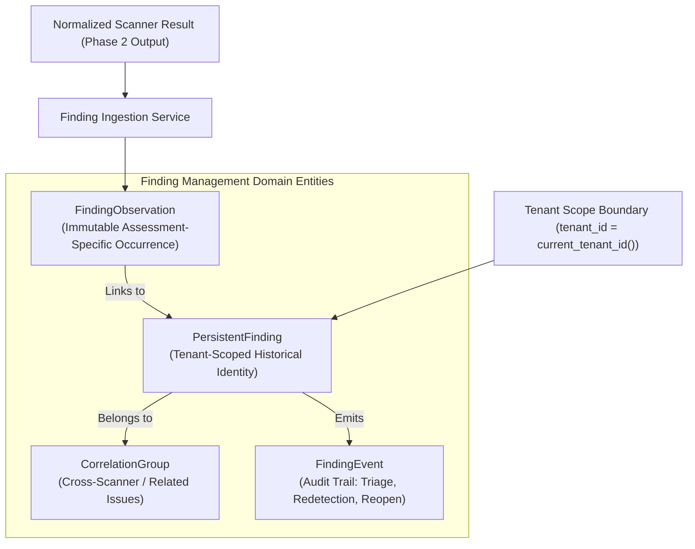
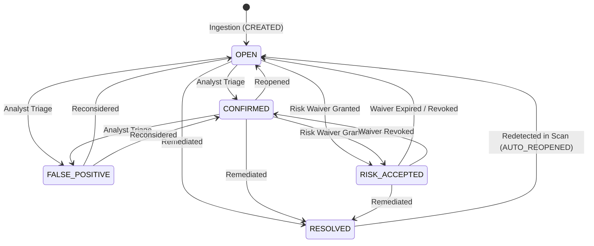

# Finding Management Domain Model & Lifecycle Semantics

This document defines Kelvin's finding domain architecture, persistence hierarchy, lifecycle state machine, and immutability invariants, fulfilling requirement **P3-01** (Issue #153).

---

## 1. Domain Entities & Conceptual Boundaries

Kelvin enforces a strict boundary between ephemeral scan results, immutable assessment occurrences, persistent vulnerabilities, and correlation groups:

### 1.1 Entity Hierarchy
1. **Normalized Scanner Result**: Ephemeral in-memory envelope produced by Phase 2 scanner adapters (`finding.v1.json`). Contains raw finding data and inline redacted evidence.
2. **Finding Observation (`finding_observations`)**: Immutable occurrence of a finding in a specific assessment execution. Stores the exact scanner ID, observation timestamp, evidence references, and scanner metadata. Protected by a database trigger preventing `UPDATE`s.
3. **Persistent Finding (`findings`)**: Tenant- and project-scoped persistent entity tracked over time. Identified by `project_id + fingerprint`. Tracks triage status, first/last seen timestamps, and occurrence counts.
4. **Correlation Group (`correlation_groups`)**: Logical grouping of related findings across different assets or scanners (e.g. distributed Log4Shell exposure across microservices).
5. **Finding Event (`finding_events`)**: Immutable append-only audit trail recording status changes, analyst notes, and redetections.

---

## 2. Lifecycle State Machine

### 2.1 Permitted Transitions
- **`OPEN`**: Can transition to `CONFIRMED`, `FALSE_POSITIVE`, `RISK_ACCEPTED`, `RESOLVED`.
- **`CONFIRMED`**: Can transition to `FALSE_POSITIVE`, `RISK_ACCEPTED`, `RESOLVED`, or `OPEN`.
- **`FALSE_POSITIVE`**: Terminal state unless explicitly reconsidered by an analyst back to `OPEN` or `CONFIRMED`.
- **`RISK_ACCEPTED`**: Time-bounded waiver. When expired or revoked, transitions back to `OPEN`, `CONFIRMED`, or `RESOLVED`.
- **`RESOLVED`**: Remediated state. If redetected in a subsequent scan, it automatically transitions back to `OPEN` via an `AUTO_REOPENED` event.

---

## 3. Immutability & Ownership Rules

| Entity / Property | Mutability | Protection Mechanism |
|---|---|---|
| `finding_observations` | **Immutable** | PostgreSQL trigger `trg_prevent_observation_update` raises exception on `UPDATE`. |
| `findings.fingerprint` | **Immutable** | Generated via Algorithm v1 SHA-256 hash; never mutated. |
| `findings.first_seen_at` | **Immutable** | Preserves original detection timestamp across re-scans. |
| `findings.status` | **Mutable** | Transition enforced by domain state machine (`ValidateTransition`). |
| `findings.last_seen_at` | **Mutable** | Updated on subsequent observation ingestion. |
| `findings.occurrence_count` | **Mutable** | Incremented on each redetection. |

---

## 4. Tenant Isolation Invariants

- All tables (`findings`, `finding_observations`, `finding_events`, `correlation_groups`) enforce PostgreSQL Row Level Security (RLS) with `tenant_id = current_tenant_id()`.
- Domain ingestion functions strictly reject any observation whose `tenant_id` does not match the persistent finding.
