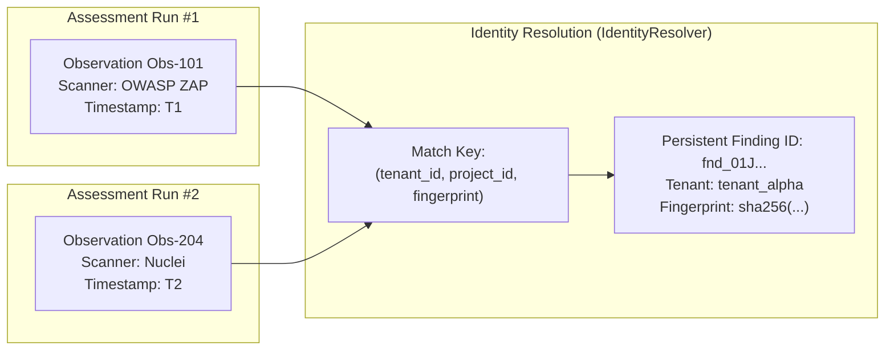

# Finding Identity and Observation Model

This document defines Kelvin's identity resolution architecture, multi-assessment deduplication rules, and persistent finding vs observation separation, fulfilling requirement **P3-02** (Issue #154).

---

## 1. Overview & Objective

When multiple assessments execute over time against an asset or across multiple scanning engines (e.g. OWASP ZAP Baseline on Monday, Curated Nuclei on Wednesday), they repeatedly observe the same underlying vulnerability.

The **Finding Identity and Observation Model** (`IdentityResolver`) ensures that:
1. Every assessment occurrence is recorded as an immutable **FindingObservation** preserving exact scanner provenance, execution context, and timestamps.
2. Recurring occurrences of the same issue resolve to a single **PersistentFinding** identified by a deterministic Algorithm v1 fingerprint.
3. Multi-tenant boundaries and project isolation are strictly enforced: identical vulnerabilities in different tenants or projects are never merged.
4. Findings are never merged based on fuzzy or heuristic title/description similarity.

---

## 2. Architecture & Identity Resolution



---

## 3. Identity Invariants & Matching Semantics

### 3.1 Distinct Identifiers
- **Persistent Finding**: Identified by UUIDv7 (`finding.id`), representing the persistent historical lifecycle of the defect.
- **Finding Observation**: Identified by a distinct UUIDv7 (`observation.id`), representing an immutable point-in-time assessment occurrence.
- `observation.finding_id` explicitly references the parent persistent finding.

### 3.2 Exact Deduplication Matching Key
Two observations link to the same persistent finding if and only if:
```text
finding.tenant_id == observation.tenant_id AND
finding.project_id == observation.project_id AND
finding.fingerprint == computed_fingerprint
```

### 3.3 Strict Isolation Rules
- **Cross-Tenant Isolation**: Observations belonging to `Tenant A` and `Tenant B` NEVER resolve to the same persistent finding, even if target host, URL, and vulnerability parameters are identical.
- **Cross-Project Isolation**: Separate projects within the same tenant maintain distinct finding records.
- **No Fuzzy Matching**: Differences in template ID, lowest CVE, CWE, or target endpoint path generate distinct fingerprints and therefore distinct findings. Similar descriptions or titles never trigger merges.

### 3.4 Multi-Observation Provenance
When a re-scan redetects an existing finding:
- The persistent finding's `occurrence_count` increments.
- `last_seen_at` and `last_job_id` are updated.
- A new immutable `finding_observations` row is inserted, retaining the new assessment ID, scanner ID, evidence references, and scanner metadata.
- Pre-existing historical observation rows remain completely unchanged.
