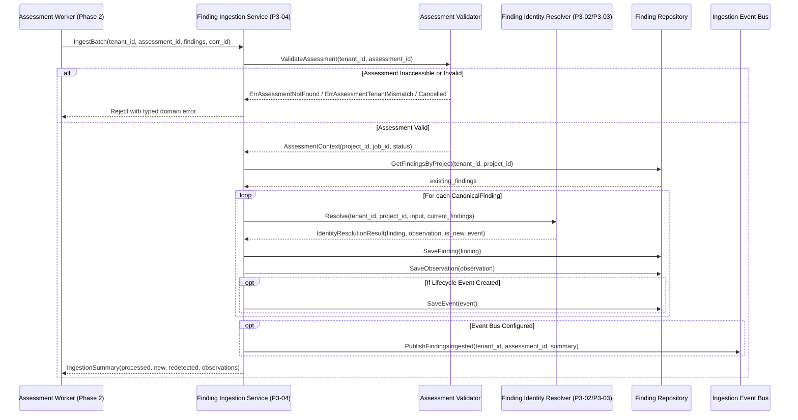

# Finding Ingestion Service Architecture

## 1. Overview & Purpose

This document details the Finding Ingestion Service designed and implemented as part of **P3-04** (Issue #156).

The Finding Ingestion Service is the application-layer entry point for canonical findings produced by Phase 2 scanner adapters. It bridges the transient worker execution plane with Kelvin's durable finding storage plane, enforcing tenant isolation, deterministic deduplication, observation immutability, and execution provenance preservation.

---

## 2. Key Responsibilities & Architectural Invariants

### 2.1 Multi-Tenant Boundary Enforcement (ADR-0002)
- Assessment authorization is validated against the requesting `tenant_id`. Findings belonging to foreign tenants are rejected with `ErrAssessmentTenantMismatch`.
- Dedup and persistence queries are strictly scoped to `(tenant_id, project_id)`. Cross-tenant merges are structurally impossible.

### 2.2 Canonical Finding Decoupling
- The Ingestion Service operates strictly on Kelvin's unified `normalization.CanonicalFinding` domain model.
- It contains **zero scanner-specific logic** (no parsing, no scanner heuristics, no tool-specific branches). Scanner adapters in Phase 2 handle mapping to the canonical schema.

### 2.3 Observation Immutability & Provenance Preservation
- Every observation (`FindingObservation`) represents a point-in-time detection from an individual assessment run.
- Observations are append-only: an existing observation is never mutated by a subsequent scan.
- Full provenance (`scanner_name`, `adapter_version`, `engine_version`, `run_id`, `evidence_refs`) is recorded.

### 2.4 Partial Assessment Semantics (P2-32 Integration)
- When an assessment terminates with `COMPLETED_WITH_WARNINGS` (e.g., partial target reachability or timeout), findings are ingested with `partial_scan: true` metadata and tagged with `partial-assessment`.
- Assessments marked `CANCELLED` or `FAILED` are rejected to prevent unverified or aborted state from corrupting persistent finding records.

### 2.5 Security Invariant: Internal Ingestion Gate
- Finding ingestion is not exposed as an unauthenticated or public REST endpoint. It is invoked exclusively through internal system authentication by the assessment orchestration pipeline.

