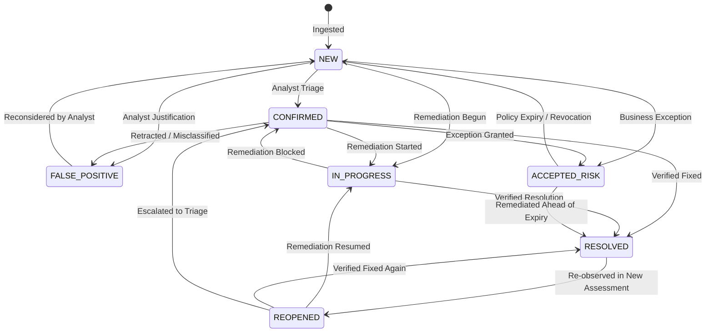

# Finding Lifecycle State Machine Architecture

## 1. Overview & Purpose

This document details the Finding Lifecycle State Machine implemented for Kelvin as part of **P3-09** (Issue #161).

The finding lifecycle governs the progression of persistent security vulnerabilities from ingestion through analyst triage, remediation verification, and potential redetection. It guarantees that human triage decisions are never overridden by automated scanner telemetry, while providing automated auto-reopening when previously resolved issues are observed again.

---

## 2. Canonical Lifecycle States

| State | Role & Semantic Meaning | Allowed Next States |
| :--- | :--- | :--- |
| `NEW` (`OPEN`) | Freshly ingested finding awaiting analyst review. | `CONFIRMED`, `IN_PROGRESS`, `FALSE_POSITIVE`, `ACCEPTED_RISK` |
| `CONFIRMED` | Analyst has verified vulnerability validity. | `IN_PROGRESS`, `RESOLVED`, `FALSE_POSITIVE`, `ACCEPTED_RISK` |
| `IN_PROGRESS` | Engineering or DevOps has begun active remediation. | `RESOLVED`, `CONFIRMED` |
| `RESOLVED` | Fix has been deployed and verified. | `REOPENED` (on redetection), `IN_PROGRESS`, `NEW` |
| `REOPENED` | Previously resolved vulnerability observed again. | `IN_PROGRESS`, `RESOLVED`, `CONFIRMED` |
| `FALSE_POSITIVE` | Analyst has justified and suppressed the alert. | `NEW` (if reconsidered) |
| `ACCEPTED_RISK` (`RISK_ACCEPTED`) | Business owner has accepted risk under exception policy. | `NEW` (on policy expiry), `RESOLVED` |

---

## 3. Transition Rules & Actor Governance

### 3.1 Automated vs. Analyst Actions
1. **Automated Transitions**:
   - Automated scanners (e.g. Nuclei, OWASP ZAP) may **only** trigger the `RESOLVED -> REOPENED` transition upon re-observation in a subsequent assessment.
   - All other transitions require authenticated analyst action (`isAutomated = false`).
2. **Protection of Analyst Decisions**:
   - Findings in `CONFIRMED`, `FALSE_POSITIVE`, or `ACCEPTED_RISK` states retain their analyst triage status across redetections.
   - Re-observation increments `occurrence_count` and updates `last_seen_at`, but generates a non-mutating `REDETECTED` audit event without altering the status.

### 3.2 False Positive vs. Accepted Risk Distinction
- **`FALSE_POSITIVE`**: Represents scanner inaccuracy, benign test pattern, or out-of-scope non-vulnerability. It suppresses alerts permanently unless explicitly reconsidered by an analyst.
- **`ACCEPTED_RISK`**: Represents a real, verified vulnerability whose immediate remediation is deferred due to business constraints. It is subject to time-bound exception policies and re-enters the active queue upon expiry.
