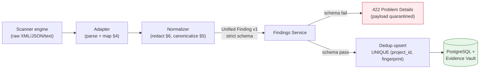

# Kelvin Security Platform — Unified Finding & Evidence Schema

**Document Control**

| Field | Value |
| :--- | :--- |
| **Status** | Baseline — Peer Review Required |
| **Milestone** | Phase 1 — Foundation & Core Architecture (`P1-11`) |
| **Depends On** | `docs/architecture/DATA_MODEL.md` (`P1-10`) |
| **Owner** | Platform Engineering / Findings |
| **Review Cadence** | Quarterly, and on any schema, severity, fingerprint, or redaction rule change |
| **Related Docs** | `docs/architecture/DATA_MODEL.md` (§5.8 findings, §5.10 evidence), `docs/architecture/SYSTEM_ARCHITECTURE.md` (§8.7 Findings Service), `docs/security/THREAT_MODEL.md` (T-04, T-09), `docs/api/API_STANDARDS.md` (§7 ingestion errors) |
| **Machine-Readable Artifacts** | `packages/schemas/finding.v1.json`, `packages/schemas/fixtures/` (positive/negative fixtures + fingerprint vectors), `scripts/schema-validation/` |
| **Classification** | Internal — Engineering Specification |

---

## 1. Executive Summary

Every scanner adapter — Nuclei, OWASP ZAP, Nmap, OpenVAS, Trivy, and anything registered later — emits one payload shape: the **Unified Finding v1** (`packages/schemas/finding.v1.json`). One schema means one frontend card renderer, one set of database columns, one report generator, and one deduplication pipeline.

This document is the normative companion to the schema and defines the four contracts the schema alone cannot express:

1. **Severity standardization** — canonical enum + per-engine mapping tables (§4).
2. **Deterministic fingerprinting** — the exact dedup algorithm with verified test vectors (§5).
3. **Evidence redaction** — rule catalog and attestation requirements (§6).
4. **Extension discipline** — `scanner_meta` as the sole, namespaced escape hatch (§7).

Ingestion rejects any payload that fails strict schema validation with `422 validation_failed` (RFC 7807, API STANDARDS §7.4) — malformed scanner records never reach the findings table (THREAT_MODEL T-04).

---

## 2. Payload Lifecycle



| Stage | Who | Obligations |
| :--- | :--- | :--- |
| Parse | Adapter | Convert engine-native format; never forward raw output |
| Map | Adapter | Severity mapping (§4); vulnerability key extraction (§5.3) |
| Redact | Adapter (first pass) | Strip secrets per §6 **before** the payload leaves the worker DMZ (DF-06) |
| Validate | Findings Service (second pass) | Strict schema validation; secret-pattern re-scan; 422 on failure |
| Normalize | Findings Service | Recompute fingerprint (§5); assign `id`; ignore client `id`/`fingerprint`/`status` |
| Persist | Findings Service | `ON CONFLICT (project_id, fingerprint)` upsert (DATA_MODEL §10.3); triage states never overwritten |

**Server-assigned fields:** `id`, `fingerprint`, `status`, and evidence `id` are produced by the Findings Service. Servers MUST ignore client-supplied values; clients MUST NOT send them (the schema tolerates their presence only for stored/exported forms of the same document).

---

## 3. Schema Conventions

* **Format:** JSON Schema draft 2020-12 (`$id: urn:kelvin:schemas:finding.v1.json`) — same dialect as the OpenAPI 3.1 contract (API STANDARDS §11.1).
* **Strictness:** `additionalProperties: false` at every object level. An unknown root field is a rejected payload, not a silent extension (§7 for the sanctioned extension point).
* **Versioning:** `schema_version` carries the major (`1.x`). Additive, backward-compatible changes ship as new minors within v1; any removal or semantic change requires `finding.v2.json` plus a migration note in this document.
* **Wire enums** are the SCREAMING_SNAKE_CASE values persisted in PostgreSQL (DATA_MODEL §3.4) — no translation layer exists.

---

## 4. Severity Standardization

### 4.1 Canonical Enum

`CRITICAL`, `HIGH`, `MEDIUM`, `LOW`, `INFORMATIONAL`.

### 4.2 CVSS v3.x Bands (authoritative when a score is present)

| CVSS 3.0/3.1/4.0 score | Canonical severity |
| :--- | :--- |
| 9.0 – 10.0 | `CRITICAL` |
| 7.0 – 8.9 | `HIGH` |
| 4.0 – 6.9 | `MEDIUM` |
| 0.1 – 3.9 | `LOW` |
| 0.0 | `INFORMATIONAL` |

When both a native engine severity and a CVSS score exist and disagree by more than one band, the **score-derived band wins** and the adapter MUST emit `scanner_meta["<ns>.severity_native"]` preserving the engine value for audit.

### 4.3 Legacy / Native Scale Mappings

| Engine | Native scale | Mapping |
| :--- | :--- | :--- |
| Nuclei | `info`, `low`, `medium`, `high`, `critical` | Direct (uppercase) |
| OWASP ZAP | Risk `0–3` (Informational, Low, Medium, High) | `0→INFORMATIONAL`, `1→LOW`, `2→MEDIUM`, `3→HIGH`; ZAP confidence `1–4` → `0.25/0.5/0.75/1.0` |
| OpenVAS/GVM | Numeric severity `0.0–10.0` + QoD | Apply §4.2 bands to the numeric score; attach QoD as `confidence` scaled `qod/100` blended with engine confidence |
| Trivy | `UNKNOWN`, `LOW`, `MEDIUM`, `HIGH`, `CRITICAL` | Direct; `UNKNOWN → INFORMATIONAL` |
| Nmap | No severity (script categories only) | Adapter heuristics with explicit defaults: open admin/service discovery → `INFORMATIONAL`; known-vulnerable service version (NSE vuln scripts) → per §4.2 when CVSS present, else `LOW`; TLS weaknesses (CBC, weak CA) → `MEDIUM`; plaintext credential-bearing protocols → `HIGH`. Heuristic choices MUST be recorded in `scanner_meta["nmap.severity_rule"]` |
| CVSS v2 only | `0.0–10.0` | Same numeric bands as §4.2, with conservative note: v2 scores skew lower than v3; adapters SHOULD prefer a v3 vector when the engine provides one |

Adapters are the only component permitted to perform these mappings; the Findings Service stores the canonical value verbatim.

---

## 5. Deterministic Fingerprinting (Algorithm v1)

### 5.1 Purpose & Scope

The fingerprint is the identity of *a vulnerability occurrence at an asset surface* — stable across recurring scans, scanner restarts, and (where engines agree on identity) across engines. Database uniqueness is `UNIQUE (project_id, fingerprint)` (DATA_MODEL §5.8): the hash itself is **project-agnostic**; tenant/project scoping is enforced by the unique index, so the same CVE on the same endpoint of two projects yields two rows, not a collision.

### 5.2 Inputs

| Input | Required | Source |
| :--- | :--- | :--- |
| `asset` | Yes | `target.asset` |
| `endpoint` | No | `target.endpoint` (host-level findings omit it) |
| `vulnerability_key` | Yes | Derived per §5.3 |

### 5.3 Vulnerability Key Precedence

Evaluated in order; first present wins:

1. `vulnerability.template_id` — lowercased, trimmed (e.g. `cve-2021-44228`).
2. Lowest `vulnerability.cve_ids` entry — lexicographic sort of uppercase CVE IDs, take first (e.g. `CVE-2023-99999` sorts before `CVE-2024-1002`).
3. `vulnerability.cwe_id` — uppercase (e.g. `CWE-79`).
4. Title slug — lowercase; replace every run of non-alphanumeric characters with a single `-`; trim leading/trailing `-` (e.g. `Login Form — SQL Injection!!` → `login-form-sql-injection`).

### 5.4 Normalization

**Asset:**

* Trim ASCII whitespace.
* If it parses as an IP literal: canonical form via RFC 5952 (IPv6, lowercase, compressed) or dotted-decimal (IPv4, no leading zeros).
* Else: lowercase; strip one trailing dot (`Example.COM.` → `example.com`).

**Endpoint** (empty/absent → empty string `""`):

* Must parse as an absolute URL; unparseable endpoints are rejected at ingestion (`422`).
* Lowercase scheme and host (host normalized as an asset above; IPv6 hosts keep URL brackets `[...]`).
* Drop default ports (`http:80`, `https:443`); keep non-default ports.
* Remove dot-segments from the path per RFC 3986 §5.2.4; empty path → `/`.
* Uppercase percent-encoding hex digits (`%2f` → `%2F`); do not decode.
* **Drop the entire query string and fragment** — query parameters carry volatile tokens (CSRF, session IDs) that would shatter fingerprint stability and could leak secrets into the hash preimage.

### 5.5 Canonical String & Hash

```
canonical = "v1" + "\n" + asset_normalized + "\n" + endpoint_normalized + "\n" + vulnerability_key
fingerprint = lowercase_hex(sha256(utf8(canonical)))        // no trailing newline
```

The `v1` algorithm tag is hashed in: a future v2 changes the tag first, making algorithm detection and selective re-fingerprinting possible without prefix collisions.

### 5.6 Test Vectors (normative)

Executable copies: `packages/schemas/fixtures/fingerprint-vectors.json`. Any Go implementation MUST reproduce these exactly.

| # | Purpose | asset (input) | endpoint (input) | vulnerability key inputs | Canonical string | fingerprint |
| :--- | :--- | :--- | :--- | :--- | :--- | :--- |
| 1 | Case, trailing dot, default port, query+fragment stripped | `Example.COM.` | `HTTPS://Example.Com:443/login?token=abc#frag` | `cwe_id: CWE-79` | `v1` ⏎ `example.com` ⏎ `https://example.com/login` ⏎ `CWE-79` | `0b74ae615704f8af320a13ea3dbc218e5319c67e4ce3c10e1b4abd6254c0960b` |
| 2 | IPv6 canonicalization, dot-segments, default port | `2001:0DB8:0:0::1` | `http://[2001:DB8::1]:80/a/../b/c` | `template_id: cve-2021-44228` | `v1` ⏎ `2001:db8::1` ⏎ `http://[2001:db8::1]/b/c` ⏎ `cve-2021-44228` | `5fc7fe8eeab5344946e650f1b14de6a1e79cea0460e5441564302eee9e5e5fe8` |
| 3 | Host-level (no endpoint), CVE precedence | `10.0.0.5` | *(absent)* | `cve_ids: ["CVE-2024-1002", "CVE-2023-99999"]` → `CVE-2023-99999` | `v1` ⏎ `10.0.0.5` ⏎ *(empty)* ⏎ `CVE-2023-99999` | `6a90cda46f0c24a569b1a658a3c6dcda7474ca2a4bdd02408699e5dc0220b195` |
| 4 | Percent-encoding case, title-slug fallback | `shop.example.com` | `https://shop.example.com/Products%2fitem` | no template/CVE/CWE; title `Login Form — SQL Injection!!` | `v1` ⏎ `shop.example.com` ⏎ `https://shop.example.com/Products%2Fitem` ⏎ `login-form-sql-injection` | `543f061a3bf2fcb270931470e6c43cbc677337fd80cd2c7f24fc7aad03a900de` |

(⏎ = literal `\n`.)

### 5.7 Stability Guarantees

* Re-scanning an unchanged surface with the same identity inputs MUST produce the identical fingerprint (vector 1 is the regression anchor).
* Changing only volatile material (query tokens, fragments, header values, evidence content) MUST NOT change the fingerprint.
* Changing the vulnerability identity (a different template, CWE, or CVE) MUST change the fingerprint.
* Algorithm upgrades: `v2` canonical strings are distinguishable by the version tag; re-fingerprinting backfills are performed by the retention/maintenance pipeline, never by rewriting analyst triage.

---

## 6. Evidence Bundle & Redaction

### 6.1 Bundle Shape

Each `evidence[]` item carries: `type` (aligned with DATA_MODEL §5.10), optional `content_type`, an inline redacted preview `content_redacted` (**64 KiB cap**, excess → `422`), optional `artifact` descriptor for out-of-band uploads (`checksum_sha256` + `size_bytes` + `content_type`; per-asset cap 10 MiB, T-10), and the mandatory **`redacted_fields` attestation** — an explicit, possibly empty list of what was stripped. Evidence with `redaction_status` not `COMPLETED` is never servable (DATA_MODEL §5.10; T-09).

### 6.2 Redaction Rule Catalog

Adapters apply these rules **before** transmission; the Findings Service re-applies them as defense-in-depth and quarantines on any detection that survives adapter redaction.

| Rule ID | Class | Pattern / Policy |
| :--- | :--- | :--- |
| `header.denylist` | Headers | Case-insensitive deny-list: `authorization`, `proxy-authorization`, `cookie`, `set-cookie`, `x-api-key`, `x-auth-token`, `x-csrf-token`, `x-amz-security-token`, `x-access-token`, `private-key`, `sessionid`, `phpsessid`, `jsessionid` |
| `rule:jwt` | Tokens | `eyJ[A-Za-z0-9_-]{10,}\.[A-Za-z0-9_-]{10,}\.[A-Za-z0-9_-]+` |
| `rule:bearer` | Tokens | `(?i)bearer\s+[A-Za-z0-9._~+/-]{16,}` |
| `rule:private-key-block` | Keys | `-----BEGIN [A-Z ]*PRIVATE KEY-----` through matching `-----END` |
| `rule:aws-access-key` | Keys | `\b(?:AKIA|ASIA)[0-9A-Z]{16}\b` |
| `rule:aws-secret` | Keys | `(?i)aws.{0,20}['"][0-9a-zA-Z/+]{40}['"]` |
| `rule:basic-url-creds` | URLs | `://[^/\s:@]+:[^@\s]{6,}@` (userinfo in URLs) |
| `rule:secret-assignment` | Structured | `(?i)\b(password|passwd|secret|api[_-]?key|access[_-]?token|auth[_-]?token)\b\s*[=:]\s*['"]?[^\s'"]{6,}` |
| `rule:high-entropy` | Opaque | Strings ≥ 20 chars of base64/hex alphabet with Shannon entropy > 4.5 bits/char; allow-listed forms (fixed-width hex digests in checksum fields, UUIDs) exempt |
| `rule:pii-email` | PII | Email addresses → local part masked (`a***@example.com`) in previews; fully redacted in exported artifacts |

**Marker format:** every redaction replaces the matched span with `[REDACTED:<rule-id>]` (e.g. `[REDACTED:rule:jwt]`), preserving surrounding structure so analysts retain reproducible request/response context. The rule IDs / field paths touched are appended to `redacted_fields` (e.g. `response.header.set-cookie`, `rule:jwt`).

### 6.3 Quarantine Semantics

If the Findings Service detects a rule match **after** adapter redaction, the evidence row is stored with `redaction_status = QUARANTINED`: excluded from dashboards, reports, and API reads; retained 90 days for forensics then securely wiped (DATA_MODEL §8.3); security alert emitted (T-09). The parent finding survives with its non-sensitive metadata.

### 6.4 What Never Leaves the Worker

Raw unredacted responses, cookies, captured credentials, and private keys have **no serialization path** in the Unified Finding. There is no "raw" evidence type and no opt-out flag; adapters that cannot redact a payload type must omit the evidence rather than forward it.

---

## 7. Extension Points (`scanner_meta`)

* `scanner_meta` is the **only** object adapters may extend; root-level additions are schema violations.
* Keys MUST match `^[a-z][a-z0-9_]*\.[a-z0-9_.]+$` — a lowercase namespace, a dot, then the field. Registered namespaces: `nuclei`, `zap`, `nmap`, `openvas`, `trivy`, plus reserved `kelvin.*` for platform-generated annotations (e.g. `kelvin.severity_native`, `kelvin.severity_rule`).
* Values MUST be scalars (string/number/boolean). Structured data requires a schema revision — this prevents `scanner_meta` from becoming a shadow schema.
* The Findings Service persists `scanner_meta` into `findings.scanner_data` (DATA_MODEL §5.8) and indexes nothing inside it until a query predicate justifies a GIN index.
* Unknown namespaced keys are **tolerated and stored** (forward compatibility for engine upgrades); unknown root fields are **rejected**.

---

## 8. Validation, Fixtures & Testing

### 8.1 Ingestion Gate

The Findings Service validates every payload against `finding.v1.json` with a strict draft 2020-12 validator **before** any database write. Failures produce RFC 7807 `422 validation_failed` with field-level `errors[]` (API STANDARDS §7.4); the payload is logged (sanitized) keyed by `correlation_id` for adapter debugging — never persisted as a finding (T-04: forged/forged-shape results cannot corrupt the normalized store).

### 8.2 Fixture Matrix (`packages/schemas/fixtures/`)

| Fixture | Engine | Asserts |
| :--- | :--- | :--- |
| `positive/nuclei.cve-2021-44228.json` | Nuclei | Full Log4Shell finding: CVSS 10.0, template ID, HTTP evidence with `request.header.authorization` redacted |
| `positive/zap.sqli.json` | OWASP ZAP | Risk/confidence mapping, `set-cookie` redaction attestation, CWE-89 |
| `positive/nmap.tls-cbc.json` | Nmap | Host-level finding (no endpoint), heuristic severity rule recorded in `scanner_meta` |
| `negative/missing-title.json` | — | Missing required `title` |
| `negative/invalid-severity.json` | — | Non-canonical severity `URGENT` |
| `negative/unexpected-root-field.json` | — | Root `additionalProperties` violation |
| `negative/invalid-fingerprint.json` | — | Client-supplied fingerprint with bad format (also documents server-recompute rule) |
| `negative/redacted-fields-wrong-type.json` | — | `redacted_fields` as string instead of array |
| `fingerprint-vectors.json` | — | The §5.6 vectors in executable form |

### 8.3 CI Harness

```bash
cd scripts/schema-validation
npm ci
npm test          # ajv strict: all positive fixtures MUST validate; all negative MUST fail
```

The harness (`scripts/schema-validation/validate.mjs`) exits non-zero on any deviation and runs in CI on every PR touching `packages/schemas/**`. The same validator binary is the reference for the Go ingestion gate (identical schema file; Go runtime uses a draft 2020-12-compatible validator and must pass the same fixture suite in `tests/`).

---

## 9. Mapping to Persistence

| Unified Finding field | Column (DATA_MODEL §5.8 / §5.10) | Notes |
| :--- | :--- | :--- |
| `id` | `findings.id` | Server-assigned UUIDv7 |
| `fingerprint` | `findings.fingerprint` | Server-computed (§5); `UNIQUE (project_id, fingerprint)` |
| `title` | `findings.title` | |
| `severity` | `findings.severity` | CHECK enum matches §4.1 |
| `confidence` | `findings.confidence` | `numeric(4,3)` |
| `target.asset` | `findings.asset_id` → `assets` | Resolved/created via scope-verified asset registry |
| `target.endpoint` | `findings.affected_endpoint` | |
| `vulnerability.cwe_id` | `findings.cwe_id` | |
| `vulnerability.cve_ids` | `findings.cve_ids` | `text[]` |
| `vulnerability.cvss.score` | `findings.cvss_score` | |
| `remediation`, `reproduction_steps`, `description` | `findings.scanner_data` (JSONB) | Queryable later via GIN if a predicate emerges |
| `scanner` + `scanner_meta` | `findings.scanner_data` | Namespaced keys preserved |
| `tags` | `findings.tags` | `text[]`, GIN-indexed |
| `evidence[]` | `evidence` rows + object store | Inline preview → `redacted_preview`; artifact → `object_key` after upload; `redacted_fields` recorded on the row |
| `discovered_at` | `findings.first_seen_at` / `last_seen_at` | Upsert semantics per DATA_MODEL §10.3 |

---

## 10. Governance & Change Control

1. **Schema changes require a PR** updating `finding.v1.json`, this document, and the fixture suite together. CI rejects schema changes that break existing positive fixtures without fixture updates.
2. **Fingerprint algorithm changes** require a new version tag (§5.7), new test vectors, and an ADR — fingerprints are durable identifiers inside analyst workflows.
3. **Redaction rule changes** require Product Security review (owner of T-09). Rules may only broaden redaction within v1; narrowing requires an ADR.
4. **New scanner adapters** must ship: severity mapping row (§4.3), namespace registration (§7), and one positive fixture — the adapter is not "done" until its fixture validates.
5. **Review cadence:** quarterly, and on any new engine integration.

---

## 11. Traceability

| Artifact | Reference |
| :--- | :--- |
| Planning reference | `P1-11` |
| Milestone | Phase 1 — Foundation & Core Architecture |
| Blocked by | `P1-10` — `docs/architecture/DATA_MODEL.md` |
| Canonical schema | `packages/schemas/finding.v1.json` |
| Fixtures & vectors | `packages/schemas/fixtures/` |
| CI harness | `scripts/schema-validation/` |
| Persistence mapping | `docs/architecture/DATA_MODEL.md` §5.8, §5.10, §10.3 |
| Ingestion error contract | `docs/api/API_STANDARDS.md` §7 (`422 validation_failed`) |
| Threat controls | `docs/security/THREAT_MODEL.md` — T-04 (forged findings rejected by schema), T-09 (credential redaction/quarantine), T-10 (size caps) |
| Architecture | `docs/architecture/SYSTEM_ARCHITECTURE.md` §8.7 (Finding Normalization & Deduplication Service) |

---

*Kelvin Security Platform — Phase 1 Engineering Backlog*
