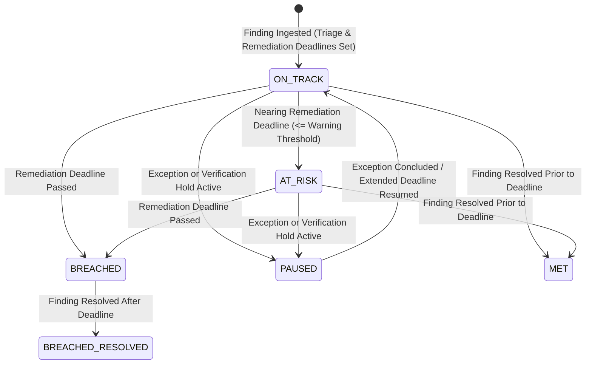
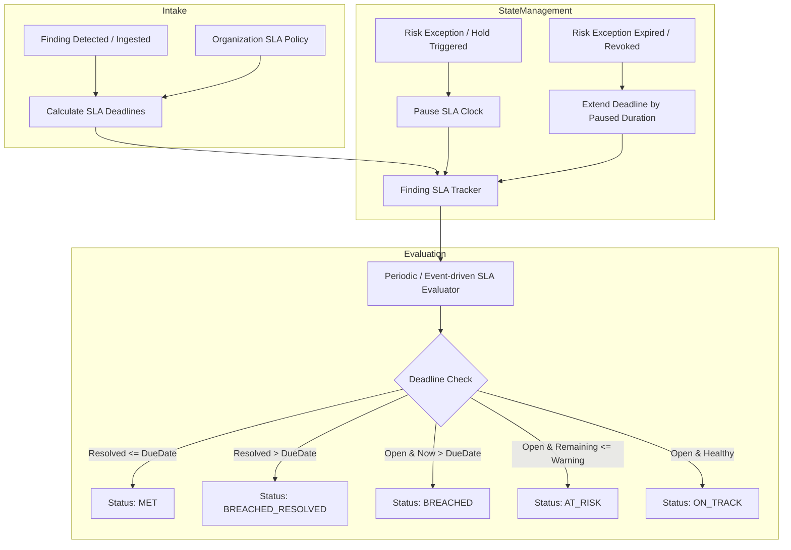

# Finding SLA and Priority Governance Architecture

## 1. Overview
The Finding SLA and Priority Governance subsystem manages deterministic remediation deadlines, breach tracking, risk exceptions, and priority alignment across organizational boundaries. It decouples governance compliance status from the finding lifecycle while enforcing auditable remediation requirements.

## 2. SLA Lifecycle and Clock State Machine

## 3. SLA Evaluation Engine Architecture

## 4. Key Architectural Guarantees
1. **Deterministic Severity Deadlines**: Standardized defaults across `CRITICAL` (14d), `HIGH` (30d), `MEDIUM` (60d), `LOW` (90d), and `INFO` (180d) with 24-72h triage windows.
2. **Deterministic Clock Suspension & Extension**: Clock pausing freezes SLA evaluation; resumption adjusts the `remediation_due_date` by the exact elapsed paused duration, preventing artificial breaches during authorized risk holds.
3. **Decoupled Governance Status**: Governance SLA status (`ON_TRACK`, `AT_RISK`, `BREACHED`, `MET`, `BREACHED_RESOLVED`) is tracked orthogonally to technical finding states (`OPEN`, `TRIAGED`, `RESOLVED`, `FALSE_POSITIVE`).
4. **Tenant Isolation**: All policies and SLA tracking records enforce strict tenant boundary isolation via composite primary keys and foreign keys.
