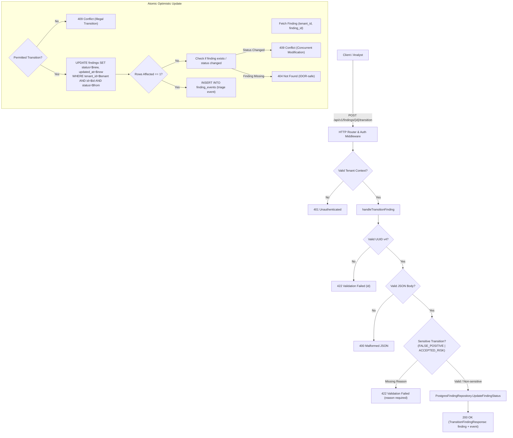

# Finding Status Transition Commands and API

## Overview

The Finding Status Transition Command subsystem enables authenticated security analysts and internal orchestration services to move findings along the defined lifecycle state machine. It guarantees strict multi-tenant boundary isolation, verifies state validity against established transition matrices, mandates documentation rationale for sensitive overrides, and protects against silent write collisions via optimistic concurrency control.

---

## Architecture & Workflow

---

## Transition Rules & State Constraints

| Source Status | Permitted Target Statuses | Mandatory Reason? |
|---|---|---|
| `NEW` | `CONFIRMED`, `IN_PROGRESS`, `FALSE_POSITIVE`, `ACCEPTED_RISK` | Yes (for `FALSE_POSITIVE`, `ACCEPTED_RISK`) |
| `CONFIRMED` | `IN_PROGRESS`, `FALSE_POSITIVE`, `ACCEPTED_RISK`, `RESOLVED` | Yes (for `FALSE_POSITIVE`, `ACCEPTED_RISK`) |
| `IN_PROGRESS` | `RESOLVED`, `FALSE_POSITIVE`, `ACCEPTED_RISK` | Yes (for `FALSE_POSITIVE`, `ACCEPTED_RISK`) |
| `RESOLVED` | `REOPENED` | No |
| `REOPENED` | `IN_PROGRESS`, `RESOLVED`, `FALSE_POSITIVE`, `ACCEPTED_RISK` | Yes (for `FALSE_POSITIVE`, `ACCEPTED_RISK`) |
| `FALSE_POSITIVE` | None (Terminal) | N/A |
| `ACCEPTED_RISK` | None (Terminal) | N/A |

---

## Optimistic Concurrency Control

To prevent silent overwrites when multiple triage analysts or automated workflows update a finding simultaneously:
1. The repository reads the current finding status.
2. The SQL `UPDATE` statement predicates on `status = $fromStatus`.
3. If zero rows are affected, the repository re-inspects the record:
   - If the finding exists with a different status, an optimistic concurrency conflict error is returned (`409 Conflict`).
   - If the finding does not exist or belongs to another tenant, an IDOR-safe `404 Not Found` is returned.

---

## Auditability & Event Traceability

Every successful transition generates a corresponding `FindingEvent` record (`event_type = 'TRIAGE'`) persisted atomically with the finding status change. The audit event captures:
- `from_status` and `to_status`
- `actor_user_id` (when initiated by authenticated user)
- `note` / reason
- `correlation_id` propagated from the incoming request context
- Timestamp (`created_at`)
