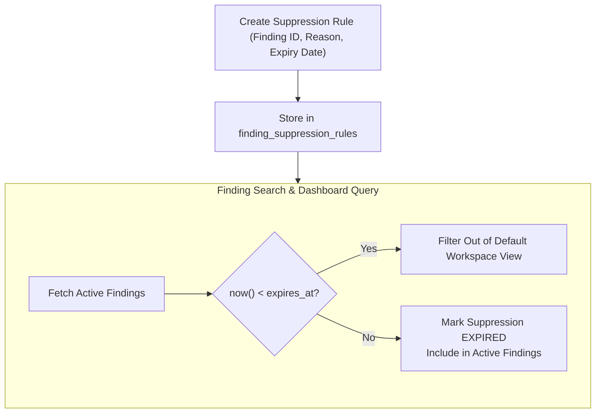

# Finding Suppression Rules with Expiry Architecture

## Overview
The Kelvin Finding Suppression Subsystem enables security analysts and system administrators to temporarily exclude specific findings from operational review and routine alerting dashboards without deleting or altering the underlying findings, observations, or raw scanner outputs.

Every suppression rule is tenant-scoped, time-bounded by a mandatory future expiration timestamp (`expires_at > now()`), and requires documented justification. When the expiration timestamp is reached, the system automatically treats the suppression as expired, immediately returning the finding to active dashboards and review queues.

## Core Invariants

1. **Non-Destructive Exclusion:**
   - Suppressing a finding does not modify its lifecycle state or delete historical scanner observations, evidence payloads, or activity timeline logs.
   - Suppressed findings remain queryable by authorized reviewers using filter parameters (`include_suppressed=true`).

2. **Mandatory Expiration Date:**
   - Indefinite suppressions are strictly prohibited. Every suppression rule must specify an `expires_at` timestamp in the future.
   - Once `now() >= expires_at`, the rule lapses automatically without requiring manual administrator intervention.

3. **Mandatory Justification & Auditability:**
   - Creating or revoking a suppression rule requires a documented rationale explaining the decision.
   - Every rule records the actor ID and appends an auditable timeline event (`SUPPRESSION_CREATED`, `SUPPRESSION_REVOKED`, `SUPPRESSION_EXPIRED`).

4. **Strict Tenant Boundaries:**
   - Suppression rules are strictly bound to `(tenant_id, finding_id)`. Cross-tenant rule application or retrieval is blocked (ADR-0002).

## Database Schema
The `finding_suppression_rules` table provides an immutable record of temporary exclusions:
- `id` (UUID PRIMARY KEY)
- `tenant_id` (UUID NOT NULL REFERENCES tenants(id))
- `finding_id` (UUID NOT NULL REFERENCES findings(id))
- `actor_id` (UUID NULL REFERENCES users(id))
- `reason` (TEXT NOT NULL)
- `status` (TEXT NOT NULL CHECK: `ACTIVE`, `EXPIRED`, `REVOKED`)
- `expires_at` (TIMESTAMPTZ NOT NULL)
- `revoked_at` (TIMESTAMPTZ NULL)
- `revoked_by` (UUID NULL REFERENCES users(id))
- `revocation_reason` (TEXT NULL)
- `metadata` (JSONB NOT NULL DEFAULT '{}')
- `created_at` (TIMESTAMPTZ NOT NULL DEFAULT NOW())

## API Contract
- `POST /api/v1/findings/{id}/suppress`: Creates a new temporary suppression rule.
- `POST /api/v1/findings/{id}/unsuppress`: Revokes an active suppression rule early with documented rationale.
- `GET /api/v1/findings/{id}/suppressions`: Retrieves all historical and active suppression rules for the finding.
- Idempotency supported via `Idempotency-Key` header.
