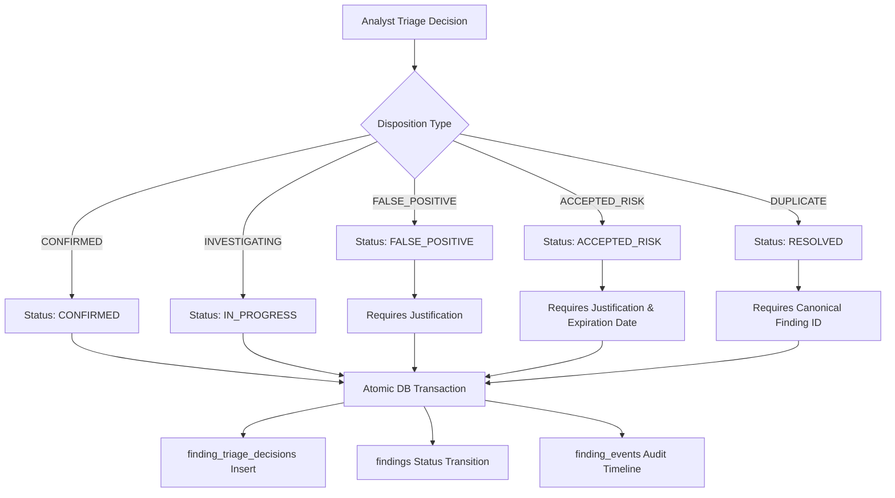

# Finding Triage Decisions and Dispositions Architecture

## Overview
The Kelvin Finding Triage Subsystem enables security analysts to document standardized review outcomes (dispositions) against persistent vulnerability findings. Every triage decision is immutable, tenant-scoped, and cryptographically auditable. Applying a triage decision atomically synchronizes the finding's lifecycle state in accordance with rigorous transition rules.

## Supported Dispositions and Scopes

### Triage Dispositions
| Disposition | Target Finding Status | Requirements |
|---|---|---|
| `CONFIRMED` | `CONFIRMED` | Documented justification recommended |
| `INVESTIGATING` | `IN_PROGRESS` | Documented justification recommended |
| `FALSE_POSITIVE` | `FALSE_POSITIVE` | Documented rationale mandatory |
| `ACCEPTED_RISK` | `ACCEPTED_RISK` | Rationale & future expiration date mandatory (`expires_at > now()`) |
| `DUPLICATE` | `RESOLVED` | Canonical finding ID mandatory (non-self-referential, tenant-isolated) |

### Triage Scopes
- `PERSISTENT_FINDING`: Applies to the persistent aggregate finding and future matching scanner observations.
- `OBSERVATION`: Scoped specifically to a single observation instance.
- `CORRELATION_GROUP`: Propagates triage intent across members of an identified vulnerability cluster.

## Database Schema
The `finding_triage_decisions` table provides an append-only audit trail:
- `id` (UUID PRIMARY KEY)
- `tenant_id` (UUID NOT NULL REFERENCES tenants(id))
- `finding_id` (UUID NOT NULL REFERENCES findings(id))
- `disposition` (VARCHAR(32) NOT NULL)
- `scope` (VARCHAR(32) NOT NULL DEFAULT 'PERSISTENT_FINDING')
- `actor_id` (UUID NULL)
- `justification` (TEXT NOT NULL)
- `approver_id` (UUID NULL)
- `expires_at` (TIMESTAMPTZ NULL)
- `canonical_finding_id` (UUID NULL REFERENCES findings(id))
- `metadata` (JSONB NOT NULL DEFAULT '{}')
- `created_at` (TIMESTAMPTZ NOT NULL DEFAULT NOW())

## API Contract
`POST /api/v1/findings/{id}/triage`
Requires authentication with `finding:write` permission. Supports idempotency via `Idempotency-Key` header.
Tenant isolation is strictly verified via context; cross-tenant references return `404 Not Found`.
