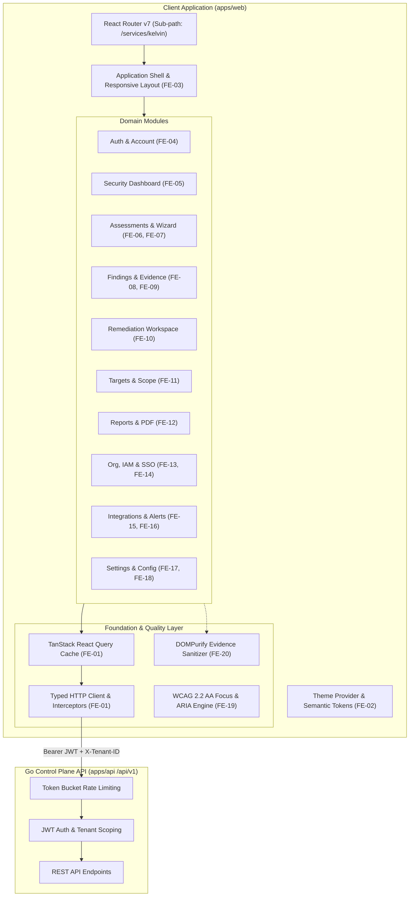

# KELVIN Frontend Architecture & API Contract Mapping

**Milestone:** [Frontend Development & Product Experience](../../.github/issues/MILESTONE_FRONTEND.md)  
**Parent Epic:** [FE-EPIC-01: Design & Implement Complete KELVIN Frontend Application](../../.github/issues/frontend/FE-EPIC-01_DESIGN_AND_IMPLEMENT_COMPLETE_KELVIN_FRONTEND_APPLICATION.md)  
**Version:** 1.0.0-GA  
**Last Updated:** November 2026  

---

## 1. Architectural Overview & System Design

The KELVIN Web Application (`apps/web`) is a high-performance, single-page enterprise web console constructed using **React 19**, **TypeScript 5.9**, **Vite 7**, **Tailwind CSS 4**, and **TanStack React Query 5**.

It serves as the unified security assessment portal through which security engineers, auditors, and platform administrators manage organizations, target assets, scan workflows, vulnerability findings, and enterprise compliance policies.

---

## 2. API-to-Frontend Contract Mapping

Every frontend feature is mapped directly to live Go API endpoints implemented across Phases 1 through 5:

| Frontend Feature | Issue ID | Backend Go API Endpoint | HTTP Method | Request Payload / Params | Response Contract |
|---|---|---|---|---|---|
| **Auth Login** | `FE-04` | `/api/v1/auth/login` | `POST` | `{ "email": str, "password": str }` | `{ "token": str, "user": User, "expires_at": str }` |
| **Auth MFA** | `FE-04` | `/api/v1/auth/mfa/verify` | `POST` | `{ "code": str, "mfa_token": str }` | `{ "token": str, "user": User }` |
| **Dashboard Metrics**| `FE-05` | `/api/v1/dashboard/overview` | `GET` | `?time_range=30d` | `{ "stats": Metrics, "trends": TrendPoint[] }` |
| **Create Assessment**| `FE-06` | `/api/v1/assessments` | `POST` | `{ "name": str, "target_id": str, "profile_id": str }` | `{ "id": str, "status": "PENDING", ... }` |
| **Assessment Detail**| `FE-07` | `/api/v1/assessments/:id` | `GET` | - | `{ "assessment": Assessment, "tasks": Task[] }` |
| **Assessment Control**| `FE-07` | `/api/v1/assessments/:id/cancel`| `POST`| - | `{ "id": str, "status": "CANCELLED" }` |
| **Findings List** | `FE-08` | `/api/v1/findings` | `GET` | `?severity=HIGH&status=OPEN&page=1` | `{ "findings": Finding[], "total": int }` |
| **Finding Detail** | `FE-09` | `/api/v1/findings/:id` | `GET` | - | `{ "finding": Finding, "history": History[] }` |
| **Finding Triage** | `FE-08` | `/api/v1/findings/:id/triage` | `POST` | `{ "status": "SUPPRESSED", "reason": str }` | `{ "finding": Finding }` |
| **Evidence Retrieval**| `FE-09` | `/api/v1/evidence/:id` | `GET` | - | `{ "id": str, "content": str, "checksum": str }` |
| **Remediation Items** | `FE-10` | `/api/v1/remediations` | `GET` | `?assignee_id=...&due_before=...` | `{ "remediations": Remediation[] }` |
| **Target Management**| `FE-11` | `/api/v1/targets` | `GET`, `POST`| `{ "name": str, "address": str, "scope": str }` | `{ "targets": Target[] }` |
| **Target Safety Test**| `FE-11` | `/api/v1/targets/validate` | `POST` | `{ "address": str }` | `{ "valid": bool, "guardrail_violation": str }` |
| **Report Generation** | `FE-12` | `/api/v1/reports/generate` | `POST` | `{ "assessment_id": str, "format": "pdf" }` | `{ "download_url": str, "report_id": str }` |
| **Org & Team Mgmt** | `FE-13` | `/api/v1/organizations/:id` | `GET`, `PUT` | `{ "name": str, "settings": OrgSettings }` | `{ "organization": Organization }` |
| **RBAC Roles** | `FE-14` | `/api/v1/roles` | `GET`, `POST`| `{ "name": str, "permissions": str[] }` | `{ "roles": Role[] }` |
| **SSO Config** | `FE-14` | `/api/v1/sso/config` | `GET`, `PUT` | `{ "idp_url": str, "entity_id": str }` | `{ "sso_config": SSOConfig }` |
| **Integrations** | `FE-15` | `/api/v1/integrations` | `GET`, `POST`| `{ "type": "jira|slack", "config": ... }` | `{ "integrations": Integration[] }` |
| **Audit Logs** | `FE-16` | `/api/v1/audit/logs` | `GET` | `?actor=...&action=...&page=1` | `{ "logs": AuditLog[], "integrity": str }` |
| **Settings & Quotas**| `FE-17` | `/api/v1/workspaces/:id/settings`| `GET`, `PUT`| `{ "concurrency_limit": int, ... }` | `{ "settings": WorkspaceSettings }` |

---

## 3. Subsystem Breakdown (FE-01 through FE-24)

```mermaid
graph LR
    subgraph Foundation ["Phase A: Foundation"]
        FE01["FE-01: Architecture & API Client"]
        FE02["FE-02: Design System & Tokens"]
        FE03["FE-03: Shell & Responsive Nav"]
    end

    subgraph CoreFeatures ["Phase B: Core Modules"]
        FE04["FE-04: Auth & MFA UI"]
        FE05["FE-05: Security Dashboard"]
        FE06["FE-06: Assessment Wizard"]
        FE07["FE-07: Execution Monitor"]
        FE08["FE-08: Findings Explorer"]
        FE09["FE-09: Evidence Viewer"]
        FE10["FE-10: Remediation Workspace"]
        FE11["FE-11: Target Scope Mgmt"]
        FE12["FE-12: Reports & PDF"]
    end

    subgraph Enterprise ["Phase C: Enterprise Admin"]
        FE13["FE-13: Org & Teams"]
        FE14["FE-14: Roles & SSO"]
        FE15["FE-15: Integrations & Webhooks"]
        FE16["FE-16: Tamper-Evident Audit"]
        FE17["FE-17: Settings & Quotas"]
        FE18["FE-18: Global Search & Omnibar"]
    end

    subgraph Quality ["Phase D: Quality & Release"]
        FE19["FE-19: WCAG 2.2 AA A11y"]
        FE20["FE-20: Security & DOM Sanitization"]
        FE21["FE-21: Test Automation & E2E"]
        FE22["FE-22: Performance & Vitals"]
        FE23["FE-23: Sub-Path /services/kelvin"]
        FE24["FE-24: Final QA Gate Review"]
    end

    Foundation --> CoreFeatures
    CoreFeatures --> Enterprise
    Enterprise --> Quality
```

---

## 4. Security & Quality Invariants

1. **Zero Client Secrets**: Production web bundles must contain zero API secrets, database credentials, private encryption keys, or privileged tokens.
2. **Untrusted Scanner Output Sanitization**: Any HTTP headers, response bodies, or raw scanner outputs rendered in the UI must be passed through DOMPurify with inert DOM containers to eliminate DOM-XSS risks.
3. **Sub-Path Hosting Readiness**: The application must natively resolve assets and routes under both root `/` and sub-path `https://eozka.com/services/kelvin`.
4. **WCAG 2.2 AA Compliance**: Full keyboard navigability, high-contrast dark palette, minimum target sizes (44x44px), and ARIA landmark compliance.
