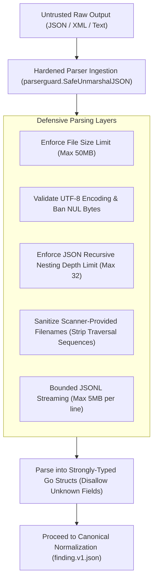

# Hardened Scanner Output Parsing Against Untrusted Data

This document defines Kelvin's architecture, defensive boundaries, resource limits, and path traversal sanitization for scanner output parsing, fulfilling requirement **P2-38** (Issue #114).

---

## 1. Overview & Objective

External vulnerability scanners execute complex inspection scripts against untrusted targets. The output emitted by scanners (raw stdout, stderr, JSON reports, and JSONL streams) is inherently **untrusted input**. Malicious targets or adversarial payloads may attempt to exploit parser bugs in the scanner or worker daemon through:
- Giant or infinite output streams intended to trigger out-of-memory (OOM) faults.
- Deeply nested recursive JSON structures designed to exhaust the call stack.
- Malformed byte sequences and NUL byte injections designed to bypass sanitization or corrupt memory.
- Path traversal sequences (`../../etc/passwd` or `..\..\Windows\cmd.exe`) embedded in artifact filenames.

The **Hardened Scanner Output Parsing** engine treats all external outputs with zero trust and applies layered defensive validations before deserialization.

---

## 2. Architecture & Defensive Layers

---

## 3. Core Components

### 3.1 `parserguard` Package (`apps/worker/internal/parserguard`)

Implements defensive parser constraints:
- `ValidatePayload(raw []byte) error`: Enforces a 50MB maximum ceiling (`MaxPayloadBytes`), non-empty payloads, valid UTF-8 encoding, and zero tolerance for NUL bytes (`\x00`).
- `CheckJSONNestingDepth(raw []byte, maxDepth int) error`: Uses a streaming token scanner to count delimiter nesting (`{` and `[`), rejecting payloads exceeding depth 32 (`MaxNestingDepth`) to prevent stack overflows.
- `SafeUnmarshalJSON(raw []byte, target any) error`: Sequentially validates size, UTF-8 encoding, nesting depth, and strict struct deserialization (`DisallowUnknownFields`).
- `SanitizeFileName(rawName string) (string, error)`: Neutralizes path traversal sequences (`../`, `..\`), absolute paths (`/var/log`, `C:\`), and special characters, safely returning the clean base filename.
- `ScanBoundedLines(reader io.Reader, maxLineBytes int, fn func(line []byte) error) error`: Streams JSONL outputs line-by-line with a strict 5MB per-line cap (`MaxLineBytes`), preventing memory bloat.

### 3.2 Finding Validation Integration (`apps/worker/internal/adapters/task.go`)

`ValidateFindings(raw []byte) error` integrates `parserguard.ValidatePayload` and `parserguard.CheckJSONNestingDepth` before any schema evaluation, guaranteeing that finding payloads adhere to defensive invariants.

---

## 4. Verification & Testing

Validated in `apps/worker/internal/parserguard/guard_test.go`:
- `TestValidatePayload`: Verifies size limits, empty document rejection, invalid UTF-8 detection, and NUL byte injection blocking.
- `TestCheckJSONNestingDepth`: Verifies that normal JSON (depth &le; 32) passes, while adversarial nested structures (depth 35) are rejected with `ErrNestingDepthExceeded`.
- `TestSafeUnmarshalJSON`: Verifies strict unmarshaling and rejection of unknown fields.
- `TestSanitizeFileName`: Verifies neutralization of Unix and Windows path traversal attacks (`../../etc/passwd`, `..\..\windows\system32\cmd.exe`, absolute paths, control characters).
- `TestScanBoundedLines`: Verifies bounded line streaming and rejection of oversized lines (> 5MB).
