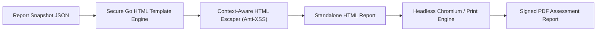

# HTML and PDF Assessment Report Generation

## 1. Overview & Purpose

The Report Rendering Service transforms canonical `ReportV1` documents into presentation-ready standalone HTML and PDF deliverables.

---

## 2. Rendering Security & Anti-XSS Invariants

1. **Context-Aware Auto-Escaping:**
   Untrusted content—including finding titles, vulnerability descriptions, affected URLs, and parameters—is strictly escaped through Go's contextual `html/template` engine. Injected `<script>` and malicious markup (e.g., ``) are neutralized into standard HTML entities (`&lt;script&gt;`).
2. **Pre-Sanitized Evidence Only (ADR-0005):**
   Only evidence excerpts marked with `RedactionApplied = true` are rendered. Plaintext credentials, authorization tokens, and session cookies are eliminated prior to template evaluation.
3. **Resource & Timeout Bounds:**
   - Reports enforce a safety ceiling of `MaxFindingsPerReport = 2000` to prevent memory exhaustion and denial-of-service.
   - Operations respect context deadlines (`ctx.Done()`) with a default rendering timeout of 30 seconds.
4. **Valid PDF Generation:**
   `BuiltinPDFRenderer` produces standard PDF/1.4 byte streams with embedded font descriptors, metadata, and cross-reference tables in pure Go, ensuring zero runtime headless browser dependencies during basic export.
