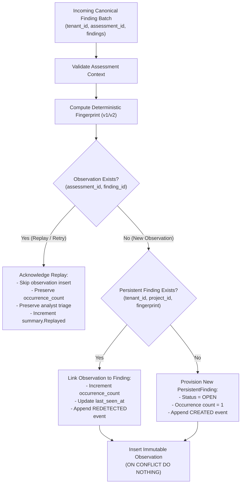

# Idempotent Finding Ingestion Architecture

## 1. Overview & Purpose

This document details Kelvin's idempotent finding ingestion architecture implemented as part of **P3-06** (Issue #158).

Distributed assessment jobs and worker queue redeliveries can cause duplicate delivery of assessment finding batches. The Ingestion Service ensures that repeated deliveries of results for the same assessment are processed idempotently without creating duplicate observation records, inflating occurrence counters, or overwriting manual analyst triage.

---

## 2. Idempotency Boundary & Database Constraints

1. **Unique Constraint on Observations (Migration `000007`)**:
   - `CONSTRAINT uq_finding_observations_assessment_finding UNIQUE (assessment_id, finding_id)`
   - Guarantees at the PostgreSQL relational engine level that within a single assessment execution, a finding can never have more than one point-in-time observation.

2. **In-Flight Application Idempotency Probe**:
   - `IngestionService` computes the finding's deterministic fingerprint and probes `ObservationExists(ctx, tenantID, assessmentID, findingID)` before invoking lifecycle resolution.
   - If an observation for `(assessment_id, finding_id)` is detected, the finding is counted as `Replayed` and skipped.

3. **Protection of Analyst Triage**:
   - Findings in statuses `FALSE_POSITIVE`, `CONFIRMED`, or `RISK_ACCEPTED` are protected against inadvertent status resets during worker retries or queue re-deliveries.

4. **Multi-Assessment Separation**:
   - Idempotency is strictly scoped to `(assessment_id, finding_id)`.
   - Distinct assessments (e.g. weekly scheduled scan vs ad-hoc scan) have differing `assessment_id` values, ensuring genuine recurrence is properly recorded with new observations and updated `last_seen_at`.
