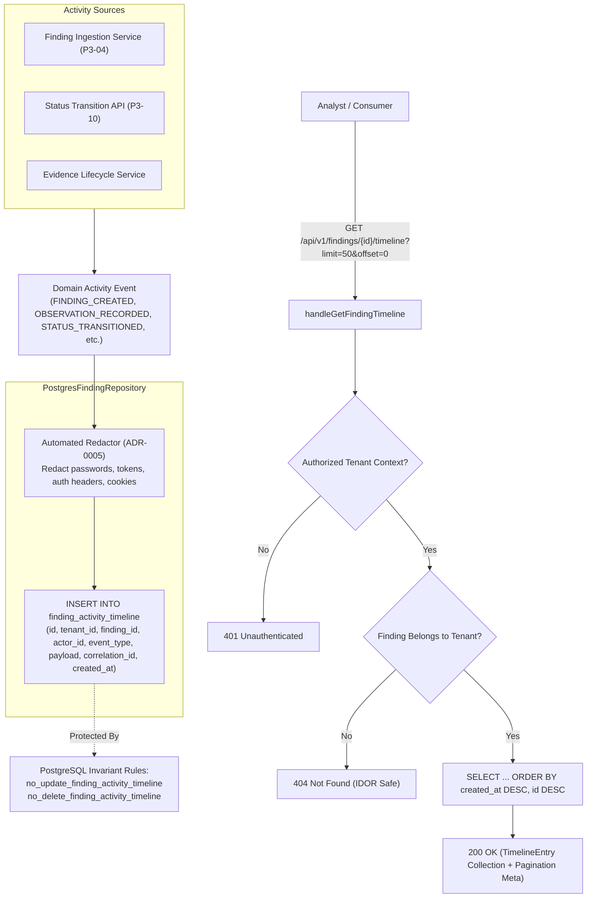

# Immutable Finding Activity Timeline

## Overview

The Finding Activity Timeline provides an immutable, append-only, chronological audit stream of all significant state, observation, and lifecycle changes for findings in Kelvin. It supports forensic audits, regulatory compliance, triage collaboration, and historical explainability while ensuring strict multi-tenant isolation and automated redaction of sensitive credentials.

---

## Architecture & Workflow

---

## Event Types

| Event Type | Source Action | Example Payload Attributes |
|---|---|---|
| `FINDING_CREATED` | First-time canonical ingestion | `title`, `severity`, `fingerprint` |
| `OBSERVATION_RECORDED` | Redetection across assessments | `assessment_id`, `job_id`, `scanner_id` |
| `STATUS_TRANSITIONED` | Triage state modification | `from_status`, `to_status`, `reason` |
| `FALSE_POSITIVE_MARKED` | Sensitive status change | `from_status`, `to_status`, `reason` |
| `ACCEPTED_RISK_MARKED` | Sensitive risk acceptance | `from_status`, `to_status`, `reason` |
| `SEVERITY_CHANGED` | Severity override or CVSS update | `old_severity`, `new_severity`, `rationale` |
| `EVIDENCE_ADDED` | Attachment of artifact evidence | `evidence_id`, `content_type`, `sha256` |
| `EVIDENCE_REMOVED` | Evidence expiry / redaction | `evidence_id`, `retention_policy` |
| `REMEDIATION_UPDATED` | Jira ticket / SLA target set | `ticket_ref`, `remediation_due` |

---

## Security & Architectural Invariants

1. **Strict Append-Only Guarantee:**
   - Normal application operations cannot modify (`UPDATE`) or erase (`DELETE`) timeline records.
   - Enforced via database rewrite rules (`no_update_finding_activity_timeline`, `no_delete_finding_activity_timeline`).
2. **Tenant Boundary Defense (ADR-0002):**
   - Every timeline record references `tenant_id`.
   - Querying timeline records requires verifying finding ownership within the caller's tenant; attempts to access foreign tenant records return `404 Not Found`.
3. **Automated Evidence & Credential Redaction (ADR-0005):**
   - All payload attributes undergo schema-aware string redaction before insertion into the database to ensure session tokens, passwords, cookies, and authorization headers are sanitized.
