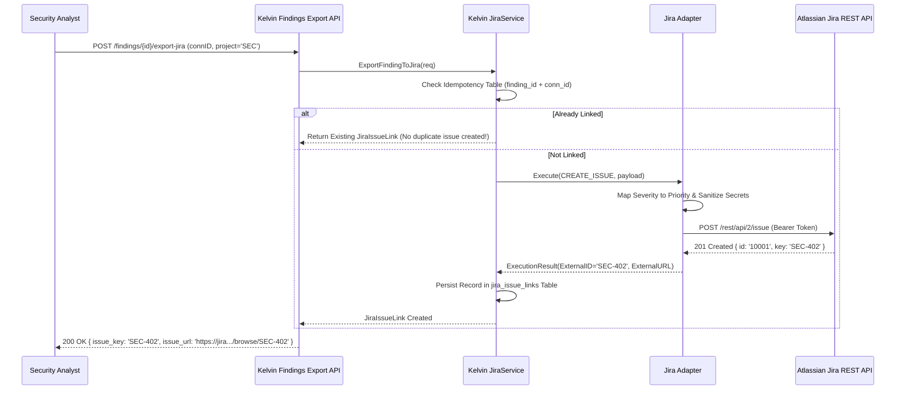

# Jira Issue-Tracking Integration Architecture

## 1. Overview
The Jira Issue-Tracking Integration connects Kelvin vulnerability findings and remediation records directly to Atlassian Jira Cloud and Data Center. It provides automatic finding-to-issue field translation, severity-to-priority mapping, evidence credential redaction, strict idempotency against duplicate issue creation, and error classification.

## 2. Jira Export & Idempotent Linking Lifecycle

## 3. Severity to Jira Priority Mapping
Kelvin finding severities translate deterministically into standard Jira issue priorities:
- `CRITICAL` &rarr; `Highest`
- `HIGH` &rarr; `High`
- `MEDIUM` &rarr; `Medium`
- `LOW` &rarr; `Low`
- `INFO` &rarr; `Lowest`

## 4. Key Architectural Guarantees
1. **Idempotent Issue Creation Barrier**: `jira_issue_links` enforces a unique constraint on `(organization_id, connection_id, finding_id)`. Subsequent or retried export operations return the existing issue link without calling the Jira REST API twice.
2. **Leakage & Sanitization Defense**: Finding descriptions and summary fields undergo token sanitization before dispatch, stripping raw token signatures (e.g. `klv_live_`, `whsec_`) and replacing them with `[REDACTED_SECRET]`.
3. **Resilient Error Classification**: HTTP 429 yields `ErrProviderRateLimited`, 401/403 yields `ErrProviderAuthFailed`, and network drops yield `ErrProviderUnavailable`.
4. **Tenant-Scoped Access**: Connections and exported issues are strictly bounded by organization and workspace tenancies.
