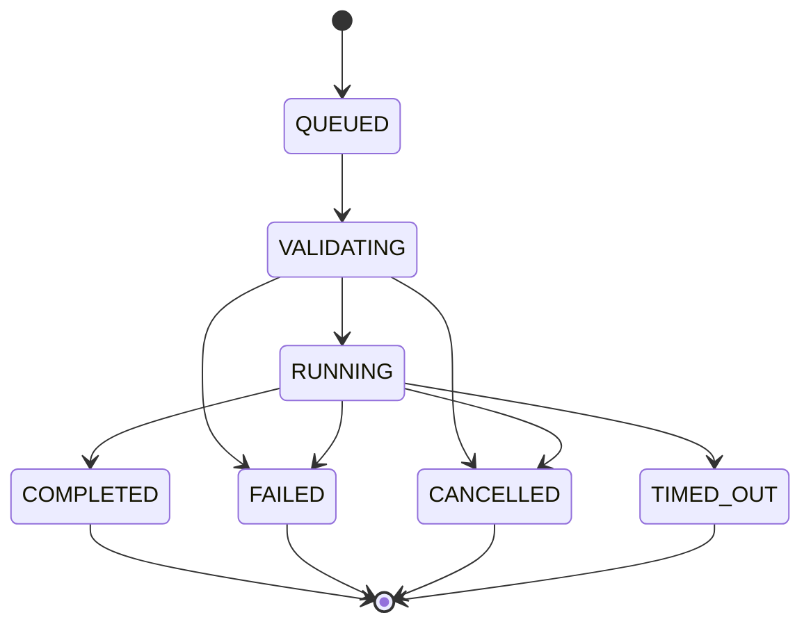

# Assessment Job Lifecycle

Job status is stored in PostgreSQL as the durable source of truth (ADR-0002 and ADR-0003). The `apps/api/pkg/job` package contains the canonical state vocabulary, transition validator, transactional store, Redis heartbeat helper, and stalled-job reaper.

All terminal states absorb: a second completion, cancellation, failure, or restart is rejected with `ErrInvalidTransition`. Retries create a new `jobs` attempt row, preserving history.

`Store.Transition` opens a transaction, selects the job `FOR UPDATE`, validates the edge, and writes status and lifecycle timestamps atomically. `started_at` is set on entry to `RUNNING`; `finished_at` is set on terminal transitions. PostgreSQL `now()` supplies a consistent transaction timestamp.

Workers refresh `Heartbeats.Touch` in Redis under a job-scoped key with a TTL, and should also update the PostgreSQL `heartbeat_at` and `lease_expires_at` fields through their worker integration. Every `Store` database operation requires a tenant context and uses a transaction-local `kelvin_app` role/GUC. Run `Store.ReapStalled` once per tenant context; it locks eligible tenant rows with `SKIP LOCKED` and fails jobs whose hard deadline or lease expired, or whose database heartbeat is older than 90 seconds. Set `hard_deadline_at` when dispatching a job from its configured `hard_execution_deadline_seconds`; the worker supervisor remains responsible for terminating the scanner process at that deadline (ADR-0005).

The reaper is safe to run concurrently from multiple control-plane instances. It should be scheduled periodically and monitored for database/Redis errors. Redis heartbeat absence alone does not mutate durable job state; the database lease and heartbeat fields allow recovery during a Redis outage.
