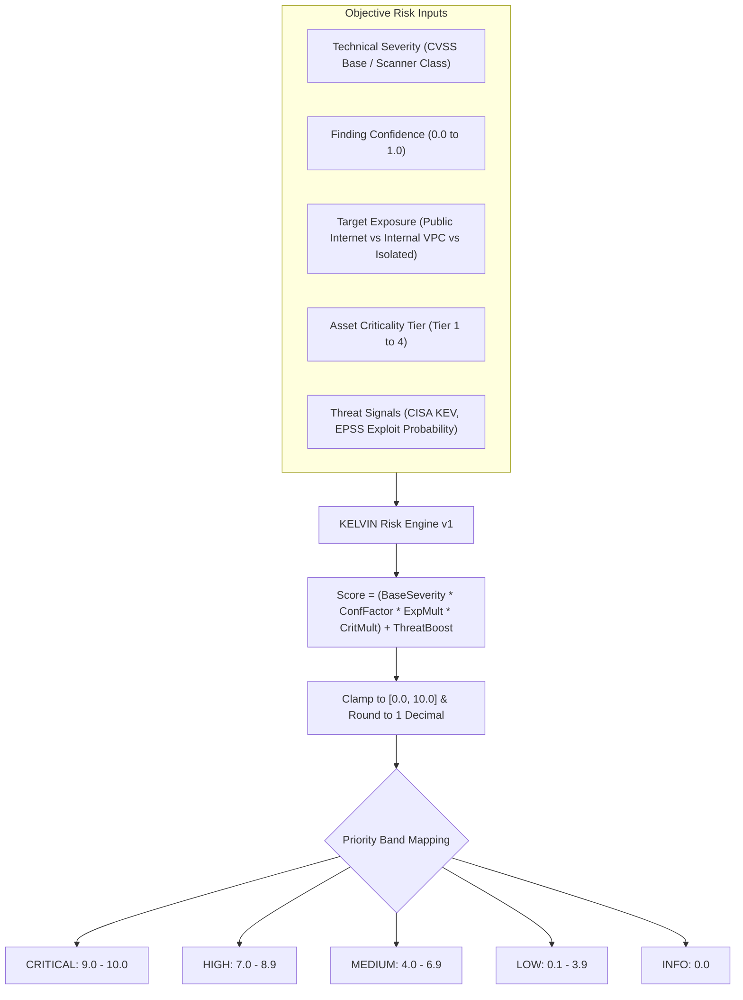

# KELVIN Risk Assessment Model Specification

## 1. Overview & Philosophy
The **KELVIN Risk Assessment Model** provides an objective, deterministic, and reproducible mechanism for prioritizing security findings beyond the raw technical severity labels assigned by disparate automated vulnerability scanners.

Raw scanner severity ratings (such as `CRITICAL`, `HIGH`, `MEDIUM`, `LOW`) describe intrinsic flaw severity in a vacuum without considering environmental exposure, asset criticality, vulnerability confidence, or external threat activity. KELVIN bridges this gap by calculating a contextualized numeric score from `0.0` to `10.0` mapped into 5 standardized Priority Bands.

## 2. Input Factors & Baseline Weights

### 2.1 Technical Severity Baseline ($BaseSeverity$)
If an authoritative CVSS Base Score is available ($0.0 \le CVSS \le 10.0$), it is directly used as $BaseSeverity$. If omitted, scanner severity strings are normalized according to the following baseline:
- `CRITICAL`: 9.5
- `HIGH`: 8.0
- `MEDIUM`: 5.5
- `LOW`: 2.5
- `INFO`: 0.0

### 2.2 Confidence Attenuation ($ConfidenceFactor$)
To avoid hiding unconfirmed high-severity findings while appropriately dampening tentative scanner reports, confidence ($c \in [0.0, 1.0]$) is transformed via bounded attenuation:
$$ConfidenceFactor = 0.5 + (c \times 0.5)$$
- Certain ($c = 1.0$) $\rightarrow 1.00$
- Firm ($c = 0.8$) $\rightarrow 0.90$
- Tentative ($c = 0.5$) $\rightarrow 0.75$

### 2.3 Exposure Context Multiplier ($ExposureMultiplier$)
- `PUBLIC_INTERNET`: **1.20x** (Directly reachable by untrusted public attackers)
- `INTERNAL_VPC`: **0.85x** (Protected by network perimeter or private subnet)
- `ISOLATED`: **0.50x** (Air-gapped, offline, or sandbox target)
- `UNKNOWN`: **1.00x** (Neutral default when network topology is omitted)

### 2.4 Asset Criticality Multiplier ($CriticalityMultiplier$)
- `TIER_1_CRITICAL`: **1.25x** (Core payment, auth, or customer PII database)
- `TIER_2_HIGH`: **1.10x** (Customer-facing application services)
- `TIER_3_MEDIUM`: **1.00x** (Internal business tools, staging services)
- `TIER_4_LOW`: **0.80x** (Ephemeral build environments, dev testbeds)
- `UNKNOWN`: **1.00x** (Neutral default when asset tiering is omitted)

### 2.5 Active Threat Intelligence Boost ($ExploitabilityBoost$)
- Active Exploitation in the Wild (CISA KEV Catalog match): **+1.0**
- High EPSS Probability ($\ge 0.50$): **+0.5**

## 3. Mathematical Formula & Bounds
$$\text{RawScore} = \left(\text{BaseSeverity} \times \text{ConfidenceFactor} \times \text{ExposureMultiplier} \times \text{CriticalityMultiplier}\right) + \text{ExploitabilityBoost}$$

$$\text{FinalScore} = \text{round}\left(\min(10.0, \max(0.1, \text{RawScore})), 1\right)$$

*(Exception: Informational findings with $BaseSeverity = 0.0$ are strictly assigned $0.0$ / `INFO`).*

Rounding to exactly 1 decimal place avoids implying unsupported statistical precision.

## 4. Operational Priority Bands
| Priority Band | Score Range | Default SLA | Typical Action |
|---|---|---|---|
| **CRITICAL** | `9.0 - 10.0` | 24 Hours | Immediate emergency paging & hotfix deployment |
| **HIGH** | `7.0 - 8.9` | 7 Days | Scheduled sprint remediation |
| **MEDIUM** | `4.0 - 6.9` | 30 Days | Routine backlog tracking |
| **LOW** | `0.1 - 3.9` | 90 Days | Defense-in-depth hardening |
| **INFO** | `0.0` | None | Informational observation only |

## 5. Explainability Invariant
Every calculated score must produce a human-readable audit string breaking down each contributing input:
`Base Severity: 8.0 | Confidence: 0.90 (factor 0.95) | Exposure: PUBLIC_INTERNET (x1.20) | Asset Criticality: TIER_1_CRITICAL (x1.25) | Threat Boost: +1.0 (Known Exploited (CISA KEV)) -> Final Risk: 10.0 [CRITICAL]`
