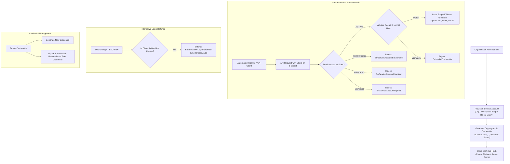

# Machine Identity and Service Account Model Architecture

## 1. Overview
The Machine Identity and Service Account Model establishes first-class non-human identities for automation, CI/CD pipelines, integration workers, and external security tooling. Service accounts operate completely decoupled from human user sessions and are strictly prohibited from interactive web login.

## 2. Service Account Lifecycle and Credential Flow

## 3. Key Architectural Guarantees
1. **Separation from Human Session Model**: Service accounts have no email/password login, no SSO redirection (SAML/OIDC), and no session cookie generation. Interactive web UI login attempts are rejected with `ErrInteractiveLoginForbidden`.
2. **Explicit Organization and Workspace Scoping**: Service accounts are bounded by tenant organization boundaries, with optional narrow workspace delegation and role/permission attachments.
3. **Immediate Revocation Propagation**: Suspending or revoking a service account immediately invalidates all machine credentials, terminating downstream API and webhook access synchronously.
4. **Credential Rotation Support**: Cryptographic secrets are stored exclusively as SHA-256 hashes. Seamless rotation issues a new credential with support for immediate or grace-period older credential revocation.
5. **Tamper-Evident Machine Audit Log**: Administrative creation, rotation, suspension, authentication, and blocked interactive login attempts are persisted to `service_account_audit_logs`.
