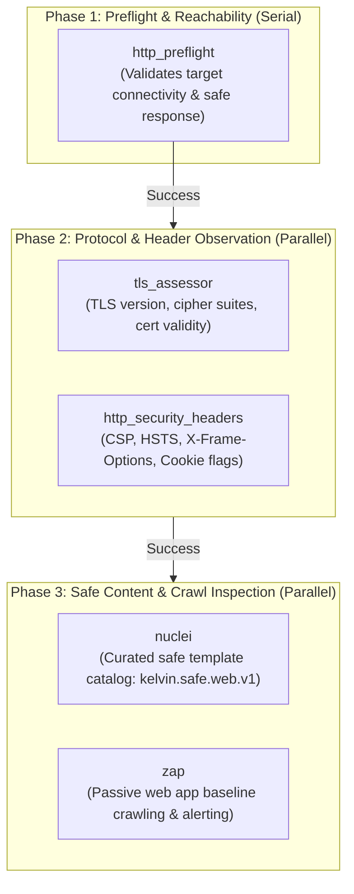

# MVP Assessment Profile Definitions (P2-19)

## 1. Overview & Purpose

The Kelvin Assessment Engine enforces deterministic, non-destructive, and resource-bounded security assessments through declarative, versioned Assessment Profiles. As defined in ADR-0005 and `docs/architecture/SCAN_PROFILES.md`, assessment profiles decouple high-level scanning policies (intensity, concurrency, traffic limits, and permitted scanners) from specific scanner adapter mechanisms.

This document establishes the concrete Phase 2 implementation of MVP assessment profiles within the worker adapter engine (`apps/worker/internal/adapters/profiles.go`).

---

## 2. Approved MVP Assessment Profiles

Three versioned profiles are formally approved for MVP operations:

| Profile Identifier | Version | Display Name | Impact Level | Traffic Level | Permitted Scanners | Admin Sign-off Required |
| :--- | :--- | :--- | :--- | :--- | :--- | :--- |
| `kelvin.profile.passive.v1` | `1.0.0` | Passive Discovery | `low` | `none` | *(none - OSINT / discovery only)* | No |
| `kelvin.profile.standard.v1` | `1.0.0` | Standard Automated Baseline | `medium` | `limited` | `http_preflight`, `tls_assessor`, `http_security_headers`, `zap`, `nuclei` | No |
| `kelvin.profile.deep.v1` | `1.0.0` | Deep Authorized Assessment | `high` | `active` | `http_preflight`, `tls_assessor`, `http_security_headers`, `zap`, `nuclei` | Yes |

---

## 3. Resource Budgets and Safety Ceilings

Each profile enforces hard limits on worker resource consumption, request pacing, and execution timeouts:

```
+-----------------------------------------------------------------------------------------+
|                                  Resource Budget Table                                  |
+----------------------------+-------------+----------------+----------------+------------+
| Profile                    | Req / Sec   | Max Concurrency| Max Req/Target | Deadline   |
+----------------------------+-------------+----------------+----------------+------------+
| kelvin.profile.passive.v1  | 1 req/s     | 1 connection   | 10 requests    | 5 minutes  |
| kelvin.profile.standard.v1 | 2 req/s     | 2 connections  | 500 requests   | 10 minutes |
| kelvin.profile.deep.v1     | 5 req/s     | 2 connections  | 2000 requests  | 30 minutes |
+----------------------------+-------------+----------------+----------------+------------+
```

### Safety Invariants:
1. **Destructive Checks Prohibited:** No MVP profile enables intrusive payloads, fuzzers that corrupt state, or denial-of-service checks (`destructive_checks = false`).
2. **Scope Constraint:** Execution is strictly limited to verified, in-scope targets validated in Phase 1.
3. **Execution Isolation:** External scanners (`nuclei`, `zap`) run in unprivileged, rootless OCI containers (ADR-0005, non-root `UID 10001`, dropped capabilities).
4. **Hard Deadlines:** The worker supervisor terminates scanner child processes upon reaching `MaxDuration`.

---

## 4. Phased Scanner Execution & Dependency Ordering

To prevent hammering unverified or unreachable hosts, profiles define execution phases with prerequisite checks.

### Standard Baseline Phasing (`kelvin.profile.standard.v1`)



1. **Phase 1: Preflight (`http_preflight`)**
   - Serial execution.
   - Confirms HTTP/HTTPS target reachability and DNS resolution before dispatching heavy scanner engines.
2. **Phase 2: Protocol & Header Inspection (`tls_assessor`, `http_security_headers`)**
   - Parallel execution (`Parallel: true`).
   - Requires successful Phase 1 completion (`RequirePrev: true`).
   - Non-intrusive protocol and header verification.
3. **Phase 3: Content & Baseline Crawling (`nuclei`, `zap`)**
   - Parallel execution (`Parallel: true`).
   - Requires successful Phase 2 completion (`RequirePrev: true`).
   - Runs curated Nuclei checks (safe web v1 catalog) and ZAP passive web application baseline.

---

## 5. Adapter API & Profile Validation

The worker package `adapters` exposes the following API:

```go
// GetAssessmentProfile retrieves an approved profile definition by canonical or short name.
func GetAssessmentProfile(profileID string) (AssessmentProfile, error)

// ValidateProfileSelection validates that a profile exists and explicitly permits the requested scanner.
func ValidateProfileSelection(profileID, scannerID string) (AssessmentProfile, error)

// ListAssessmentProfiles returns all registered MVP assessment profiles.
func ListAssessmentProfiles() []AssessmentProfile
```

### Validation Guarantees:
- **Default-Deny:** Unregistered profile identifiers produce `adapters: unknown or unsupported assessment profile`.
- **Scanner Whitelist Enforcement:** Requesting an unpermitted scanner under a profile (e.g. attempting to run `zap` or `nuclei` under `kelvin.profile.passive.v1`) produces an explicit error `adapters: scanner "<scanner>" is not permitted under profile "<profile>"`.
- **Alias Compatibility:** Supports short profile names (`passive`, `standard`, `deep`) with transparent normalization to versioned canonical IDs.
