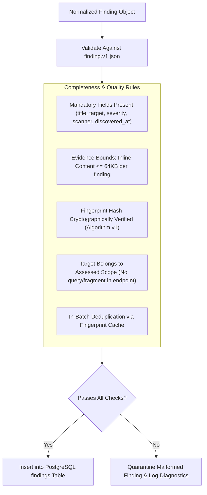

# Normalized Result Validation & Completeness Checks

This document defines Kelvin's architecture, completeness verification rules, inline evidence caps, in-batch deduplication, and quarantine audit logging for normalized vulnerability findings, fulfilling requirement **P2-44** (Issue #120).

---

## 1. Overview & Objective

Before scanner findings are accepted into the Findings Service or stored in PostgreSQL, they must pass through the **Normalized Result Validation Gate** (`ResultValidator`). This layer enforces data quality, prevents forged or mismatched deduplication fingerprints, caps inline evidence sizes to avoid memory bloat, rejects scope mismatches, and quarantines invalid records with structured audit diagnostic logs.

Key Invariants:
1. **Zero-Trust Validation Gate**: Normalized findings undergo layered structural, cryptographic, and contextual checks before ingestion.
2. **Fingerprint Verification**: Recomputes Algorithm v1 fingerprint from target and vulnerability properties; mismatches trigger immediate quarantine.
3. **Scope Containment**: Ensures finding targets match or fall within authorized assessment scope boundaries.
4. **Evidence Safeguards**: Strictly enforces 64KiB maximum inline preview cap per finding, validates evidence types, and requires non-nil `redacted_fields` attestations.
5. **In-Batch Deduplication**: Identical finding fingerprints within the same scanner run are deduplicated deterministically.
6. **Quarantine Auditability**: Rejection counts and structured violation reasons (`QuarantineRecord`) are recorded without crashing the worker daemon.

---

## 2. Architecture & Gate Pipeline

---

## 3. Validation Rules Specification

### 3.1 Structural & Schema Integrity
- Schema version must equal `"1.0"`.
- Title must be between 1 and 500 characters.
- Severity must belong to the canonical enum (`CRITICAL`, `HIGH`, `MEDIUM`, `LOW`, `INFORMATIONAL`).
- Confidence must be a floating point value in `[0.0, 1.0]`.
- Scanner provenance must declare non-empty `name` and semver `adapter_version`.
- Discovered timestamp must be valid ISO 8601 / RFC 3339.

### 3.2 Target Scope & URL Cleanliness
- `target.asset` must be non-empty and match the expected assessment asset or authorized sub-domain.
- `target.endpoint` must not contain volatile query parameters (`?`) or URL fragments (`#`).

### 3.3 Evidence Bounds & Redaction Attestation
- Inline preview text (`content_redacted`) must not exceed **64 KiB** (`MaxEvidenceBytesPerFinding = 65536`).
- Large artifacts must use out-of-band artifact references with SHA-256 checksums.
- `evidence.type` must be one of `HTTP_EXCHANGE`, `HEADER_DUMP`, `SCREENSHOT`, `FILE`, `LOG`.
- `redacted_fields` array must be non-nil (attestation required even if empty).

### 3.4 Cryptographic Fingerprint Verification
The validator independently re-executes `ComputeFingerprint` using the finding's normalized asset, endpoint, and vulnerability keys. If the declared fingerprint does not match the computed hash, the finding is quarantined to prevent fingerprint tampering.

### 3.5 In-Batch Deduplication & Quarantine Reporting
- When duplicate fingerprints are encountered within a single assessment batch, only the first occurrence is ingested; subsequent occurrences increment `DuplicateCount`.
- Quarantined records are captured in `QuarantineRecord` with index, reason, raw snippet, violation list, and timestamp, making validation failure rates observable.
