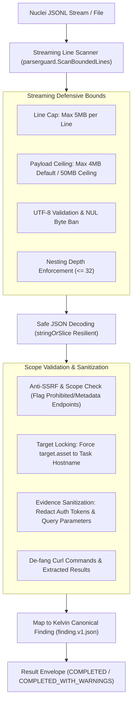

# Nuclei Output Parser Architecture

This document defines Kelvin's architecture, streaming safety constraints, target scope validation, and normalization rules for parsing ProjectDiscovery Nuclei JSONL streams into Kelvin's canonical finding schema (`finding.v1.json`), fulfilling requirement **P2-40** (Issue #116).

---

## 1. Overview & Objective

ProjectDiscovery Nuclei performs fast, template-driven vulnerability assessments. In Kelvin's execution pipeline, Nuclei executes within a locked-down, rootless OCI container (`UID 10001`, dropped capabilities) against a pinned, curated template catalog (`kelvin.safe.web.v1`).

Because Nuclei scans external targets and emits streaming JSONL events, the raw output is treated as untrusted:
- Individual lines are bounded to prevent memory exhaustion.
- JSON nesting depth is strictly enforced (`<= 32`).
- Target identity is tied directly to the authorized Kelvin assessment task rather than scanner-reported URLs.
- Reported matched locations are checked against scope policies to detect and flag out-of-scope or SSRF targets (e.g., cloud metadata `169.254.169.254`).
- Potential instruction injection via `curl-command` or `extracted-results` is sanitized and quarantined as passive text logs.

---

## 2. Architecture & Streaming Pipeline

---

## 3. Taxonomy & Field Normalization

### 3.1 Severity Mapping
Nuclei severities map deterministically into Kelvin canonical severities:
| Nuclei Severity | Kelvin Canonical Severity | Default Calibrated Confidence |
|---|---|---|
| `critical` | `CRITICAL` | `0.95` |
| `high` | `HIGH` | `0.85` |
| `medium` | `MEDIUM` | `0.70` |
| `low` | `LOW` | `0.60` |
| `info` / `informational` | `INFORMATIONAL` | `0.50` |

### 3.2 Vulnerability Taxonomy
- **Template ID**: Preserved under `vulnerability.template_id` and `scanner_meta["nuclei.template_id"]`.
- **CWE**: Extracted from `info.classification.cwe-id` (supporting either string or array format), normalized to `CWE-{id}`.
- **CVE**: Extracted from `info.classification.cve-id` (supporting either string or array format), normalized to uppercase `CVE-YYYY-NNNN`.
- **CVSS Score**: Preserved under `vulnerability.cvss.score` with `version: "3.1"`.

### 3.3 Target Scope Validation & SSRF Prevention
- The canonical `target.asset` is explicitly set to `task.Target.Hostname()`, ensuring scanner-reported hostnames cannot hijack finding attribution.
- If `matched-at` references prohibited endpoints (e.g., `169.254.169.254`, `metadata.google.internal`, or external hostnames outside task domain), an `ExecutionDiagnostic` with code `NUCLEI_OUT_OF_SCOPE_TARGET` and level `warning` is recorded.
- In accordance with Kelvin's partial completion semantics (P2-32), the presence of any warning diagnostic elevates the execution status from `COMPLETED` to `COMPLETED_WITH_WARNINGS`.

### 3.4 Non-Executable Evidence
- Nuclei's `curl-command` and `extracted-results` are treated strictly as passive text data.
- URL query parameters and authorization credentials are redacted (`?[REDACTED]`).
- Evidence entries are typed as `LOG` / `text/plain` with declared `redacted_fields`.
