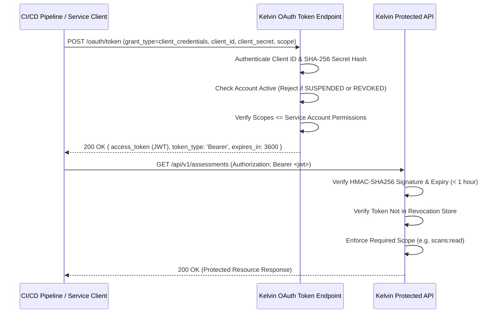

# OAuth 2.0 Client Credentials for Machine-to-Machine Access Architecture

## 1. Overview
The OAuth 2.0 Client Credentials subsystem implements the standard RFC 6749 machine-to-machine profile for enterprise automation, CI/CD runners, and integration workers. It issues short-lived, cryptographically signed Bearer JWTs bound strictly to registered Service Account permissions, enforcing anti-scope escalation guards and immediate revocation controls.

## 2. Token Lifecycle & Authentication Sequence

## 3. Key Architectural Guarantees
1. **RFC 6749 Client Credentials Profile**: Exchanges `client_id` and `client_secret` via `grant_type=client_credentials` for scoped access tokens. User-delegated authorization flows (e.g., authorization code with user redirect) are decoupled.
2. **Strict Anti-Scope Escalation**: Requested scopes must be a strict subset of the permissions assigned to the underlying Service Account identity. Requests containing ungranted scopes fail with `ErrScopeEscalationDenied`.
3. **Bounded 1-Hour Token Lifetime**: Tokens expire automatically after 3600 seconds (`expires_in = 3600`), minimizing risk windows for leaked tokens.
4. **Immediate Revocation and Cascading Invalidation**: Tokens are tracked via unique IDs (`jti`). Individual tokens can be revoked on-demand. Suspending or revoking the service account immediately invalidates all active tokens issued to it.
5. **Decoupled Identity and Secrets**: Tokens convey claims (`sub`, `org_id`, `scopes`) without embedding credentials or secrets.
