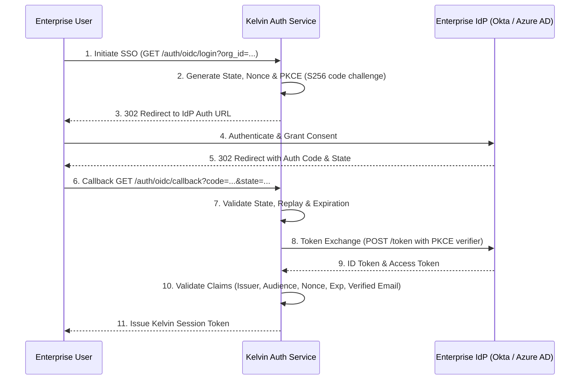

# OpenID Connect Enterprise SSO Architecture (P4-13)

## Executive Summary

Enterprise customers require integration with their central identity providers (IdPs) such as Okta, Microsoft Entra ID (Azure AD), Ping Identity, and Keycloak using modern open standards.

Issue **P4-13** implements an OpenID Connect (OIDC) 1.0 authentication subsystem for organization-level single sign-on (SSO). It enforces authorization code flow with Proof Key for Code Exchange (PKCE, RFC 7636), multi-layer cryptographic replay defense, strict redirect URI validation, unverified email rejection, and complete decoupling of authentication from organization authorization.

---

## 1. Authentication & Verification Workflow



---

## 2. Security Invariants & Defenses

### 2.1 PKCE (RFC 7636) Protection
The authorization code flow strictly mandates S256 PKCE code challenges:
- High-entropy cryptographic random byte sequence generates `code_verifier`.
- SHA-256 base64url-encoded digest generates `code_challenge`.
- Mitigates authorization code interception attacks on public or hybrid clients.

### 2.2 Replay & CSRF Defense
- **Single-Use State Consumption**: `ConsumeFlow` atomically marks the flow state as used upon callback. Subsequent calls with the same state are rejected immediately (`ErrSSOFlowReplayed`).
- **Cryptographic Nonce Binding**: The ID token's `nonce` claim is validated against the flow's ephemeral nonce to prevent token injection replay attacks.
- **Short-Lived Expiration**: Flow states expire after 10 minutes (`ErrSSOFlowExpired`).

### 2.3 Strict Redirect URI & Domain Binding
- Redirect URIs passed in authentication requests must strictly match the pre-configured redirect URI registered for that organization (`ErrInvalidRedirectURI`).
- Open redirect vulnerabilities and IdP parameter tampering are prevented.

### 2.4 Decoupling Authentication from Authorization
- **Invariant**: Successful authentication at the IdP establishes identity (`OIDCIdentity`), but **does not grant implicit access** to any organization or workspace.
- The user must possess an active `OrganizationMembership` within the organization to access resources. If no membership exists, the user is directed to an invitation or provisioning workflow (JIT / SCIM in P4-15).

---

## 3. Database Schema

The configuration is isolated per organization in `oidc_configurations`:

```sql
CREATE TABLE IF NOT EXISTS oidc_configurations (
  id                      UUID PRIMARY KEY DEFAULT gen_random_uuid(),
  organization_id         UUID NOT NULL REFERENCES organizations(id) ON DELETE CASCADE,
  issuer_url              VARCHAR(512) NOT NULL,
  client_id               VARCHAR(255) NOT NULL,
  client_secret_encrypted TEXT NOT NULL,
  redirect_uri            VARCHAR(512) NOT NULL,
  scopes                  JSONB NOT NULL DEFAULT '["openid", "profile", "email"]'::jsonb,
  enabled                 BOOLEAN NOT NULL DEFAULT true,
  enforce_sso             BOOLEAN NOT NULL DEFAULT false,
  created_at              TIMESTAMPTZ NOT NULL DEFAULT clock_timestamp(),
  updated_at              TIMESTAMPTZ NOT NULL DEFAULT clock_timestamp(),
  CONSTRAINT uq_oidc_org UNIQUE (organization_id)
);

CREATE INDEX IF NOT EXISTS idx_oidc_configurations_org
  ON oidc_configurations (organization_id);
```

---

## 4. Acceptance Criteria & Test Verification

| Acceptance Criterion | Verification Method | Status |
| :--- | :--- | :--- |
| Organization-level OIDC configuration | `TestOIDCService_Configure/successful_OIDC_configuration` | Verified |
| Full token validation (Issuer, Audience, Exp) | `TestOIDCService_AuthFlowAndValidation/successful_callback_validation` | Verified |
| Replay & state manipulation protection | `TestOIDCService_AuthFlowAndValidation/replay_protection:_consuming_state_twice_fails` | Verified |
| Nonce and Redirect URI verification | `TestOIDCService_AuthFlowAndValidation/reject_redirect_URI_manipulation` & `reject_nonce_mismatch` | Verified |
| Unverified email claim rejection | `TestOIDCService_AuthFlowAndValidation/reject_unverified_email_claim` | Verified |
