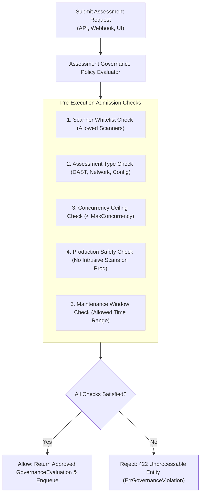

# Organization Assessment Governance Policies Architecture (P4-20)

## Executive Summary

Beyond individual scan configuration profiles (from Phase 2), enterprise organizations require organizational-level guardrails to control scanner selection, enforce concurrency ceilings, protect production targets from intrusive or destructive payloads, and restrict active assessments to pre-approved maintenance windows.

Issue **P4-20** implements the organization assessment governance subsystem, providing versioned policy definitions, platform boundary checks, pre-execution admission validation, and tamper-evident audit logging.

---

## 1. Admission Control & Governance Workflow



---

## 2. Governance Rules & Guardrails

### 2.1 Approved Scanner Whitelist
- An organization can define the set of permitted scanning tools (e.g. `["zap", "nuclei", "http", "tls"]`).
- Requests referencing unapproved scanners or experimental engines are rejected (`ErrDisallowedScanner`).

### 2.2 Concurrency Ceilings & Platform Boundaries
- Organizations configure `max_concurrency` (default 5) to throttle simultaneous resource consumption.
- **Platform Invariant**: Organization concurrency ceilings cannot exceed the platform hard limit of 20 (`ErrExceedsPlatformLimit`).

### 2.3 Production Environment Protection
- Active or intrusive exploits running against live production assets risk service degradation.
- When `prohibit_intrusive_on_prod = true` and `target_environment = "PRODUCTION"`, any intrusive scan request is automatically blocked (`ErrIntrusiveProdScan`).

### 2.4 Maintenance Window Enforcement
- Organizations can enforce dedicated maintenance windows (e.g. `00:00` to `06:00` UTC).
- Scan submissions scheduled or launched outside this window are rejected (`ErrOutsideMaintenanceWindow`).

### 2.5 Policy Versioning & Traceability
- Every policy modification increments the `version` counter.
- Evaluation decisions capture `policy_version`, ensuring immutable audit records and historical compliance verification.

---

## 3. Database Schema

Managed in `assessment_governance_policies`:

```sql
CREATE TABLE IF NOT EXISTS assessment_governance_policies (
  id                           UUID PRIMARY KEY DEFAULT gen_random_uuid(),
  organization_id              UUID NOT NULL REFERENCES organizations(id) ON DELETE CASCADE,
  allowed_scanners             JSONB NOT NULL DEFAULT '["zap", "nuclei", "http", "tls"]'::jsonb,
  allowed_assessment_types     JSONB NOT NULL DEFAULT '["DAST", "NETWORK", "CONFIG"]'::jsonb,
  max_concurrency              INTEGER NOT NULL DEFAULT 5,
  max_target_pacing_ms         INTEGER NOT NULL DEFAULT 1000,
  prohibit_intrusive_on_prod   BOOLEAN NOT NULL DEFAULT true,
  enforce_maintenance_windows  BOOLEAN NOT NULL DEFAULT false,
  maintenance_window_start     VARCHAR(5) NOT NULL DEFAULT '00:00',
  maintenance_window_end       VARCHAR(5) NOT NULL DEFAULT '06:00',
  version                      INTEGER NOT NULL DEFAULT 1,
  status                       VARCHAR(50) NOT NULL DEFAULT 'ACTIVE', -- ACTIVE, DISABLED
  created_at                   TIMESTAMPTZ NOT NULL DEFAULT clock_timestamp(),
  updated_at                   TIMESTAMPTZ NOT NULL DEFAULT clock_timestamp(),
  CONSTRAINT uq_assessment_gov_org UNIQUE (organization_id)
);

CREATE INDEX IF NOT EXISTS idx_assessment_gov_org
  ON assessment_governance_policies (organization_id);
```

---

## 4. Acceptance Criteria & Test Verification

| Acceptance Criterion | Verification Method | Status |
| :--- | :--- | :--- |
| Versioned policy configuration & platform limits | `TestAssessmentGovernance_ConfigurePolicy` | Verified |
| Scanner whitelist & approved assessment types | `TestAssessmentGovernance_EvaluateSubmission/reject_unauthorized_scanner` | Verified |
| Concurrency ceiling enforcement | `TestAssessmentGovernance_EvaluateSubmission/reject_when_concurrency_ceiling_is_reached` | Verified |
| Production target protection against intrusive scans | `TestAssessmentGovernance_EvaluateSubmission/reject_intrusive_scanning_on_production_targets` | Verified |
| Maintenance window restrictions | `TestAssessmentGovernance_EvaluateSubmission/reject_scan_scheduled_outside_maintenance_window` | Verified |
| Traceable policy version tracking | Evaluated result records `eval.PolicyVersion == policy.Version` | Verified |
