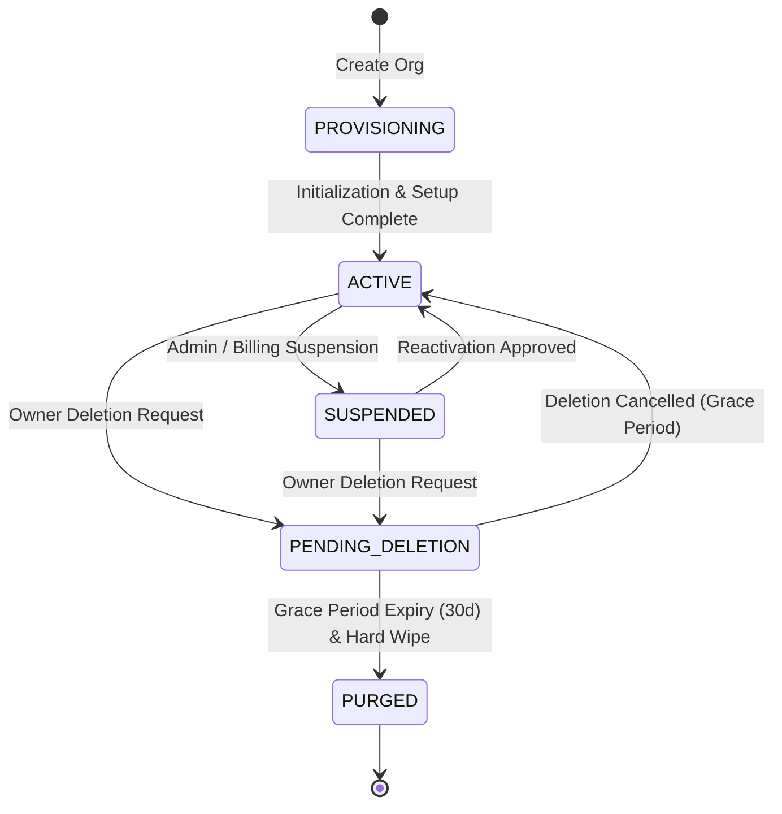
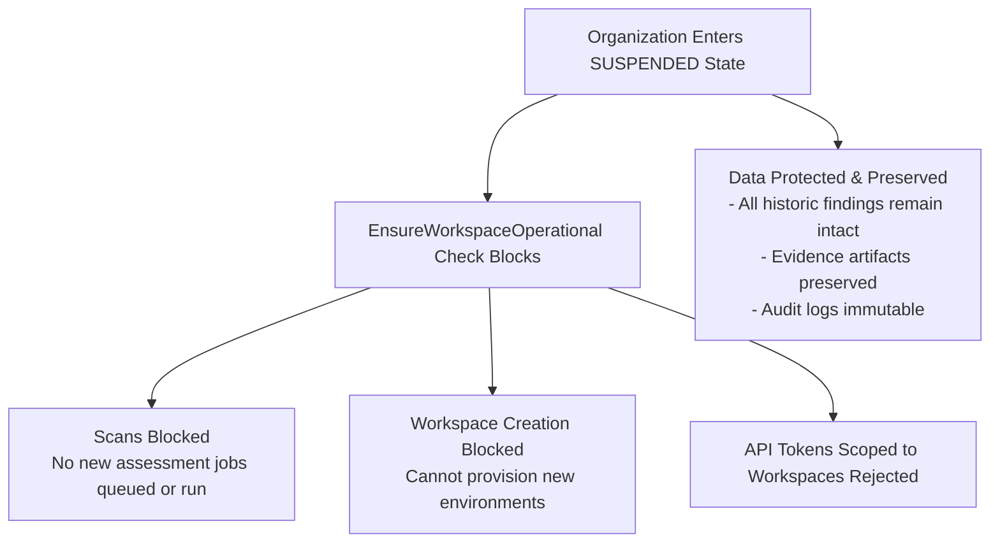

# Organization Lifecycle Management

**Milestone:** P4-02 (Issue #200)  
**Workstream:** Workstream A — Organization & Team Administration  
**Status:** Approved / Implemented  

---

## 1. Overview & Purpose

Enterprise Organizations in Kelvin represent the legal, billing, and root governance boundaries for multi-workspace security operations. This specification establishes the organization lifecycle state machine, authorized transition policies, the operational effects of organization suspension, deletion grace periods, and audit trail guarantees.

---

## 2. Organization Lifecycle State Machine

### State Definitions

| State | Description | Permitted Operational Actions |
| :--- | :--- | :--- |
| **`PROVISIONING`** | Organization record initialized; configuring default workspaces, teams, and billing. | Internal configuration only; cannot execute scans. |
| **`ACTIVE`** | Fully functional enterprise organization. | Full assessment execution, scan job orchestration, finding updates, report downloads, and member administration. |
| **`SUSPENDED`** | Administratively locked due to billing default, policy non-compliance, or security freeze. | Read-only historic access to findings and reports; **prohibits new assessments, queued scans, finding triage, or workspace creation**. |
| **`PENDING_DELETION`** | Deletion requested by Organization Owner; entering 30-day legal grace period. | Read-only access; can be restored to `ACTIVE` by Owner within grace window. |
| **`PURGED`** | Terminal hard wipe state following grace period expiration and cryptographic erasure. | None. Terminal tombstone state. |

---

## 3. Operational Impact of Suspension

When an Organization transitions to `SUSPENDED`:

1. **New Assessments Blocked**: Workers reject queued jobs for all workspaces under the suspended organization via `EnsureWorkspaceOperational`.
2. **Finding Triage Blocked**: Finding status transitions and risk score overrides are halted.
3. **Workspace Provisioning Halted**: Attempting to create new workspaces returns `ErrOrgSuspended`.
4. **Data Preservation Guarantee**: Suspension **never** deletes or modifies existing findings, observation history, evidence artifacts, or reports. Data remains read-only for compliance export.
5. **API & Service Tokens**: Tokens associated with the organization or its workspaces are temporarily disabled for mutation endpoints.

---

## 4. Deletion & Retention Grace Period

- **Owner-Only Privilege**: Only an authenticated user with `OrgRoleOwner` can initiate `RequestOrganizationDeletion`.
- **Grace Period (30 Days)**: Organizations enter `PENDING_DELETION` with a default 30-day grace window (`purge_after = now() + 30d`).
- **Restoration / Cancellation**: During the grace period, the Owner can call `CancelOrganizationDeletion` to restore the organization to `ACTIVE`.
- **Permanent Purge**: Once `purge_after` passes, automated lifecycle purgers cryptographically shred workspace evidence and delete database rows in accordance with ADR-0002.

---

## 5. Audit Logging Invariants

Every lifecycle transition records an immutable, structured event in the audit trail:

- `org.created`: Recorded when initial organization is provisioned.
- `org.suspended`: Recorded with suspension reason and actor user ID.
- `org.reactivated`: Recorded when restored to active status.
- `org.deletion_requested`: Recorded with scheduled purge timestamp.
- `org.deletion_cancelled`: Recorded when deletion is revoked.

---

## 6. Verification & Validation

The lifecycle state machine, authorization checks, and workspace operation locks are verified by comprehensive unit and integration tests in `apps/api/internal/hierarchy/lifecycle_test.go`.
