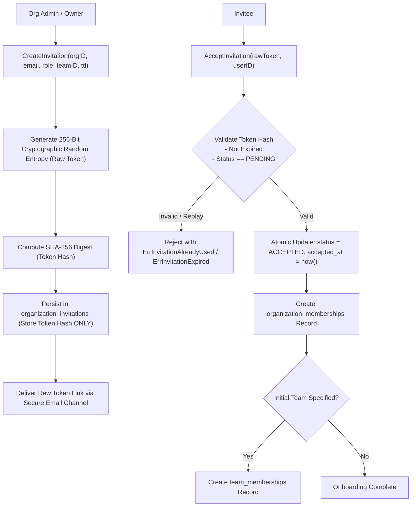

# Organization Membership and Invitation Management

**Milestone:** P4-04 (Issue #202)  
**Workstream:** Workstream A — Organization & Team Administration  
**Status:** Approved / Implemented  

---

## 1. Overview & Purpose

Inviting new users into an Enterprise Organization requires a cryptographically secure, tamper-resistant onboarding workflow. This specification establishes the organization invitation domain model, single-use token lifecycle, expiration and revocation controls, optional team assignment, and audit guarantees.

---

## 2. Invitation Architecture & Workflow

---

## 3. Cryptographic Token & Storage Security

1. **High-Entropy Token Generation**:
   - Invitation tokens are generated using `crypto/rand` reading 32 bytes (256 bits) of system CSPRNG entropy.
2. **Zero Plaintext Storage**:
   - The raw invitation token is **never** written to database storage or persistent audit logs.
   - Only the SHA-256 cryptographic digest (`token_hash`) is stored in the `organization_invitations` table.
   - Database read compromises cannot be weaponized to impersonate or accept pending invitations.
3. **Single-Use Enforcement**:
   - Once a token is accepted or revoked, its status immediately transitions away from `PENDING`.
   - Replay attempts are rejected with `ErrInvitationAlreadyUsed`.
4. **Time-To-Live (TTL)**:
   - Default expiration is 7 days (`ExpiresAt = now() + 7d`), configurable per invitation. Expired tokens are rejected with `ErrInvitationExpired`.

---

## 4. Reissuance and Revocation

- **Revocation**: Org Admins can revoke pending invitations via `RevokeInvitation`. The status transitions to `REVOKED`, invalidating the existing token.
- **Reissuance**: Org Admins can reissue invitations via `ReissueInvitation`. A fresh 256-bit token is generated, the expiration timer is reset, and the previous token hash is replaced.

---

## 5. Audit Logging Invariants

All invitation actions generate structured immutable audit events:

- `org.invitation_created`: Recorded when invitation is provisioned with expiration timestamp.
- `org.invitation_accepted`: Recorded when invitee redeems the invitation.
- `org.invitation_revoked`: Recorded when an invitation is cancelled.
- `org.invitation_reissued`: Recorded when a new token is generated.

---

## 6. Verification & Validation

The invitation lifecycle, token generation, replay prevention, and expiration enforcement are verified by comprehensive unit tests in `apps/api/internal/hierarchy/invitation_test.go`.
