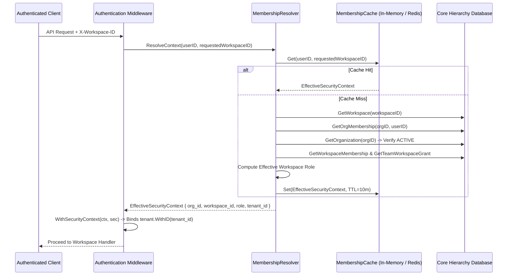

# Organization Membership and Ownership Resolution

**Milestone:** P4-05 (Issue #203)  
**Workstream:** Workstream A — Organization & Team Administration  
**Status:** Approved / Implemented  

---

## 1. Overview & Purpose

In an enterprise multi-tenant system, client-provided tenant headers or workspace IDs cannot be trusted blindly as authorization evidence. This specification defines the **Membership and Ownership Resolution Service**, responsible for evaluating an authenticated user's verified privileges, selecting their active workspace, resolving effective roles across direct memberships and team grants, binding the trusted database `tenant_id`, and managing caching and invalidation.

---

## 2. Sequence Diagram & Resolution Pipeline



---

## 3. Effective Security Context Structure

The resolution service produces an immutable, trusted `EffectiveSecurityContext`:

```go
type EffectiveSecurityContext struct {
    UserID         string        `json:"user_id"`
    OrganizationID uuid.UUID     `json:"organization_id"`
    OrgRole        OrgRole       `json:"org_role"`
    WorkspaceID    uuid.UUID     `json:"workspace_id"`
    WorkspaceRole  WorkspaceRole `json:"workspace_role"`
    TenantID       uuid.UUID     `json:"tenant_id"` // Cryptographically isolated database tenant ID
    TeamIDs        []uuid.UUID   `json:"team_ids"`
    ResolvedAt     time.Time     `json:"resolved_at"`
}
```

When attached via `WithSecurityContext(ctx, sec)`, the verified `TenantID` is automatically injected into `packages/common/tenant.WithID`, enforcing row-level security (RLS) across all subsequent database queries.

---

## 4. Multi-Tier Role Resolution Logic

A user's effective role within a requested workspace is determined by evaluating:

1. **Direct Workspace Membership**: If a `workspace_memberships` record exists for the user on the workspace, its role (`ADMIN`, `OPERATOR`, `VIEWER`) is recorded.
2. **Team Workspace Grants**: If the user belongs to one or more active teams that hold grants on the workspace, the highest role granted across all teams is considered.
3. **Role Combination**: The effective workspace role is computed as the maximum privilege across direct membership and team grants.
4. **Organization Administrator Override**: If the user is an `OWNER` or `ADMIN` of the parent organization, they are granted administrative access to manage workspace configurations.
5. **Default Deny**: If no membership, team grant, or administrative relationship exists, access is denied with `ErrNoWorkspaceAccess`.

---

## 5. Caching and Invalidation Strategy

1. **Cache Layer**:
   - Cache key format: `mem:{userID}:{workspaceID}`.
   - Cache TTL: 10 minutes default.
2. **Deterministic Invalidation**:
   - The cache is automatically invalidated whenever:
     - A user's organization role changes.
     - A user's workspace membership is added, updated, or deleted.
     - A team's workspace grant is modified.
     - The organization is suspended or marked pending deletion (`InvalidateUser`).

---

## 6. Verification & Validation

The resolution pipeline, cache behavior, team grant inheritance, and organization suspension rejection are verified by unit and integration tests in `apps/api/internal/hierarchy/resolver_test.go`.
