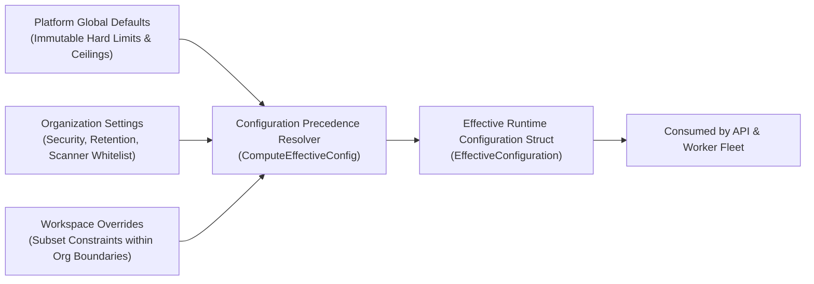

# Organization-Level Settings and Configuration

**Milestone:** P4-07 (Issue #205)  
**Workstream:** Workstream A — Organization & Team Administration  
**Status:** Approved / Implemented  

---

## 1. Overview & Purpose

Enterprise security governance requires central administrative management of baseline security policies, data retention constraints, approved scanner tools, and default workflow configurations. This specification defines the **Organization Settings Framework**, establishing category definitions, platform-enforced immutable guardrails, configuration precedence resolution, versioned audit history, and schema validation.

---

## 2. Configuration Precedence Architecture



### Precedence Hierarchy Rules

1. **Platform Global Defaults (Baseline)**: Defines immutable boundaries (e.g., maximum session duration of 24h, maximum evidence retention of 365d, minimum audit retention of 90d, whitelist of supported scanners).
2. **Organization Settings (Governing)**: Organizations may configure tighter policies (e.g. enforce MFA, restrict allowed scanners to a subset, shorten retention). They **cannot** weaken platform-enforced constraints.
3. **Workspace Overrides (Operational)**: Workspaces can only tighten constraints further (e.g., shorter session timeout, further restricted subset of scanners). A workspace cannot enable a scanner disallowed by its parent organization.

---

## 3. Configuration Categories

```json
{
  "security": {
    "require_mfa": true,
    "session_max_duration_seconds": 28800,
    "allowed_scanners": ["nuclei", "zap", "tls"],
    "ip_allowlist": ["192.168.1.0/24"]
  },
  "retention": {
    "evidence_retention_days": 90,
    "report_retention_days": 365,
    "audit_log_retention_days": 365
  },
  "workflow": {
    "default_scan_profile_id": "standard-full",
    "auto_approve_triage": false,
    "notification_email": "security@example.com"
  }
}
```

---

## 4. Platform-Enforced Immutable Limits

| Setting | Platform Minimum | Platform Maximum | Enforcement Action |
| :--- | :--- | :--- | :--- |
| **`session_max_duration_seconds`** | 300s (5 min) | 86,400s (24 hours) | Reject if outside bounds (`ErrPlatformLimitExceeded`) |
| **`evidence_retention_days`** | 1 day | 365 days (1 year) | Reject if exceeding ceiling (`ErrPlatformLimitExceeded`) |
| **`report_retention_days`** | 1 day | 730 days (2 years) | Reject if exceeding ceiling (`ErrPlatformLimitExceeded`) |
| **`audit_log_retention_days`** | 90 days (Compliance) | 2,555 days (7 years) | Reject if below minimum (`ErrPlatformLimitExceeded`) |
| **`allowed_scanners`** | Non-empty | `nuclei`, `zap`, `tls` | Reject unknown/unsupported scanners (`ErrUnsupportedScanner`) |

---

## 5. Versioning & Audit History

All organization setting updates:
1. Increment the monotonically increasing `version` number (`version = current.version + 1`).
2. Record an immutable snapshot in `organization_settings_history` tracking the actor and timestamp.
3. Emit a structured audit event `org.settings_updated`.

---

## 6. Verification & Validation

The configuration validation engine, platform ceiling enforcement, precedence resolver, and versioned history tracking are verified by unit tests in `apps/api/internal/hierarchy/settings_test.go`.
