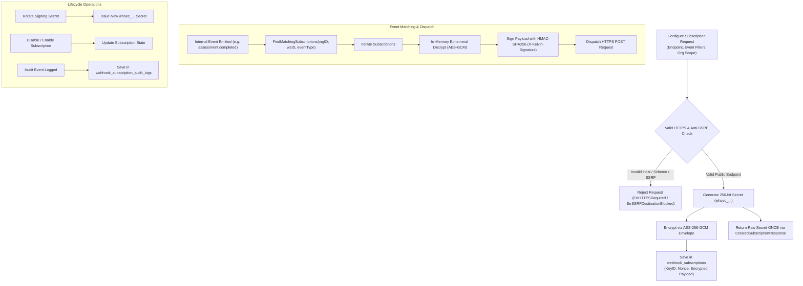

# Outbound Webhook Subscription Management Architecture

## 1. Overview
The Outbound Webhook Subscription Management subsystem enables organizations and workspaces to register external endpoints for automated Kelvin event notifications. It enforces an approved event catalog, validates endpoint destinations against SSRF and non-HTTPS schemes, encrypts shared signing secrets via AES-256-GCM envelope encryption, and manages subscription lifecycles.

## 2. Webhook Subscription Lifecycle & Event Filtering

## 3. Approved Event Catalog (v1)
- `assessment.completed` — Triggered when a vulnerability assessment concludes successfully or with warnings.
- `assessment.failed` — Triggered when a scanner invocation encounters an unrecoverable error.
- `finding.created` — Triggered when a novel finding is ingested.
- `finding.status_changed` — Triggered when a finding's triage, remediation, or suppression state changes.
- `risk_exception.approved` — Triggered when an accepted risk exception is signed off.
- `risk_exception.expired` — Triggered when a risk exception elapses.
- `remediation.state_changed` — Triggered when remediation ownership, due date, or task lifecycle transitions.
- `report.generated` — Triggered when an HTML/PDF report artifact finishes data assembly.
- `*` — Wildcard subscription for all approved organization events.

## 4. Key Architectural Guarantees
1. **Mandatory HTTPS and Anti-SSRF Protection**: Subscriptions require secure HTTPS schemes and prohibit RFC 1918 private IP subnets, loopback interfaces, and cloud metadata endpoints.
2. **AES-256-GCM Envelope Encryption**: Shared webhook signing secrets (`whsec_...`) are encrypted at rest with AES-GCM and unique nonces, decrypted strictly in-memory during signature creation.
3. **Strict Secret Redaction**: Secrets are never output in JSON APIs, log entries, or diagnostic traces.
4. **Subscription Filtering**: Webhook events are tenant-isolated; subscriptions receive events strictly matching their organization, workspace, and registered event types.
5. **Auditable Lifecycle**: Creation, secret rotation, disable/enable, and deletions generate tamper-evident audit records in `webhook_subscription_audit_logs`.
