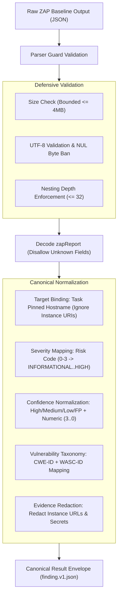

# OWASP ZAP Output Parser Architecture

This document defines Kelvin's architecture, security boundaries, and normalization rules for parsing OWASP ZAP Baseline JSON reports into Kelvin's canonical finding schema (`finding.v1.json`), fulfilling requirement **P2-39** (Issue #115).

---

## 1. Overview & Objective

OWASP ZAP generates comprehensive web application security assessment reports. In Kelvin's execution pipeline, the OWASP ZAP Baseline scanner executes inside a sandboxed, ephemeral OCI container and emits structured JSON reports.

Because ZAP reports are generated after scanning untrusted endpoints, their contents must be treated as untrusted:
- Alert instances may contain sensitive tokens, query parameters, or attacker-controlled reflected strings.
- Target asset identity must be bound strictly to the authorized Kelvin assessment task, rather than scanner-reported URIs.
- Risk codes, confidence indicators, CWE IDs, and WASC IDs must be normalized deterministically into Kelvin's taxonomy.

---

## 2. Parsing Architecture & Flow

---

## 3. Data Transformation & Taxonomy Mappings

### 3.1 Severity Mapping
ZAP risk codes map directly to Kelvin canonical severities:
| ZAP Risk Code | Label | Kelvin Canonical Severity |
|---|---|---|
| `3` | High | `HIGH` |
| `2` | Medium | `MEDIUM` |
| `1` | Low | `LOW` |
| `0` | Informational | `INFORMATIONAL` |

### 3.2 Confidence Mapping
ZAP supports both string confidence labels and legacy numeric codes:
| ZAP Confidence String | ZAP Numeric Code | Kelvin Confidence Float |
|---|---|---|
| `High` | `3` | `0.9` |
| `Medium` | `2` | `0.7` |
| `Low` | `1` | `0.5` |
| `False Positive` | `0` | `0.2` |
| Unspecified / Unknown | - | `0.5` (Default) |

### 3.3 Vulnerability Taxonomies
- **CWE**: Valid numeric strings (`1..999999`) are formatted as `CWE-{id}` (e.g., `CWE-79`).
- **WASC**: Valid numeric strings (`1..999999`) are formatted as `WASC-{id}` (e.g., `WASC-8`).

### 3.4 Target Identity & Scope Isolation
- `target.asset` is explicitly locked to the hostname derived from `task.Target`. Scanner-reported instance URIs (which may point to unintended subdomains or cross-origin redirections) are not trusted as the target identifier.
- Instance URIs and parameters are redacted from evidence payloads to prevent leaking session tokens or credentials into findings.
