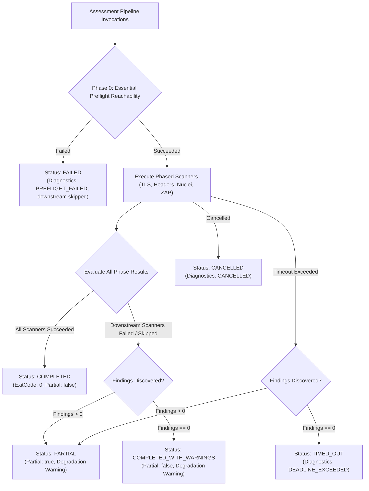

# Partial Assessment Completion Semantics

This document defines Kelvin's execution semantics and outcome classification when multi-scanner assessment pipelines experience partial failures, degradations, or timeouts, implementing requirement **P2-32** (Issue #108).

---

## 1. Overview & Objective

In security assessment workflows, scan profiles execute multiple distinct scanners across phased pipelines (e.g. baseline HTTP preflight reachability, TLS posture analysis, HTTP security header verification, Nuclei template checks, and ZAP baseline scans).

External network targets frequently exhibit transient disconnects, upstream rate limiting, application crashes, or scanner-specific timeouts. To avoid discarding critical vulnerability findings when an auxiliary scanner encounters a fault, Kelvin implements **resilient partial assessment completion semantics**:

1. **Preserve Valid Findings:** Discovered vulnerabilities from successfully completed scanner phases are preserved, canonicalized, and persisted.
2. **Explicit Outcome Disambiguation:** Assessments are never marked as fully successful if scanners failed or were skipped; outcome states clearly distinguish between full completion, partial completion, warnings, failure, cancellation, and timeouts.
3. **Prerequisite & Dependency Enforcement:** Essential baseline preflight checks act as pipeline gates. If reachability or scope verification fails upfront, dependent scans are safely aborted.
4. **Transparent Degradation Diagnostics:** Detailed diagnostic warnings catalog exactly which scanners ran, which failed, and which were skipped.

---

## 2. Assessment State Machine

---

## 3. Standardized Status Taxonomy

| Status | `partial` Flag | Minimum Findings | Required Diagnostics | Description |
|---|:---:|:---:|---|---|
| `COMPLETED` | `false` | 0 | None required | All configured scanners in the profile completed cleanly with exit code 0. |
| `COMPLETED_WITH_WARNINGS` | `false` | 0 | At least 1 `warning` | Some scanners failed or were skipped, but no vulnerability findings were discovered by successful scanners. |
| `PARTIAL` | `true` | &ge; 1 | At least 1 `warning` | One or more scanners failed or timed out, but preceding or concurrent scanners successfully captured findings that are preserved. |
| `FAILED` | `false` | 0 | At least 1 `error` | Essential prerequisite reachability (preflight) failed or unrecoverable infrastructure fault occurred. |
| `TIMED_OUT` | `false` | 0 | `DEADLINE_EXCEEDED` error | Assessment exceeded hard deadline without producing any findings. |
| `CANCELLED` | `false` | 0 | `CANCELLED` error | Assessment execution was aborted by operator or client request. |

---

## 4. Pipeline Execution Contract

### 4.1 Essential Preflight Gating

The pipeline profile identifies prerequisite phases (`RequirePrev: true`). The primary example is baseline HTTP preflight:
- If preflight reachability fails (e.g. host unreachable, DNS resolution failure, network down), the assessment cannot safely or meaningfully proceed.
- Downstream scanners are marked as `skipped because previous prerequisite phase failed`.
- The pipeline aborts immediately, emitting `Status: FAILED` with a `PREFLIGHT_FAILED` diagnostic.

### 4.2 Non-Fatal Auxiliary Degradations

Once baseline connectivity is confirmed:
- Failure in an auxiliary scanner (such as an aggressive DAST probe or heavy template suite) does not discard findings discovered by previous analyzers (such as missing security headers or TLS configuration flaws).
- The pipeline collects all valid envelopes, aggregating their normalized findings into the assessment report.
- The pipeline report populates:
  - `ScannersRun`: Slice of successfully completed scanner identifiers.
  - `ScannersFailed`: Slice of scanner IDs that errored or crashed.
  - `ScannersSkipped`: Slice of scanner IDs skipped due to downstream dependencies.
  - `DegradationWarning`: Human-readable summary of missing scanner coverage.

---

## 5. Verification & Testing

Partial assessment semantics are validated in `apps/worker/internal/daemon/orchestrator_test.go`:
- `TestExecutePipelinePartialCompletionPreservesSuccessfulFindings`: Verifies that when ZAP fails after preflight and TLS assessor succeed, findings are preserved, status is `PARTIAL`, `partial=true`, and degradation warnings catalog the failure.
- `TestExecutePipelineFailsWhenEssentialPreflightFails`: Verifies that preflight failures halt subsequent execution, skipping downstream phases and setting `FAILED` status with explicit error diagnostics.
- `TestOrchestratorPipelineHaltsOnPrerequisiteFailure`: Verifies that pipeline worker queue completion records the structured pipeline report without crashing the worker process.
