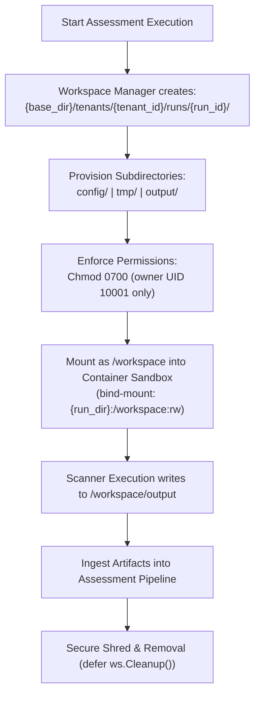

# Per-Assessment Workspace Management (P2-22)

## 1. Executive Summary & Purpose

The Kelvin Assessment Worker enforces rigorous execution and tenant isolation under ADR-0005. To prevent cross-tenant data contamination, path traversal vulnerabilities, and uncontrolled temporary file accumulation, every assessment execution is allocated an ephemeral, isolated workspace.

This specification documents the implementation of the Per-Assessment Workspace Management system delivered under **P2-22** in `apps/worker/internal/workspace`.

---

## 2. Workspace Architecture & Directory Layout



### Directory Structure
```
/tmp/kelvin/workspaces/
  └── tenants/
      └── {tenant_uuid}/
          └── runs/
              └── {run_uuid}/
                  ├── config/   # Scanner configurations (chmod 0600)
                  ├── tmp/      # Ephemeral scratch space for tools
                  └── output/   # Raw findings and reports (chmod 0600)
```

---

## 3. Path Traversal Prevention

All file paths accessed or created within a workspace are validated through `ResolveSafePath(subDir, relativePath)`. The path resolution engine enforces strict fail-closed constraints:

1. **Control Characters Denied:** Paths containing null bytes (`\x00`), carriage returns (`\r`), or newlines (`\n`) are rejected immediately.
2. **Absolute Paths Rejected:** Absolute paths (e.g. `/etc/passwd`, `C:\Windows`) supplied as relative inputs are rejected.
3. **Drive & Root Escapes Blocked:** Paths beginning with `/`, `\`, or containing drive volume separators (`:`) are prohibited.
4. **Boundary Verification:** After canonical cleaning with `filepath.Clean`, the resulting target path must have the workspace directory as its strict prefix.

---

## 4. Container Sandbox Integration (ADR-0005)

For containerized scanners (`zap`, `nuclei`):
- The host workspace directory is bind-mounted into the rootless OCI container at `/workspace:rw`.
- The container working directory is set to `/workspace` (`--workdir /workspace`).
- The unprivileged container user (`UID 10001:10001`) has full read-write access to its own mounted workspace without granting access to the host or other tenant directories.
- The environment variable `KELVIN_WORKSPACE=/workspace` is injected into the container environment.

---

## 5. Lifecycle Management & Cleanup Guarantees

```
+---------------------------------------------------------------------------------+
|                              Cleanup Lifecycle                                  |
+----------------------+----------------------------------------------------------+
| Execution State      | Cleanup Action                                           |
+----------------------+----------------------------------------------------------+
| Success              | Deferred ws.Cleanup() shreds & deletes root directory    |
| Scanner Failure      | Deferred ws.Cleanup() shreds & deletes root directory    |
| Context Cancellation | Deferred ws.Cleanup() executes during stack unwinding    |
| Hard SIGKILL / Crash | Handled asynchronously by Manager.ReapStale(maxAge)      |
+----------------------+----------------------------------------------------------+
```

1. **Idempotent Removal:** `ws.Cleanup()` can be safely called multiple times without error. Once cleaned, any subsequent file operations return `ErrWorkspaceCleaned`.
2. **Automated Deferral:** In `Orchestrator.ExecuteScanner`, workspace creation is immediately followed by a deferred cleanup call, ensuring no orphaned directories remain upon function exit.
3. **Stale Workspace Reaper (`ReapStale`)**:
   - The workspace manager sweeps the tenant runs directory periodically.
   - Any run directory whose modification time is older than the configured TTL (e.g., 1 hour or hard deadline) is recursively deleted.
   - Empty tenant directories are automatically reclaimed.

---

## 6. Security & Invariant Mapping

- **Tenant Boundary Enforcement:** Workspaces are partitioned by validated `tenant_id` UUIDs. Cross-tenant access is structurally prevented.
- **Execution Isolation (ADR-0005):** External scanners access only their dedicated `/workspace` mount; root filesystems remain read-only (`--read-only`).
- **Data Integrity:** Outputs harvested from `/workspace/output` are validated against Kelvin's Canonical Finding Schema (`finding.v1.json`, ADR-0002).
