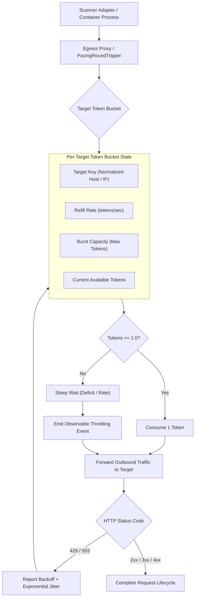

# Architecture Guide: Per-Target Request Pacing (P2-29)

## 1. Overview & Purpose

The Kelvin platform enforces strict **Per-Target Request Pacing** to govern the velocity at which automated scanners and assessment adapters dispatch HTTP, HTTPS, and TLS requests to target infrastructure.

Unregulated scanner bursts risk degrading target services, triggering upstream web application firewalls (WAF), inducing denial-of-service conditions, or causing severe IP reputational blocks. Request pacing ensures that scan activity remains controlled, predictable, and compliant with target authorizations while preserving assessment completeness.

---

## 2. Pacing Architecture & Token Bucket Mechanism

Request pacing is implemented via a thread-safe **Token Bucket Rate Limiter** residing within the worker boundary (`apps/worker/internal/pacing`):



### Key Components

1. **`TokenBucketPacer`**:
   - Manages independent token buckets partitioned by normalized target host (`example.com` or `192.168.1.1`).
   - Thread-safe synchronization ensures concurrent scanner workers hitting the same target coordinate under a shared target rate budget.
2. **`PacingRoundTripper`**:
   - Decorates Go `http.RoundTripper` instances for built-in scanner adapters (`http_preflight`, `http_security_headers`, `tls_assessor`).
   - Automatically intercepts requests and consumes target tokens prior to socket transmission.
3. **`Egress Proxy Integration`**:
   - The sandboxed anti-SSRF local egress proxy (`apps/worker/internal/egress/proxy.go`) intercepts all external containerized traffic (OWASP ZAP, ProjectDiscovery Nuclei).
   - Before relaying `CONNECT` tunnels or forwarding HTTP requests, the proxy enforces token acquisition via `pacer.Acquire(ctx, host)`.
4. **Adaptive Backoff & Jitter**:
   - When an upstream server responds with `HTTP 429 Too Many Requests` or `HTTP 503 Service Unavailable`, `Pacer.ReportBackoff` is invoked.
   - Parses standard `Retry-After` headers (in delta-seconds or HTTP-date) and applies randomized jitter to prevent thundering herd behavior.

---

## 3. Rate Limits, Ceilings & Scanner Defaults

| Scanner ID | Default Rate (req/s) | Default Burst | Scanner Ceiling (req/s) | Enforcement Layer |
| :--- | :--- | :--- | :--- | :--- |
| `http_preflight` | 2 | 2 | 2 | Built-in RoundTripper |
| `tls_assessor` | 2 | 2 | 2 | Built-in Dial Context |
| `http_security_headers` | 2 | 2 | 2 | Built-in RoundTripper |
| `zap` (OWASP ZAP Baseline) | 1 | 1 | 1 | Egress Proxy Tunnel |
| `nuclei` (ProjectDiscovery) | 2 | 2 | 5 | Egress Proxy Tunnel |
| **Platform Absolute Ceiling** | — | — | **5 req/s** | `pacing.EffectiveRate` |

### Platform Ceilings & User Override Prevention

Kelvin enforces a strict platform ceiling (`PlatformMaxRateCeiling = 5 req/s` for MVP). 

User configurations and scan profiles can narrow the rate (e.g., reduce Nuclei from 2 req/s to 1 req/s), but **cannot raise rates above the platform or scanner ceilings**:
```go
effectiveRate = min(PlatformCeiling, ScannerCeiling, ProfileCeiling, UserRequestedRate)
```
Any scanner configuration that requests rates exceeding the ceiling is rejected during configuration validation.

---

## 4. Handling Redirects & Discovered URLs

1. **Per-Host Normalization**: Targets are normalized to their canonical hostname or IP address (e.g., stripping URL schemes, credentials, ports, and paths).
2. **Redirect Accounting**:
   - When following HTTP 301/302 redirects, each hop initiates a new outbound request.
   - If the redirect target resides on the same host, it immediately consumes a token from that host's bucket.
   - If the redirect target resides on a different permitted in-scope host, it consumes a token from the new target's bucket.
3. **Discovered Crawl URLs**:
   - Scanners discovering nested URLs (e.g., `/api/v1/auth`, `/docs`) dispatch requests through the egress proxy or round-tripper, seamlessly debiting the per-target token budget.

---

## 5. Request Pacing vs. Worker Concurrency

| Dimension | Request Pacing (`apps/worker/internal/pacing`) | Worker Concurrency (`apps/worker/internal/concurrency`) |
| :--- | :--- | :--- |
| **Scope** | Network layer per target destination host / IP | Process/worker slot allocation across tenants & nodes |
| **Unit** | Outbound HTTP requests / sec (req/s) | Active running jobs / scanner executions |
| **Mechanism** | In-memory token bucket + egress proxy interception | Distributed Redis Lua locks / local semaphore leases |
| **Failure Mode** | Micro-sleep wait / throttling delay | Queue re-enqueue / Job rejection |

---

## 6. Observability & Throttling Diagnostics

Whenever a request encounters an exhausted token bucket or active backoff, a `PacingEvent` is generated:
```go
type PacingEvent struct {
    Target       string        `json:"target"`
    Scanner      string        `json:"scanner"`
    Rate         int           `json:"rate"`
    WaitDuration time.Duration `json:"wait_duration"`
    Throttled    bool          `json:"throttled"`
    Timestamp    time.Time     `json:"timestamp"`
}
```
Diagnostic listeners log throttling events (`scanner request throttled by per-target pacing`) to provide operators with full visibility into scan pacing efficiency and target responsiveness.

---

## 7. Assessment Duration Estimation

Request pacing directly governs the lower bound of assessment execution duration:
$$\text{Duration}_{\text{min}} = \frac{\text{Total Requests}}{\text{Effective Rate}} + \text{Network RTT Latency}$$

For example, a Nuclei scan executing 200 checks against a target paced at 2 req/s will require:
$$\text{Duration} \ge \frac{200}{2} = 100 \text{ seconds}$$

Platform execution deadlines (`EffectiveDeadline`) must account for request pacing when establishing hard timeouts to prevent premature job cancellation on large test catalogs.
