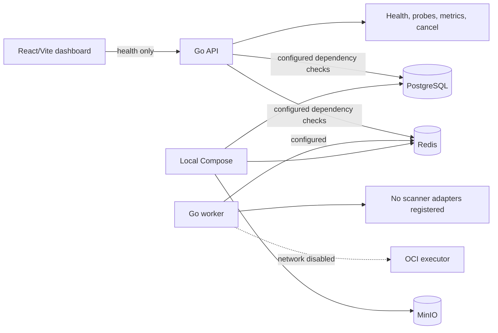

# Phase 1 Readiness and Architecture Audit

**Review date:** 2026-10-31
**Status:** Draft for Platform Engineering and Product Security review
**Readiness:** **Ready to begin Phase 2 implementation; not production-operational**
**Scope:** Repository state after the Phase 1 readiness remediation in this checkout.

## Executive summary

This pass repaired worker Go syntax/build blockers, aligned OpenAPI with the API routes that are actually registered, added API startup checks for configured database and Redis dependencies, and installed JWT bearer and role checks on the cancellation route. OpenAPI lint is now part of CI. Local Go tests and vet, frontend lint/tests, and schema validation pass.

KELVIN is not yet an operational assessment platform. Assessment create/list/read handlers, tenant-scoped persistence, an API queue producer, scanner adapters, and a complete controlled-egress path remain unimplemented. Cancellation returns unavailable until its store is wired. The worker fails closed when Redis is enabled without adapters and sets job networking disabled. Application services are not included in the local Compose topology. Live PostgreSQL RLS tests and container drills were not run.

**Decision:** The codebase is ready to start Phase 2 implementation. It is not ready for production deployment or a claim that assessment scanning works end to end. ADRs record design decisions and do not prove runtime implementation.

## Inventory and audit scope

The review covered `apps/`, `packages/`, `scripts/`, `deploy/`, Compose and root configuration, `.github/`, SQL migrations, OpenAPI/JSON schemas, tests, architecture docs, and ADRs. It compared route declarations to handlers, startup wiring to dependency packages, RLS policies to integration tests, CI commands to documented gates, and diagrams to local runtime topology.

| Area | Observed state |
| :--- | :--- |
| `apps/api/` | Go HTTP service, auth/config/database packages, migrations, tests and OpenAPI. Health/probes/metrics and cancellation are registered; assessment CRUD is not. Startup checks configured DB and Redis; JWT/role protection applies to cancellation when configured. No assessment repository or queue producer is wired. |
| `apps/worker/` | Go runner, Redis consumer, adapter registry, sandbox/OCI abstractions, egress and limits. Sources now compile and tests pass. There are no concrete scanner adapters; configured processing fails fast on an empty registry. Job network access is disabled. |
| `apps/web/` | React/Vite dashboard and API helper; current client calls health only. |
| `packages/common/` | Shared Go/TypeScript helpers and Redis Streams queue primitive, with tests. Queue producer is not connected to API assessment flow. |
| `packages/schemas/` | Finding, envelope/error, and job JSON schemas; fixture/fingerprint validation passes. Does not define all persisted entities or assessment REST operations. |
| `scripts/` | Backup/restore, development reset, schema validation and planning scripts. Only schema validation was exercised here. |
| `deploy/` and Compose | PostgreSQL, migration, Redis, MinIO and mock-target dependencies. Compose does not start API, web, or worker services. |
| `.github/` | CI/security workflows and repo templates. OpenAPI lint is configured in CI; hosted branch protection and check results are outside this checkout. |
| `docs/` | Broad target architecture and operational documentation. System architecture and execution isolation docs now label target/partial status; not every documented capability exists in runtime. |

## Current runtime and contract

The registered API route set includes `GET /api/v1/health`, liveness/readiness probes, metrics, and `POST /api/v1/assessments/{id}/cancel`. OpenAPI describes the current health and cancel operations; assessment CRUD is intentionally absent from the active contract until implemented. Cancellation is protected by JWT bearer authentication and role checks when a secret is configured, and fails closed if protected-route middleware is missing. Its store is not wired, so it cannot yet complete a cancellation.

## Reconciliation

| Dimension | Verified state | Classification |
| :--- | :--- | :--- |
| API contract vs registered routes | Active OpenAPI paths match supported health/cancel operations. Assessment CRUD is planned, not falsely declared implemented. CI runs Redocly lint; local YAML parsing passed, but CLI lint was not run here. | Aligned for current route set; feature contract incomplete |
| Authentication/authorization | API startup configures JWT verification when a secret is provided; staging/production require a strong JWT secret. Cancellation has bearer and role checks. There are no CRUD routes to protect yet. | Partial, route-scoped |
| Database and RLS | Migrations define tenant tables and forced RLS policies. Integration tests cover cross-tenant access but were not verified against a live PostgreSQL instance in this run. API can connect/ping a configured DB but has no assessment repository. | Schema implemented; runtime domain persistence incomplete |
| Audit and idempotency | Packages exist; startup does not wire an assessment audit or idempotency lifecycle. No create operation exists. | Planned for lifecycle implementation |
| Queue and worker | Shared Redis Streams primitive and worker consumer exist. No API producer-to-assessment path or scanner adapter is present. Worker refuses configured processing with an empty registry. | Partial; end-to-end flow absent |
| Sandbox and egress | OCI executor is configured by worker when processing is enabled; job networking is disabled. No adapter/runtime drill or controlled proxy egress path is implemented. | Containment baseline; scanner execution deferred |
| Backup/restore | Operational scripts and design docs exist; no restore/integrity drill was run in this audit. | Unverified operational capability |
| Security scanning | Gitleaks, Go security, Semgrep, npm audit, and Trivy are defined in security workflows. Hosted results and branch protection cannot be asserted from local source. | Configured; hosted enforcement pending |
| Frontend/schema quality | Lint, web tests (1 file, 2 tests), and schema fixture/fingerprint checks passed. | Verified for exercised scope |
| Architecture decisions | ADR-0001–0005 remain technology/design decisions. ADR-0006 proposes maintaining a reviewed distinction between target and verified runtime. | Design records; not runtime evidence |

## Validation performed

| Check | Result |
| :--- | :--- |
| Go formatting/parser check | Passed after worker source repairs. |
| `go test ./...` in API, worker, common, schemas, and integration modules | Passed using a workspace-local Go cache. Live DB-dependent coverage was not established. |
| `go vet ./...` in API, worker, common, and schemas | Passed. |
| `npm run lint` | Passed. |
| `npm run test:web` | Passed: 1 test file, 2 tests. |
| `npm test --prefix scripts/schema-validation` | Passed. |
| OpenAPI YAML parse | Passed. Redocly lint is configured in CI but was not run locally. |
| Live PostgreSQL RLS, backup restore, OCI runtime, and hosted CI | Not run/verified. |

This report is a repository audit, not a penetration test, live deployment review, or organizational approval. All results are limited to the checks listed above.

## Phase 2 entry work

1. Implement tenant-scoped assessment create/list/read/cancel repositories and handlers, then wire authentication, authorization, request validation, audit, idempotency, and the Redis producer.
2. Add scanner adapters and result persistence; implement controlled egress before enabling job networking.
3. Run PostgreSQL migrations and cross-tenant RLS tests with the intended least-privilege application role.
4. Execute backup restore/integrity drills and OCI isolation tests in an isolated environment.
5. Add application services to repeatable local/deployment topology and exercise a complete API-to-worker-to-persisted-result flow.
6. Run hosted security/contract checks, triage findings, and configure required branch protection.
7. Obtain Platform Engineering and Product Security review before production authorization.

## Review sign-off

| Role | Reviewer | Status | Date |
| :--- | :--- | :--- | :--- |
| Platform Engineering | TBD | Pending | — |
| Product Security | TBD | Pending | — |
| Phase 2 implementation readiness | TBD | Ready to begin; not production authorized | — |
