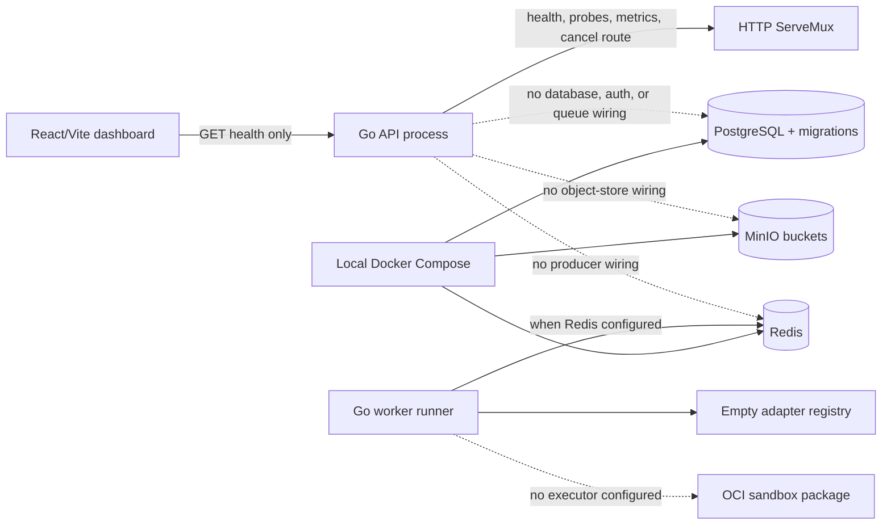

# Phase 1 Architecture and Documentation Audit

**Review date:** 2026-10-31  
**Status:** Draft for Platform Engineering and Product Security review  
**Readiness:** **Not ready to authorize Phase 2**  
**Scope:** Repository state at the review date; implementation claims are based on source, manifests, migrations, tests, and workflows in this checkout.

## Executive summary

Kelvin has a substantial set of Phase 1 design documents, data schemas, SQL migrations,
security-oriented packages, and unit-test harnesses. Some foundational mechanisms are
implemented in isolation: PostgreSQL migrations define tenant tables and RLS policies,
the API has authentication and authorization packages, the common queue package has a
Redis Streams adapter, and the worker has sandbox and egress abstractions.

The repository does **not** currently demonstrate the architecture described by its
accepted ADRs and system diagrams as an end-to-end running product. The OpenAPI assessment
operations are absent from the API router; the API entry point does not connect the
database, queue, authentication middleware, or stores; the worker starts with an empty
adapter registry and no configured executor; and the local Compose file does not start
the API, web app, or worker. In addition, Go parser checks identify syntax errors in four
worker files, which block compilation of worker packages and tests.

**Decision:** Treat the current repository as a foundation and scaffolding baseline.
Proceeding to Phase 2 should wait until the compile blockers are fixed, the real API and
worker paths are connected to persistence and queueing, security controls are mounted on
those paths, and a reproducible integration test validates the resulting flow. Existing
ADRs remain accepted technology/design decisions, but their prose must not be read as
evidence that every described control or service is deployed.

## Audit method and limits

The audit inventoried application, package, script, configuration, test, schema, SQL,
workflow, ADR, and architecture-document files. It compared route declarations and
handlers, app startup wiring, migration tables and RLS declarations, package schemas and
validators, test harnesses, CI commands, Compose services, and architecture diagrams.

Validation executed during this review:

| Check | Result |
| :--- | :--- |
| `npm run lint` | Passed. |
| `npm run test:web` | Passed: 1 test file, 2 tests. |
| `npm test --prefix scripts/schema-validation` | Passed: positive/negative fixtures and fingerprint vectors. |
| `gofmt -d` parser check across Go sources | Failed: syntax errors reported in `apps/worker/internal/daemon/daemon.go`, `apps/worker/internal/daemon/daemon_test.go`, `apps/worker/internal/sandbox/executor.go`, and `apps/worker/internal/sandbox/oci.go`. |
| `go test ./...` across Go modules | Could not complete: Go build cache access was denied under the execution user's default cache path. The parser errors independently establish worker compile blockers. |
| Docker/runtime integration | Not run in this audit. |

This is a repository review, not a penetration test, PostgreSQL-backed RLS test, deployed
environment review, or approval by the named code owners. Findings describe observable
repository state and should be rechecked after remediation.

## Repository inventory

| Area | Inventory | Observed state |
| :--- | :--- | :--- |
| `apps/api/` | Go API entry point, configuration, auth, HTTP middleware, database/migration helpers, security helpers, OpenAPI, migrations, seed data, unit/security tests. | Core packages exist, but startup mounts only a small route set and does not wire the principal service dependencies. |
| `apps/worker/` | Go runner, config, daemon, Redis queue adapter, adapter registry, sandbox/OCI code, egress, limits, metrics, reaper, tests. | Foundations exist; worker sources currently contain syntax errors, registry is empty at startup, and executor is not configured by the runner. |
| `apps/web/` | React/TypeScript/Vite dashboard, API helper, health hook, pages, UI state, smoke test. | Small dashboard foundation; API client currently calls health only. |
| `packages/common/` | Go logging, errors, tenant context, validation, scope, and queue packages; shared TypeScript API/error/severity/redaction helpers. | Reusable libraries with unit tests; Redis queue implementation exists here. |
| `packages/schemas/` | Finding, API envelope/error, and job-message JSON Schemas; embedded Go accessors; positive/negative fixtures and fingerprint vectors. | AJV fixture validation is active and passed in this audit. These schemas do not define every persisted entity or every REST resource. |
| `scripts/` | Database backup/restore scripts, dev reset scripts, schema fixture validator, Phase 2 issue generator. | Operational scripts exist; only schema validation was run in this audit. |
| `deploy/`, Compose, root configuration | PostgreSQL pgBackRest image/config; Compose definitions for PostgreSQL, migrations, Redis, MinIO, mock target; npm and Go workspace manifests; ESLint, Gitleaks. | Local dependencies are described. Compose does not define API, web, or worker services. |
| `.github/` | CI/security workflows, CODEOWNERS, issue and PR templates, milestones and planning issues. | CI definitions exist, but hosted branch protection remains an administrator setting. No CI OpenAPI lint/oasdiff step was found despite the API standards document promising it. |
| `docs/` | Product, API, security, database, development, deployment, data model, system architecture, job, scan-profile, isolation, observability, and ADR documents. | Broad target-state documentation; several documents describe capabilities that are not wired in the current runtime. |

## As-built runtime model

The following diagram records the observable wiring, not the target architecture in the
system-design documents:

The API exposes `GET /api/v1/health`, `GET /health/live`, `GET /health/ready`,
`GET /metrics`, and `POST /api/v1/assessments/{id}/cancel`. OpenAPI instead declares
`GET /health`, `GET/POST /assessments`, and `GET /assessments/{id}`; the three assessment
read/create operations are not registered, and the cancel operation is not in OpenAPI.
The web API helper calls only `/health`.

## Reconciliation findings

### API contract and code

| Claim or artifact | Verification | Classification |
| :--- | :--- | :--- |
| OpenAPI is the source of truth for implemented API behavior. | OpenAPI declares health plus assessment list/create/read operations. `httpapi.Server.routes` registers health/probes/metrics and cancel; it does not register the assessment operations and does not document cancel. | **Mismatch / blocker** |
| AuthN/AuthZ protects API operations. | Auth packages and a security harness exist. `Server.Handler` composes body-limit, recover, access-log, and correlation middleware only; it does not mount auth middleware, role checks, or tenant guards. `main` constructs the server without stores. | **Implemented in isolation; not wired / critical** |
| Idempotency protects state-changing API calls. | Middleware and stores exist, but the server only wraps cancel if a store is set; API startup never sets it. The middleware comment says requests without an Idempotency-Key are a no-op, while OpenAPI requires the key for create. | **Partial / not active in startup** |
| API validates against schemas and OpenAPI. | `packages/schemas` validates finding and envelope fixtures. This does not validate live API request/response handlers against the OpenAPI document. CI has no Redocly or oasdiff command, despite `docs/api/API_STANDARDS.md` listing them. | **Partial / drift risk** |

### Data model and persistence

| Claim or artifact | Verification | Classification |
| :--- | :--- | :--- |
| PostgreSQL stores the assessment and findings domain. | Migrations define 13 core tables (`tenants`, `users`, `auth_sessions`, `projects`, `scan_profiles`, `assets`, `assessments`, `jobs`, `findings`, `finding_events`, `evidence`, `reports`, `audit_log`) and lifecycle/tenant-boundary changes. | **Schema implemented** |
| RLS enforces tenant isolation. | SQL enables and forces RLS with tenant policies across the tenant-owned tables, including the tenant root in migration 000003. Go helpers set tenant context. `tests/integration/tenant_isolation_test.go` exercises live cross-tenant reads, writes, and ownership links after migrations. API startup still has no DB pool wiring, and the database integration tests were not executed in this audit environment. | **Schema and integration test implemented; API runtime enforcement not wired** |
| Audit log is append-only. | Migration grants/revokes and dedicated role/policy definitions are present. An API audit service exists, but it is not wired into API startup/routes. | **Partial** |
| Evidence and reports use object storage. | Compose provisions MinIO and buckets; evidence lifecycle abstractions exist, but no object-store client or startup wiring is present in the API path inspected. | **Dependency scaffolded; feature not wired** |
| JSON Schemas represent the whole database/API model. | Shared JSON Schemas cover finding, API envelope/error, and job message. Persisted entities are defined in SQL; REST assessments are defined in OpenAPI; no generated mapping or comprehensive contract parity check was found. | **Separate artifacts; parity not proven** |

### Queue, worker, and execution isolation

| Claim or artifact | Verification | Classification |
| :--- | :--- | :--- |
| API enqueues assessments and workers execute them. | Shared Redis Streams queue and worker-side Redis adapter exist. The API entry point never creates a Redis client/producer or assessment handler; the worker has no registered adapters at startup. | **Queue primitive implemented; end-to-end path absent** |
| Worker runs scanner adapters in a sandbox. | Adapter registry is empty in `cmd/runner`; `sandbox.Executor` is nil in daemon configuration; no scanner image build definitions are present. OCI executor and fake executor packages exist but are not wired. | **Partial / cannot execute a scan** |
| Worker egress is allow-listed and SSRF-safe. | Scope resolution/pinning and egress filter code exist in libraries. The OCI spec produced by the daemon does not attach an egress proxy/filter, and no concrete scanner adapter uses the HTTP client. Arbitrary scanner container traffic is therefore not demonstrated as constrained by this code. | **Library implemented; runtime enforcement unverified** |
| Worker is rootless, bounded, and process-isolated. | Spec validation/OCI arg construction and limit abstractions exist, but worker package syntax errors block compilation, the executor is not wired, and no runtime/container drill was run. | **Design/code partial; not verified at runtime** |

### Security and test coverage

| Control | Evidence | Classification |
| :--- | :--- | :--- |
| Authentication and RBAC | JWT/password/rate-limit code and auth/RBAC/IDOR test harness exist. The harness uses its own `httptest` mux with production middleware and stub handlers; it does not exercise the API server's registered routes. | **Unit-level mechanisms tested; production route integration absent** |
| Tenant isolation | SQL policies and tenant-context helpers exist; worker/API tests cover tenant context behavior. No live database test confirms policies, role grants, FORCE RLS, and application connection role together. | **Partial** |
| Secret/dependency/SAST checks | Security workflow defines Gitleaks, Go checks, Semgrep, npm audit, and Trivy; pre-commit hook is configured. These checks were not run remotely as part of this repository audit. | **Configured; hosted results pending** |
| Go build and test baseline | `gofmt -d` reports parse errors in daemon.go, daemon_test.go, executor.go, and oci.go. `go test` could not complete in this environment because the Go build cache path was access-denied. | **Failing/blocked; release gate** |
| Frontend and schema test baseline | ESLint, Vitest smoke tests, and AJV fixture/fingerprint validation passed locally. | **Verified for the exercised scope only** |

### Diagrams and ADRs

`docs/architecture/SYSTEM_ARCHITECTURE.md` describes a separated gateway, auth/scope/job
services, API producer, durable broker, scanner fleet, findings service, PostgreSQL, and
object store. The local runtime has one Go API entry point, one Go worker process, and
dependency containers; application processes are not in the Compose graph. Treat the
existing diagrams as **target architecture**, not as-built topology, until wiring exists.

| ADR | Accepted decision | Current implementation evidence | Audit status |
| :--- | :--- | :--- | :--- |
| ADR-0001 | Go backend/runtime | API and worker are Go modules; both entry points exist. | **Substantially aligned at language/runtime level.** |
| ADR-0002 | PostgreSQL and migrations | PostgreSQL Compose service and migrations exist; API startup does not connect to DB. | **Technology/schema aligned; service integration incomplete.** |
| ADR-0003 | Redis job broker | Redis Compose service, common Streams implementation, worker consumer exist; no API producer wiring. | **Primitive aligned; lifecycle incomplete.** |
| ADR-0004 | React/TypeScript/Tailwind SPA and design system | React/Vite/Tailwind dashboard exists. No `@kelvin/ui` package, Radix/shadcn foundation, role-based view system, or WebSocket path was found. | **Partial; ADR overstates present feature maturity.** |
| ADR-0005 | Rootless hardened scanner containers | Spec/OCI abstractions exist, but there are no concrete adapters/images, runner wiring, egress integration, or runtime proof; worker source does not parse. | **Decision remains target; implementation incomplete.** |

The ADRs themselves are marked Accepted and describe decisions; this audit does not change
their historical status. A proposed ADR-0006 records the governance rule needed to keep
target and as-built claims distinct while remediation is underway.

## Readiness matrix

| Acceptance dimension | Result | Evidence / remaining work |
| :--- | :--- | :--- |
| Repository inventory documented | **Met for this audit scope** | Inventory above covers all requested application, package, script, schema, migration, docs, and configuration areas. |
| Implemented, partial, and planned components separated | **Met in this report** | Reconciliation tables identify current status and gaps. |
| Diagrams match runtime implementation | **Not met in existing architecture docs** | Existing topology is target-state. This report supplies an as-built diagram; update the canonical architecture doc after decisions are reviewed. |
| API spec, schemas, migrations reconciled | **Not met** | OpenAPI route mismatch; SQL model, schemas, and runtime handlers are not generated/contract-checked together. |
| Security claims backed by enforcement/tests | **Not met** | Auth/RBAC middleware is not mounted in the API server; RLS not wired to a runtime connection; worker sandbox/egress are not active. |
| Go build/test health | **Not met** | Parser errors found; tests blocked by environment cache access. Fix parse errors and rerun all module suites in CI. |
| Readiness report approved and committed | **Pending** | This report is a draft for required Platform Engineering and Product Security review. It is intentionally uncommitted. |
| Phase 2 kickoff authorization | **No** | Do not authorize until critical remediation and review gates below pass. |

## Phase 1.5 remediation gate

1. **Restore Go buildability.** Repair the four syntax-error files and run `gofmt`, `go test ./...`, and race tests across all modules and integration packages in CI.
2. **Make API reality and contract agree.** Either implement and secure the declared assessment operations plus cancel, or revise OpenAPI and product/UI claims to the actual supported routes. Add OpenAPI lint and breaking-change checks to CI.
3. **Wire production security and persistence.** Mount authentication, authorization, tenant context, request validation, audit, and idempotency in the real API router. Connect a least-privilege database role and add live PostgreSQL migration/RLS cross-tenant tests.
4. **Complete one end-to-end job path.** API create/persist/enqueue, Redis consumer, registered adapter, configured executor, constrained egress, schema-validated results, and terminal state persistence must be exercised together. Fail startup rather than silently running a production worker with an empty registry or nil executor.
5. **Reconcile topology and claims.** Label system diagrams as target-state or update them to as-built; correct ADR-0004/0005 implementation claims and the API/security documents after controls are verified.
6. **Prove merge gates.** Run the new security workflow in GitHub, triage findings, configure required checks and Product Security CODEOWNERS approval in branch protection, and record the resulting check run/approvals.
7. **Obtain sign-off.** Platform Engineering and Product Security review this report and the remediation evidence. Only then record Phase 2 readiness in a follow-up decision.

## Review sign-off

| Role | Reviewer | Status | Date |
| :--- | :--- | :--- | :--- |
| Platform Engineering | TBD | Pending | — |
| Product Security | TBD | Pending | — |
| Phase 2 readiness decision | TBD | Not authorized | — |
