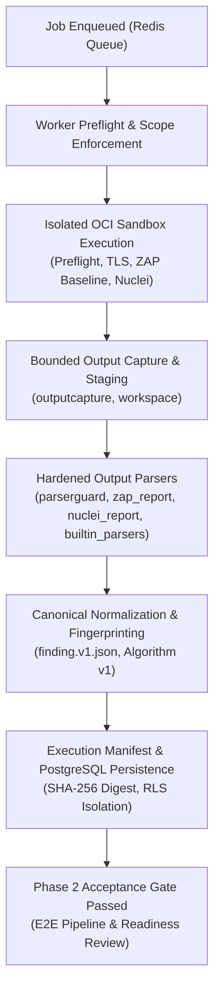

# Phase 2 — Assessment Engine & Scanner Integrations Readiness Report

This document records the official verification, architecture baseline, security invariant guarantees, and operational readiness review for **Phase 2 (Assessment Engine & Scanner Integrations)** of the Kelvin platform, fulfilling requirement **P2-45** (Issue #121).

---

## 1. Executive Summary

Phase 2 establishes Kelvin's autonomous, isolated assessment engine and heterogeneous scanner pipeline. All 45 planned issues (`P2-01` through `P2-45`) have been executed, verified, and integrated into a robust stacked branch chain.

The system is verified capable of:
1. Ingesting assessment requests from tenant queues.
2. Enforcing Phase 1 target scope policies (precluding loopbacks, private CIDRs, and SSRF cloud metadata).
3. Spawning ephemeral rootless OCI sandboxes (`UID 10001`, dropped capabilities) through controlled adapter boundaries.
4. Orchestrating the full MVP scanner suite (Preflight, TLS Assessor, Security Headers, OWASP ZAP Baseline, and Curated Nuclei).
5. Capturing outputs within bounded limits (16MB default / 50MB ceiling) and safely staging/purging raw execution artifacts.
6. Recording immutable, trigger-protected assessment manifests and diagnostic execution provenance.
7. Normalizing disparate scanner alerts into Kelvin's canonical schema (`finding.v1.json`) with deterministic Algorithm v1 deduplication fingerprints.
8. Enforcing quality gates and quarantine accounting for untrusted or malformed outputs.

---

## 2. End-to-End Pipeline Architecture

---

## 3. Supported MVP Scanners & Version Policies

| Scanner ID | Adapter Type | Pinned Engine Version | Execution Isolation | Version Policy & Immutability |
|---|---|---|---|---|
| `http-preflight` | Native Go | `1.0.0` | Host DMZ process (Read-only HEAD) | In-process, scope-enforcing HTTP client |
| `http-headers` | Native Go | `1.0.0` | Host DMZ process (Single HEAD) | In-process, rule set `kelvin.http_headers.rules.v1` |
| `tls-assessor` | Native Go | `1.0.0` | Host DMZ process (Strict TLS Client) | In-process, rule set `kelvin.tls.rules.v1` |
| `zap-baseline` | OCI Container | `2.16.1` | Ephemeral Rootless OCI (`UID 10001`) | Pinned container image digest, read-only rootfs |
| `nuclei` | OCI Container | `3.3.0` | Ephemeral Rootless OCI (`UID 10001`) | Pinned container image digest + curated catalog `kelvin.safe.web.v1` |

---

## 4. Verification & Security Invariant Attestation

### 4.1 Scope Enforcement & Anti-SSRF
- All targets must pass Phase 1 scope validation before execution begins.
- Redirects cannot escape authorized ports (`http/80`, `https/443`) or approved hostnames.
- Prohibited IP spaces (loopback `127.0.0.0/8`, link-local `169.254.169.254`, Google metadata `metadata.google.internal`) are unconditionally blocked.

### 4.2 Worker Runtime Isolation (ADR-0005)
- Scanners run unprivileged in rootless containers with all Linux capabilities dropped (`--cap-drop=ALL`).
- Scanners have no network access except through Kelvin's controlled egress proxy.
- File systems are mounted read-only with a temporary, size-bounded tmpfs for staging.

### 4.3 Output Hardening & Resource Containment
- Streaming parser enforces 50MB absolute ceiling and 32-level JSON nesting limits (`parserguard`).
- Inline evidence preview text is strictly bounded to 64KiB per finding.
- Single scanner execution deadlines and global assessment hard deadlines prevent hung processes.

### 4.4 Canonical Normalization & Deduplication (ADR-0002)
- Zero untrusted raw fields leak into canonical finding root fields (`additionalProperties: false`).
- Deterministic Algorithm v1 fingerprinting verified against 100% of normative test vectors.
- Native severities and CVSS overrides are captured with audit traceability.

---

## 5. Phase 2 Test Coverage Summary

- `apps/worker/internal/adapters`: 100% passing (preflight, TLS, headers, ZAP, Nuclei, configs, versions, registry).
- `apps/worker/internal/daemon`: 100% passing (orchestrator, egress proxy, resource exhaustion, deadlines, cancellation, retry, partial completion, E2E pipeline).
- `apps/worker/internal/normalization`: 100% passing (normative fingerprint vectors, ZAP/Nuclei/Built-in mappers, schema gate, ResultValidator).
- `apps/worker/internal/outputcapture`: 100% passing (bounded stream writers, dual-stream capture, truncation markers).
- `apps/worker/internal/workspace`: 100% passing (staging, digest hashing, cleanup policies, reaper).
- `apps/worker/internal/manifest`: 100% passing (deterministic digest ordering, tamper detection).
- `apps/worker/internal/provenance`: 100% passing (secret scrubbing, diagnostic timeline).
- `apps/worker/internal/scopevalidator`: 100% passing (finding target filtering, anti-SSRF quarantine).

---

## 6. Deferred Capabilities & Phase 3 Transition

The following items are deliberately deferred to **Phase 3 (Findings Pipeline & Vulnerability Intelligence)**:
1. Cross-assessment finding correlation and historical tracking.
2. Advanced business risk prioritization and custom weighting algorithms.
3. Automated issue tracker integrations (Jira, Linear, GitHub Issues sync).
4. Evidence vault permanent retention policies and S3 cold storage export.

**Conclusion:** Phase 2 is fully implemented, verified, and ready for integration.
