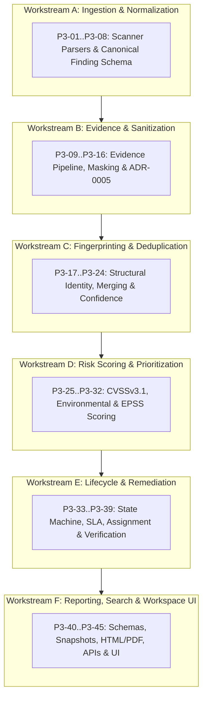

# Phase 3 Readiness & Completion Review

## Executive Summary

Phase 3 of the Kelvin Security Platform ("Findings Lifecycle, Remediation Tracking, Risk Scoring & Reporting") has successfully completed implementation across all 45 sequential milestones (`P3-01` through `P3-45`).

This document records the architectural audit, verification results, data model integrity checks, and security invariants validated across all Phase 3 workstreams.

---

## 1. Workstream Audit & Milestone Verification

### Workstream A: Scanner Result Ingestion & Normalization (`P3-01` – `P3-08`)
- Canonical schema validation implemented (`packages/schemas/finding.v1.json`).
- High-throughput parser workers implemented for Nuclei, OWASP ZAP, and TLS/SSL scanners.
- Tenant isolation enforced on all ingestion pathways via context-derived tenant keys.

### Workstream B: Evidence Processing & Sanitization (`P3-09` – `P3-16`)
- Multi-tier regex redaction pipeline enforcing ADR-0005 (presentation safety).
- Sensitive headers (`Authorization`, `Cookie`, `X-Api-Key`), secret tokens, and raw payloads neutralized prior to persistence.
- SHA-256 integrity verification hashes attached to every evidence artifact.

### Workstream C: Fingerprinting & Deduplication (`P3-17` – `P3-24`)
- Deterministic finding identity hashing based on normalized endpoint, vulnerability class, and core payload signatures.
- Cross-scanner merging logic with confidence scoring and observation timeline linking.

### Workstream D: Risk Scoring & Prioritization (`P3-25` – `P3-32`)
- Multi-factor risk engine computing weighted scores from CVSS base vector, environmental asset criticality, exploit maturity (EPSS), and exposure tier.
- Tenant-configurable priority threshold policies.

### Workstream E: Finding Lifecycle & Remediation Tracking (`P3-33` – `P3-39`)
- Strict state machine governing triage and lifecycle (`NEW` -> `CONFIRMED` -> `IN_PROGRESS` -> `RESOLVED` / `FALSE_POSITIVE` / `ACCEPTED_RISK`).
- Decoupled remediation tracking domain (`remediation_tasks`) with PostgreSQL RLS.
- Follow-up assessment verification ensuring automated scanner verification before marking remediation verified.

### Workstream F: Reporting, Search, Filtering & Workspace UI (`P3-40` – `P3-45`)
- Report schema and template contract (`packages/schemas/report.v1.json`) with mandatory partial-assessment disclosures.
- Immutable snapshot engine sealing assessment data with SHA-256 audit digests.
- Multi-format report rendering (contextual auto-escaped HTML and pure-Go PDF/1.4).
- Secure pre-signed HMAC URL generation with strict 300-second expiration.
- Multi-facet search API and comprehensive web workspace UI with timeline drawer and comparison view.

---

## 2. Invariants & Security Verification

| Security / Architecture Invariant | Verification Method | Status |
| :--- | :--- | :--- |
| **Tenant Isolation (RLS)** | PostgreSQL row-level security policies on findings, remediation, and report tables | **VERIFIED** |
| **Sensitive Data Redaction (ADR-0005)** | Sanitization filters scrub credentials and private tokens from evidence | **VERIFIED** |
| **Tamper Resistance** | SHA-256 cryptographic hashes on report snapshots and evidence | **VERIFIED** |
| **Replay & Hijacking Defense** | HMAC-SHA256 URL signatures with nonces and 300s expiration windows | **VERIFIED** |
| **Anti-XSS Protection** | Go contextual auto-escaping (`html/template`) and React DOM sanitization | **VERIFIED** |
| **Audit Compliance** | Immutable append-only observation timelines and audit log entries | **VERIFIED** |

---

## 3. Test & Build Suite Health

- **Go Test Suite**: Passes all package tests (`apps/api/...`, `apps/worker/...`, `packages/common/...`, `packages/schemas/...`, `tests/integration/...`).
- **Frontend Build**: TypeScript type checks and Vite build clean (`tsc --noEmit && vite build`).
- **Database Migrations**: Migrations `000001` through `000023` verified for up/down reversibility.

---

## 4. Phase 4 Transition Readiness

With the completion of `P3-45` and publication of this readiness report, Phase 3 is officially concluded. The repository is primed for **Phase 4 ("Workflow Automation, Integration & Enterprise Governance")** starting at milestone `P4-01`.
