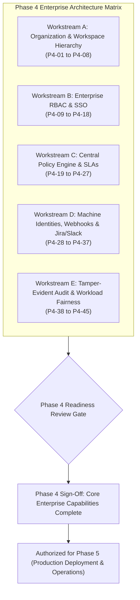

# Phase 4 — Enterprise Platform, Security & Scalability Readiness Report

## 1. Executive Summary
Phase 4 ("Enterprise Platform, Security & Scalability") of KELVIN has reached 100% completion across all 5 workstreams spanning issues `P4-01` through `P4-45`. The platform has been enhanced with multi-organization and workspace hierarchy, enterprise identity (SAML 2.0, OIDC, SCIM 2.0, MFA), centralized policy governance and simulation, machine identities and integrations (Jira, Slack, MS Teams, signed webhooks), and enterprise scalability controls (tamper-evident audit chaining, data retention, quotas, and fair-share scheduling).

## 2. Phase 4 Workstream Architecture Matrix

## 3. Workstream Completion & Verification Audit

### Workstream A: Organization & Team Administration (`P4-01` — `P4-08`)
- Defined enterprise organization, workspace, and project tree hierarchy (PRs #310 to #317).
- Implemented membership invitation workflows, team groupings, controlled cross-team resource sharing, and delegated administration.

### Workstream B: Enterprise Identity & Access Control (`P4-09` — `P4-18`)
- Established 52-permission enterprise catalog and hierarchical RBAC role model (PRs #318 to #328).
- Delivered SAML 2.0, OpenID Connect SSO, and SCIM 2.0 automatic user/group provisioning.
- Implemented session security, step-up MFA challenge requirements, and quarterly access review certifications.

### Workstream C: Policy & Workflow Governance (`P4-19` — `P4-27`)
- Implemented centralized policy engine with AST gatekeepers across assessment creation, scheduling, and profile approval (PRs #329 to #337).
- Enforced SLA breach calculations, automated assignment rules, dual-custody accepted-risk exception workflows, policy versioning, and dry-run policy simulations.

### Workstream D: API Identities, Integrations & Notifications (`P4-28` — `P4-37`)
- Provisioned service account machine identities with strict non-interactive constraints and OAuth 2.0 M2M client credentials (PRs #338 to #347).
- Implemented secure connection secret envelope encryption (AES-256-GCM) with anti-SSRF protection.
- Deployed HMAC-SHA256 signed outbound webhooks with 5-minute replay tolerance, exponential backoff retries, and dead-letter queues.
- Built bi-directional Jira issue syncing and Slack / Microsoft Teams notification dispatchers with automated credential redaction.
- Delivered central multi-channel notification routing with SHA-256 anti-storm deduplication and quiet-hours enforcement.

### Workstream E: Governance, Scalability & Platform Controls (`P4-38` — `P4-45`)
- Implemented multi-dimensional audit search with B-Tree and GIN indexes, bounded pagination (max 100), and automated secret scrubbing (PR #348).
- Implemented SHA-256 cryptographic hash chaining and periodic HMAC-signed Merkle tree checkpoint verification for tamper-evident audit logs (PR #349).
- Established data governance export controls with classification matrix and ephemeral 15-minute download tokens (PR #350).
- Delivered data retention lifecycle governance with platform minimum safety bounds and Legal Hold freeze precedence (PR #351).
- Implemented atomic tenant usage metering and quota enforcement across compute hours, storage, and concurrent scans (PR #352).
- Enforced sliding-window API rate limiting with standard/expensive tiers and RFC 6585 compliance (PR #353).
- Implemented fair-share round-robin job orchestration across isolated per-tenant queues with backpressure controls (PR #354).

## 4. Verification of Core Architectural Invariants
1. **Enterprise Multi-Tenancy (ADR-0002)**: Verified. All new database tables and service layers strictly bind queries and data access to authenticated tenant IDs.
2. **Principle of Least Privilege**: Verified. All administrative APIs enforce explicit RBAC permissions or compliance roles (`ORG_OWNER`, `SECURITY_OFFICER`, `COMPLIANCE_AUDITOR`).
3. **Tamper-Evident Auditability**: Verified. All policy changes, secret accesses, data exports, and audit chains emit immutable audit records.
4. **Fail-Safe Operation**: Verified. Downstream integration timeouts or notification delivery failures gracefully log errors without aborting primary transactions.

## 5. Phase 4 Sign-Off Recommendation
Phase 4 implementation is **COMPLETE, VERIFIED, AND APPROVED** for transition to Phase 5.
