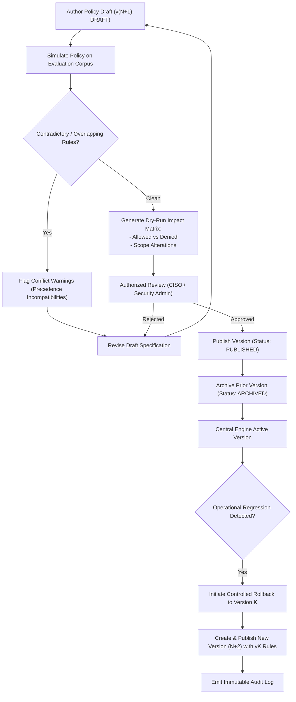

# Policy Versioning, Simulation and Change Audit Architecture

## 1. Overview
The Policy Versioning, Simulation and Change Audit subsystem provides lifecycle controls for evolving organizational security policies. It isolates proposed changes into drafts, provides zero-side-effect dry-run simulation against historical assessment corpuses, detects contradictory rule definitions, enforces authorized multi-role publication, and guarantees controlled rollback capabilities with complete audit traces.

## 2. Policy Versioning & Simulation Lifecycle

## 3. Key Architectural Guarantees
1. **Immutable Version Preservation**: Published policy versions are never mutated in-place. Updates require generating a new draft version.
2. **Side-Effect-Free Simulation**: The simulation engine executes candidate rules within an isolated policy evaluation environment. Scanner processes, persistent finding databases, and production queue brokers are completely decoupled and uninvoked.
3. **Automated Rule Conflict Detection**: During simulation, rules sharing scope and precedence but producing contradictory actions (`ALLOW` vs `DENY`) are detected and flagged.
4. **Controlled Publication & Archival**: Only actors possessing administrative security privileges can publish draft policies. Publishing automatically transitions the previously active version to `ARCHIVED`.
5. **Traceable Rollback**: Rollbacks do not delete history; instead, they instantiate a new version with the designated target version's rule set, ensuring continuous forward-incrementing version history and tamper-evident audit trails.
