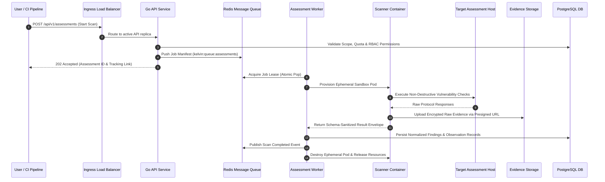

# KELVIN Security Platform — Production Deployment Architecture and Environment Topology

**Document Control**

| Field | Value |
| :--- | :--- |
| **Status** | Approved — Production Engineering Specification |
| **Milestone** | Phase 5 — Production Hardening, Deployment & Release (`P5-01`) |
| **Parent Roadmap** | [KELVIN Engineering Roadmap](../ISSUE-02_ENGINEERING_ROADMAP.md) |
| **Parent Issue** | Issue #356 (Phase 5 Overview), Issue #357 (`P5-01`) |
| **ADR Reference** | [ADR-0007: Production Deployment Topology and Network Segmentation](decisions/ADR-0007.md) |
| **Review Cadence** | Bi-annual or upon any tier, trust boundary, or cloud provider topology revision |
| **Classification** | Internal — Enterprise Engineering Baseline |

---

## 1. Executive Summary & Objective

This document formalizes the production deployment architecture and physical/logical environment topology for the **KELVIN Enterprise Security Assessment Platform**. 

Building upon the target architecture defined in [`SYSTEM_ARCHITECTURE.md`](SYSTEM_ARCHITECTURE.md) and verified during the Pre-Phase 5 Quality Assurance Audit, this specification defines the as-built production hosting models, virtual network boundaries, isolation tiers, compute runtimes, persistence topologies, and operational limits across all environments.

### Core Architectural Mandates
1. **Zero-Trust Network Segmentation:** Control-plane services, worker orchestrators, scanner execution runtimes, and persistence layers reside in segregated subnets governed by strict security groups and network policies.
2. **Scanner Execution Isolation:** Scanner processes run inside ephemeral, unprivileged sandbox containers in a dedicated compute tier with no route to the primary database or API internal interfaces.
3. **Identical Topology Across Tiers:** Development, Staging, and Production environments maintain identical structural topology, varying only in resource capacity, node redundancy, and replica counts.
4. **Resilience & High Availability:** All production control-plane and data tiers operate across at least three Availability Zones (AZs) with automated failover and zero single points of failure.

---

## 2. High-Level Production Environment Topology

```mermaid
flowchart TD
    subgraph Internet ["Public Internet / Untrusted"]
        UserBrowser["Enterprise Users & Admins (HTTPS/WSS)"]
        TargetHost["Target Systems Under Assessment"]
        IdP["SAML 2.0 / OIDC Identity Providers (Okta/Entra)"]
    end

    subgraph EdgeDMZ ["Zone 0: Edge Ingress & DMZ (Public Subnets)"]
        WAF["Cloudflare / AWS WAF (DDoS & Bot Mitigation)"]
        EdgeCDN["CloudFront / Edge CDN (Static Asset Caching)"]
        ALB["Application Load Balancer (TLS 1.3, Strict HSTS)"]
    end

    subgraph AppTier ["Zone 1: Application & Control Plane Tier (Private Subnets - Multi-AZ)"]
        SPA["Frontend SPA Edge Host (Nginx Alpine)"]
        GoAPI["KELVIN Go API Services (Stateless Pods / Autoscaled)"]
        PgBouncer["PgBouncer Connection Pooler (Transaction Mode)"]
    end

    subgraph WorkerTier ["Zone 2: Asynchronous Worker Fleet (Private Subnets - Multi-AZ)"]
        WorkerRunner["Worker Orchestrator Fleet (Go Runner Pods)"]
        RedisBroker["Redis Sentinel / Valkey Broker (Task Queues & Streams)"]
    end

    subgraph SandboxTier ["Zone 3: Scanner Execution Sandbox (Isolated Subnets)"]
        ScannerPod["Disposable Scanner Runtime Pods (Rootless / Seccomp / Egress-filtered)"]
        EgressNAT["Secured Egress NAT Gateway / Proxy (Fixed Egress IPs)"]
    end

    subgraph DataTier ["Zone 4: Data & Persistence Tier (Isolated Subnets - Multi-AZ)"]
        PostgresPrimary["PostgreSQL 16 Primary (Encrypted EBS / KMS)"]
        PostgresReplica["PostgreSQL 16 Standby Replica (Multi-AZ Sync)"]
        S3Storage["S3 / MinIO Evidence & Report Object Storage"]
    end

    UserBrowser -->|HTTPS :443| WAF
    WAF --> EdgeCDN
    WAF --> ALB
    EdgeCDN --> SPA
    ALB -->|mTLS / HTTP :8080| GoAPI

    GoAPI -->|Connection Pool| PgBouncer
    PgBouncer -->|Port 5432| PostgresPrimary
    PostgresPrimary -.->|Streaming Replication| PostgresReplica

    GoAPI -->|Publish Tasks / Subscriptions| RedisBroker
    WorkerRunner -->|Consume Tasks / Heartbeats| RedisBroker
    WorkerRunner -->|Spawn Ephemeral Pods| ScannerPod

    ScannerPod -->|Assess External Targets| EgressNAT
    EgressNAT --> TargetHost

    ScannerPod -->|Sanitized Artifact Upload (Presigned S3 URL)| S3Storage
    GoAPI -->|Generate Presigned URLs / Query Metadata| S3Storage
    GoAPI -.->|OIDC / SCIM Sync| IdP

    classDef edge fill:#f87171,stroke:#b91c1c,stroke-width:2px,color:#fff;
    classDef app fill:#60a5fa,stroke:#1d4ed8,stroke-width:2px,color:#fff;
    classDef worker fill:#fbbf24,stroke:#b45309,stroke-width:2px,color:#000;
    classDef sandbox fill:#f97316,stroke:#c2410c,stroke-width:2px,color:#fff;
    classDef data fill:#34d399,stroke:#047857,stroke-width:2px,color:#fff;

    class WAF,EdgeCDN,ALB edge;
    class SPA,GoAPI,PgBouncer app;
    class WorkerRunner,RedisBroker worker;
    class ScannerPod,EgressNAT sandbox;
    class PostgresPrimary,PostgresReplica,S3Storage data;
```

---

## 3. Environment Bifurcation & Separation Model

KELVIN defines three strictly isolated environments. Cross-environment network routing or shared persistence is prohibited.

```mermaid
flowchart LR
    subgraph DevEnv ["Development Environment"]
        D_VPC["VPC: 10.100.0.0/16"]
        D_Data["Synthetic Seeds / Local Mock S3"]
        D_Deploy["Continuous Auto-Deploy from main"]
    end

    subgraph StagingEnv ["Staging Environment"]
        S_VPC["VPC: 10.200.0.0/16"]
        S_Data["Sanitized Anonymized Benchmarks"]
        S_Deploy["Automated Promotion via Release Candidate"]
    end

    subgraph ProdEnv ["Production Environment"]
        P_VPC["VPC: 10.0.0.0/16"]
        P_Data["Multi-AZ Customer Tenants / Strict RLS / KMS"]
        P_Deploy["Manual Gate Approval / Canary & Blue-Green"]
    end

    DevEnv -.->|PR Merge & CI Verification| StagingEnv
    StagingEnv -.->|Quality Gate Pass & Formal Sign-off| ProdEnv
```



### Environment Parameter Matrix

| Parameter | Development (`dev`) | Staging (`staging`) | Production (`prod`) |
| :--- | :--- | :--- | :--- |
| **VPC CIDR Block** | `10.100.0.0/16` | `10.200.0.0/16` | `10.0.0.0/16` |
| **Availability Zones** | 1 (Single AZ) | 2 (Multi-AZ) | 3 (High-Availability Multi-AZ) |
| **PostgreSQL Topology** | Single Node (Container/RDS) | Primary + 1 Standby | Primary + 2 Multi-AZ Standbys + PgBouncer Pool |
| **Redis Broker** | Single Instance (Standalone) | 3-node Sentinel Cluster | 3-node HA Clustered Sentinel / Valkey |
| **Object Storage** | Local MinIO Container | S3 / MinIO with Versioning | AWS S3 with KMS-SSE, Object Lock & Multi-AZ |
| **Worker Concurrency** | Max 4 concurrent tasks | Max 16 concurrent tasks | Auto-scaling (10 to 100+ concurrent tasks) |
| **Data Retention** | Ephemeral / Daily reset | 14-day rolling retention | Indefinite with 90-day cold tier lifecycle |
| **Ingress DNS** | `dev.kelvin.internal` | `staging.kelvinsecurity.io` | `app.kelvinsecurity.io` & `api.kelvinsecurity.io` |
| **Promotion Criteria** | Clean build & unit test pass | Regression, Security & Perf pass | Signed release tag, Go/No-Go formal approval |

---

## 4. Component Placement & Runtime Responsibilities

### 4.1 TypeScript / React Frontend SPA
- **Location:** Zone 0 Edge CDN (CloudFront / Cloudflare) backed by Zone 1 Nginx static asset pods.
- **Runtime:** Rootless Alpine Nginx container serving optimized Vite bundle.
- **Responsibilities:**
  - Client-side rendering of dashboards, vulnerability matrices, and assessment management views.
  - Interfacing with the Go API exclusively over HTTPS using JSON Web Tokens (stored in memory / secure httpOnly cookies).
  - Implementation of strict Content Security Policy (`default-src 'self'`), framing protection (`DENY`), and SRI hashes.
- **Failover / Scaling:** Edge cached at 200+ PoPs globally. Origin pods scale on HTTP request volume (2–8 replicas).

### 4.2 Go API & Application Control Plane Services
- **Location:** Zone 1 (Private Application Subnets across 3 AZs).
- **Runtime:** Minimal distroless container running compiled Go binary (`apps/api/cmd/api`).
- **Responsibilities:**
  - REST and WebSocket endpoint termination.
  - Multi-tenant authentication, RBAC/ABAC policy enforcement, and organization/workspace tenant isolation via Row-Level Security (RLS).
  - Assessment lifecycle management, scan profile compilation, and job queue dispatching to Redis.
  - Secure evidence generation and cryptographic verification.
  - Audit logging to tamper-evident persistence.
- **Scaling:** Horizontal Pod Autoscaler (HPA) targeting 65% CPU utilization and 70% memory threshold (minimum 3 replicas, maximum 24 replicas).

### 4.3 Assessment Worker Fleet (Orchestrators)
- **Location:** Zone 2 (Private Worker Subnets across 3 AZs).
- **Runtime:** Minimal distroless Go worker container (`apps/worker/cmd/runner`).
- **Responsibilities:**
  - Pulling pending assessment jobs from Redis queue broker with atomic lease acquisition.
  - Managing scanner lifecycle, execution timeouts, progress heartbeats, and graceful cancellation.
  - Invoking ephemeral scanner pods in Zone 3 via Kubernetes API / container runtime socket.
  - Collecting, validating, and normalizing raw scanner output against the canonical finding schema.
- **Scaling:** Queue-depth driven autoscaling (KEDA) scaling worker pods from 4 to 32 instances based on active Redis queue length.

### 4.4 Scanner Runtime Containers (Disposable Sandbox)
- **Location:** Zone 3 (Isolated Sandbox Subnets).
- **Runtime:** Ephemeral OCI containers (Nuclei, ZAP baseline, custom adapters) running on dedicated nodes.
- **Sandbox Security Controls:**
  - **Zero Database Access:** No route, DNS resolution, or credentials for PostgreSQL or Redis.
  - **Rootless Execution:** Runs under UID `10001:10001` with `readOnlyRootFilesystem: true`.
  - **Capability Dropping:** Drops `ALL` Linux capabilities (`cap_drop: [ALL]`).
  - **Seccomp & AppArmor:** Enforces strict default syscall filters blocking raw socket creation beyond HTTP/HTTPS.
  - **Fixed Egress Path:** All outbound traffic routed through a dedicated egress NAT gateway with static IP addresses for client allowlisting.
- **Ephemeral Lifecycle:** Pod terminates immediately upon scan completion; maximum execution lifetime strictly enforced via hard deadlines.

### 4.5 PostgreSQL Persistence Tier & PgBouncer
- **Location:** Zone 4 (Isolated Database Subnets across 3 AZs).
- **Topology:** PostgreSQL 16 Enterprise with multi-AZ synchronous replication and automated failover (< 30s RTO).
- **PgBouncer Integration:**
  - Transaction-mode connection pooling sitting in Zone 1 / fronting Zone 4.
  - Max client connections: 2,000; server pool size: 80 active connections.
- **Data Protection:**
  - AWS KMS Customer Managed Keys (CMK) for encryption at rest (AES-256).
  - Automated continuous WAL archiving to S3 with point-in-time recovery (PITR) up to 35 days.
  - Multi-tenant tenant ID isolation enforced at the database layer via PostgreSQL Row-Level Security (RLS) session variables.

### 4.6 Redis Message Broker & Queue Service
- **Location:** Zone 2 (Private Subnets).
- **Topology:** Redis 7.2 / Valkey HA deployment with Sentinel quorum across 3 AZs.
- **Responsibilities:**
  - Distributed task queue for assessment workloads (`kelvin:queue:assessments`).
  - Real-time job progress pub/sub channels and cancel signal propagation.
  - Distributed rate limiting and concurrent scan quota counters.
- **Persistence & Durability:** Append-Only File (AOF) with `everysec` fsync policy and hourly RDB snapshots.

### 4.7 Evidence & Report Object Storage
- **Location:** Zone 4 / Managed Cloud Storage (AWS S3 / Enterprise MinIO).
- **Responsibilities:**
  - Raw scanner outputs, HTTP request/response traces, exported PDF/JSON compliance reports.
- **Security Controls:**
  - Server-Side Encryption with KMS (SSE-KMS) with per-tenant encryption context.
  - Private bucket policy: zero public read access; all downloads mediated via short-lived (15-minute) pre-signed URLs generated by Go API.
  - Object lifecycle policies: transition to Glacier Flexible Retrieval after 90 days; permanent deletion after 365 days (configurable per tenant compliance SLA).

---

## 5. Network Boundaries, Subnet Architecture & Security Groups

```mermaid
flowchart LR
    subgraph IngressVPC ["KELVIN Production VPC (10.0.0.0/16)"]
        subgraph PublicSubnets ["Public Subnet (10.0.1.0/24 - AZ-a,b,c)"]
            ALB_Node["Application Load Balancer"]
            NAT_GW["Egress NAT Gateways"]
        end

        subgraph AppSubnets ["App Private Subnet (10.0.10.0/22 - AZ-a,b,c)"]
            API_Cluster["Go API Pods"]
            PgBouncer_Node["PgBouncer Poolers"]
        end

        subgraph WorkerSubnets ["Worker Private Subnet (10.0.20.0/22 - AZ-a,b,c)"]
            Worker_Cluster["Worker Orchestrator Pods"]
            Redis_Cluster["Redis HA Cluster"]
        end

        subgraph SandboxSubnets ["Scanner Sandbox Subnet (10.0.30.0/22 - AZ-a,b,c)"]
            Scanner_Pods["Ephemeral Scanner Pods"]
        end

        subgraph DataSubnets ["Data Isolated Subnet (10.0.40.0/22 - AZ-a,b,c)"]
            DB_Cluster["PostgreSQL Multi-AZ"]
        end
    end

    PublicSubnets -->|TCP 8080 (SG-App)| AppSubnets
    AppSubnets -->|TCP 6379 (SG-Redis)| WorkerSubnets
    AppSubnets -->|TCP 5432 (SG-Postgres)| DataSubnets
    WorkerSubnets -->|K8s API / Socket| SandboxSubnets
    SandboxSubnets -->|Outbound Target Traffic| NAT_GW

    %% Prohibited paths
    SandboxSubnets -.-x|DENY ALL| DataSubnets
    SandboxSubnets -.-x|DENY ALL| AppSubnets
    PublicSubnets -.-x|DENY ALL| DataSubnets
```

### Security Group Ingress / Egress Matrix

| Security Group | Zone | Allowed Inbound Sources | Allowed Outbound Destinations |
| :--- | :--- | :--- | :--- |
| **`sg-kelvin-alb`** | Zone 0 (DMZ) | `0.0.0.0/0` on TCP 443 | `sg-kelvin-app` on TCP 8080 |
| **`sg-kelvin-app`** | Zone 1 (App) | `sg-kelvin-alb` on TCP 8080 | `sg-kelvin-db` on TCP 5432, `sg-kelvin-redis` on TCP 6379, HTTPS to S3 VPC Endpoint |
| **`sg-kelvin-worker`** | Zone 2 (Worker) | Internal Orchestrator RPC | `sg-kelvin-redis` on TCP 6379, K8s Control Plane API, HTTPS to S3 VPC Endpoint |
| **`sg-kelvin-sandbox`** | Zone 3 (Sandbox) | K8s API only (pod lifecycle) | `0.0.0.0/0` via NAT Gateway on TCP 80/443 (targets only); **NO ACCESS to 10.0.0.0/16** |
| **`sg-kelvin-redis`** | Zone 2 (Broker) | `sg-kelvin-app` & `sg-kelvin-worker` on TCP 6379 | Internal replication only |
| **`sg-kelvin-db`** | Zone 4 (Data) | `sg-kelvin-app` (PgBouncer) on TCP 5432 | Multi-AZ standby replication only; **ZERO outbound internet** |

---

## 6. High Availability, Scaling & Failure Boundaries



### Failure Domains & Blast Radius Mitigation

| Failure Scenario | Blast Radius | Mitigation & Recovery Mechanism |
| :--- | :--- | :--- |
| **AZ Outage (Data Center Loss)** | Partial node capacity loss | All tiers run across 3 AZs. ALB and Kubernetes automatically redistribute traffic to healthy AZs. Aurora/RDS initiates automatic failover within 30 seconds. |
| **Scanner Container OOM / Crash** | Single scan failure | Contained within ephemeral pod cgroups. Worker detects exit code, tags run as `failed` with diagnostic reason, and releases queue lock without affecting API or other scans. |
| **Scanner Rogue Outbound Traffic** | Target host | Zone 3 egress NAT applies strict rate limits and prevents probing of internal VPC CIDRs (`10.0.0.0/8`, `172.16.0.0/12`, `192.168.0.0/16`, `169.254.169.254`). |
| **Database Primary Instance Crash** | 15–30 seconds write interruption | Synchronous standby replica promoted automatically; PgBouncer holds incoming connection pool without dropping client HTTP requests. |
| **Redis Broker Failure** | Transient task dispatch pause | Redis Sentinel triggers automatic replica promotion (< 5s). Unacknowledged jobs return to queue upon worker lease expiration. |

---

## 7. Compliance & Security Operational Baselines

1. **Rootless & Distroless Container Policy:**
   - No container in the KELVIN fleet runs as UID 0 (`root`).
   - Production images use Google Distroless or Alpine non-root minimal bases containing no shell or compilation utilities.
2. **Secrets & Cryptographic Key Management:**
   - Zero hardcoded secrets, tokens, or private keys in Git repositories or container images.
   - All runtime credentials injected dynamically via AWS Secrets Manager / HashiCorp Vault.
   - Database connection passwords and JWT signing keys rotated automatically on a 90-day lifecycle.
3. **Audit Trail Immutability:**
   - All administrative actions, policy adjustments, user logins, and scan requests write immutable append-only records to PostgreSQL with cryptographic SHA-256 forward-chaining.
