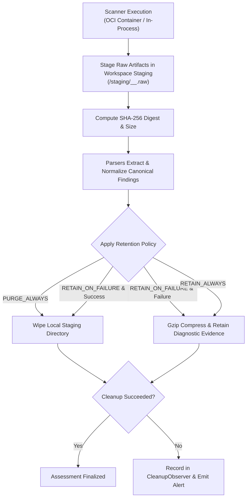

# Raw Scanner Output Staging and Cleanup

This document specifies the lifecycle, isolation, retention, and cleanup architecture for raw scanner output, fulfilling requirement **P2-34** (Issue #110).

---

## 1. Overview & Objectives

External scanner processes generate raw, untrusted outputs across diverse formats (JSON reports, JSONL line streams, verbose stdout, and stderr logs). To prevent sensitive data leaks across tenants, prevent rogue outputs from being treated as canonical findings, and guarantee resource hygiene, Kelvin enforces **assessment-scoped staging and strict cleanup semantics**:

1. **Strict Ephemeral Isolation:** Raw scanner outputs are written strictly within tenant- and run-isolated workspace staging boundaries (`<baseDir>/tenants/<tenantID>/runs/<runID>/staging`), preventing cross-tenant access.
2. **Untrusted Data Boundary:** Staged files are treated as untrusted evidence artifacts and are never exposed as verified findings until parsed and normalized into Kelvin's Canonical Finding Schema.
3. **Evidence Retention Policies:** Output retention aligns with Kelvin's Phase 1 evidence lifecycle:
   - `PURGE_ALWAYS`: Staged raw files are securely purged upon assessment completion.
   - `RETAIN_ON_FAILURE`: Raw files are purged on successful runs, but compressed with gzip and preserved upon scanner failure or crash for offline investigation.
   - `RETAIN_ALWAYS`: Raw files are compressed and retained for compliance archiving.
4. **Observable Cleanup & Reaper Sweeps:** Cleanup operations are tracked. Any disk removal errors emit structured logs and notify observable audit listeners (`CleanupObserver`). An asynchronous reaper sweeps abandoned staging directories from crashed or killed worker processes.

---

## 2. Architecture & Staging Lifecycle



---

## 3. Core Components

### 3.1 `StagedArtifact` (`internal/workspace`)

Encapsulates metadata for staged raw output:
```go
type StagedArtifact struct {
    ArtifactID   string    `json:"artifact_id"`
    TenantID     string    `json:"tenant_id"`
    AssessmentID string    `json:"assessment_id"`
    RunID        string    `json:"run_id"`
    ScannerID    string    `json:"scanner_id"`
    StreamType   string    `json:"stream_type"` // "stdout", "stderr", "report", "raw"
    FilePath     string    `json:"file_path"`
    SizeBytes    int64     `json:"size_bytes"`
    SHA256       string    `json:"sha256"`
    Compressed   bool      `json:"compressed"`
    CreatedAt    time.Time `json:"created_at"`
    Purged       bool      `json:"purged"`
}
```

### 3.2 Compression & Duplicate Prevention

When retention is required (`RETAIN_ON_FAILURE` on error or `RETAIN_ALWAYS`), `CompressArtifact` creates a `.gz` archive using stream compression, recalculates the SHA-256 checksum of the compressed payload, and removes the original uncompressed file to avoid storing duplicate copies.

### 3.3 Observable Telemetry & Reaping

- `CleanupObserver`: Interface implemented by audit loggers and monitoring infrastructure to record failed directory or artifact removals.
- `ReapStaging`: Sweeps staging directories across all tenants, identifying and purging abandoned staging directories from interrupted or killed jobs exceeding maximum TTL.

---

## 4. Verification & Testing

Validated in `apps/worker/internal/workspace/staging_test.go`:
- `TestWorkspaceStageRawOutput`: Verifies metadata, permissions, content accuracy, and digest calculation.
- `TestWorkspaceCompressStagedArtifact`: Verifies gzip compression, removal of raw duplicates, and decompression integrity.
- `TestWorkspaceApplyRetentionPolicy`: Verifies `PURGE_ALWAYS`, `RETAIN_ON_FAILURE` (success and failure modes), and artifact preservation.
- `TestManagerReapStaging`: Verifies stale staging file detection and automatic cleanup.
- `TestAuditRecorderRecordsFailures`: Verifies structured error recording during cleanup exceptions.
