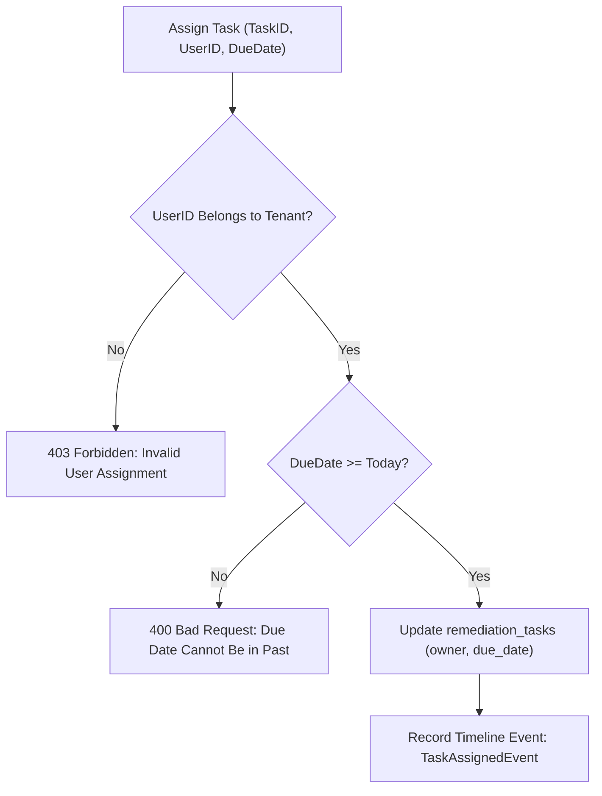

# Remediation Assignment, Ownership and Due Dates

## 1. Overview & Purpose

The Remediation Assignment service provides assignment, ownership, and target completion date controls for remediation tasks. It enables teams to track accountability and deadlines without introducing the complex organizational, team-routing, or escalation features scheduled for Phase 4.

---

## 2. Security & Architectural Invariants

1. **Strict Tenant-Scoped User Validation (ADR-0002):**
   Assigning a task to a user identity requires verifying that the user belongs to the active tenant (`ValidateUserInTenant`). Cross-tenant assignments are strictly rejected (`ErrInvalidUserAssignment`).
2. **Temporal Validation:**
   Target completion dates must be set in the present or future (`DueDate >= Today`). Historical dates are rejected (`ErrDueDateInPast`) to ensure deadlines represent forward-looking commitments.
3. **Traceable Reassignment & Ownership History:**
   Every assignment change, reassignment, deadline change, or unassignment is recorded in `remediation_updates` with the actor ID, previous and new values, and optional justification.
4. **User Unavailability & Decommissioning:**
   When an assigned user departs or loses access, `UnassignTask` clears ownership while preserving all historical audit updates.
5. **Progress Notes & Collaboration:**
   Engineers and analysts can append timestamped comments and progress notes (`AddProgressNote`) to tasks without altering task status.
