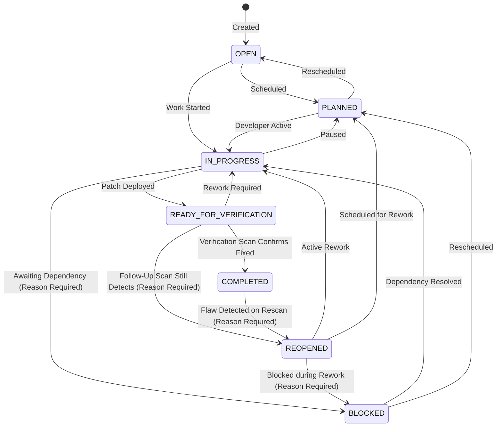

# Remediation Lifecycle Workflow

## 1. Overview & Purpose

The Remediation Lifecycle Workflow governs how remediation tasks progress from initial discovery and planning to active development, blockages, verification readiness, completion, and reopening.

This workflow guarantees:
- **Controlled & Auditable State Progression:** Tasks follow a strict deterministic finite state machine.
- **Finding Independence:** Remediation tasks operate independently of persistent finding lifecycle states. Completing a remediation task does *not* automatically resolve a finding. Empirical verification via follow-up scans is mandatory for finding resolution.
- **Mandatory Rationale Enforcement:** Specific sensitive transitions (e.g., marking a task `BLOCKED` or `REOPENED`) require explicit justification reasons recorded in the audit history.
- **Tenant Boundary Enforcement:** All transitions strictly check tenant ownership (`ADR-0002`).

---

## 2. State Machine & Permitted Transitions

---

## 3. Transition Rules & Mandatory Justifications

| Source State | Destination State | Rationale Required? | Description |
|---|---|---|---|
| `OPEN` | `PLANNED` | Optional | Task scheduled with sprint or milestone |
| `OPEN` | `IN_PROGRESS` | Optional | Engineering begins immediate work |
| `PLANNED` | `IN_PROGRESS` | Optional | Engineering starts scheduled work |
| `PLANNED` | `OPEN` | Optional | Task unscheduled |
| `IN_PROGRESS` | `BLOCKED` | **Mandatory** | Work halted; reason must describe blocker / dependency |
| `BLOCKED` | `IN_PROGRESS` | Optional | Blocker resolved; engineering resumes |
| `BLOCKED` | `PLANNED` | Optional | Blocked work rescheduled |
| `IN_PROGRESS` | `READY_FOR_VERIFICATION` | Optional | Fix applied; environment ready for re-test |
| `IN_PROGRESS` | `PLANNED` | Optional | Work paused and re-queued |
| `READY_FOR_VERIFICATION` | `COMPLETED` | Optional | Verification assessment verified fix |
| `READY_FOR_VERIFICATION` | `REOPENED` | **Mandatory** | Verification assessment failed; rationale required |
| `READY_FOR_VERIFICATION` | `IN_PROGRESS` | Optional | Pre-test failure returned for rework |
| `COMPLETED` | `REOPENED` | **Mandatory** | Flaw redetected in production/regression; rationale required |
| `REOPENED` | `IN_PROGRESS` | Optional | Rework resumed |
| `REOPENED` | `BLOCKED` | **Mandatory** | Rework blocked; reason required |
| `REOPENED` | `PLANNED` | Optional | Rework scheduled |

---

## 4. Finding Independence & Dispositions

1. **Resolution Separation:**
   A remediation task transitioning to `COMPLETED` records that engineering completed its designated tasks. It does *not* transition the underlying `PersistentFinding` to `RESOLVED`. The finding lifecycle remains decoupled, requiring follow-up scanner observation to transition from `CONFIRMED` to `RESOLVED`.
2. **False Positive & Accepted Risk Holdings:**
   When an underlying finding is triaged as `FALSE_POSITIVE` or `ACCEPTED_RISK`, remediation tasks may still be logged or completed (e.g. implementing defense-in-depth or documentation updates) without invalidating or overriding the finding triage disposition.
